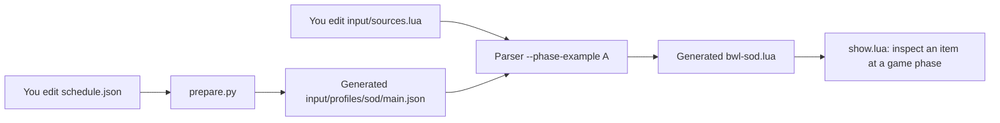

# Start here: Blackwing Lair

**Want to see the files evolve? [Open the complete P1 → P2.1 → P2.2 → P3 → P4 file comparison](evolution/blackwing-lair/FILE_EVOLUTION.md).** It shows the actual Lua and JSON diffs on one page, including steps where a file does not change.

**This branch is a runnable example, not a migration of the live addon database.** Start with one question: **why can SoD Nefarian drop the new Ashkandi in game phase 5, while the old Ashkandi remains unavailable?**

Lua contains the two bosses' separate loot lists. One JSON file supplies their opening rules. The Parser combines them into a file you can inspect.

Read [the files below](#1-the-files-you-edit) → [the BWL rules](#2-connect-the-lua-to-the-schedule) → [the result](#run-an-example). After that, read [how the existing raid migrates from P1 to P4](#migration-stages-by-file). A/B/C are alternative interfaces; this first walkthrough uses **A** so you can follow one path. That is not a decision to adopt A in production.

## 1. The files you edit

All paths in this table are inside `.contrib/phase-examples/`.

| File | Who changes it? | What belongs here? |
|---|---|---|
| [input/sources.lua](input/sources.lua) | **You**, when editing the A/C example's data. | Bosses, drops, ordinary requirements, flavor applicability and the names that connect records to opening rules. This is a small example, not the full production raid. |
| [schedule.json](schedule.json) | **You**, when changing opening, removal or reopening rules. | One shared schedule for all six examples. A flavor exception changes only that flavor's timing. |
| [input/profiles/sod/main.json](input/profiles/sod/main.json) | **prepare.py**, from the schedule. | Expanded SoD rules for the Parser. Commit generated changes, but edit the schedule to change a rule. |
| The output path you pass to Parser | **Parser**. | The combined Lua database used by the example viewer. It is output, not another loot table to maintain. |

For a timing-only change, edit `schedule.json` and regenerate the JSON. To change the SoD BWL loot while keeping the full A/B/C comparison passing, edit both [input/sources.lua](input/sources.lua) and [input/fragments/bwl.rework.lua](input/fragments/bwl.rework.lua). The fragment is option B's handwritten copy of that source for this comparison. `prepare.py` generates JSON. Authors keep these two Lua files in sync.



For this walkthrough, leave `comparison.json` and the historical comparison files alone. Their roles are listed [after the main example](#choose-an-interface).

## 2. Connect the Lua to the schedule

**File to edit for loot: [input/sources.lua](input/sources.lua).** Find `inst(742)`, Blackwing Lair. It already has these names:

| Location in the Lua | `progressionKey` | Meaning |
|---|---|---|
| `inst(742)` | `raid.bwl.common` | The raid's opening rule, inherited by the records inside it. |
| Original Nefarian; original 40-player history in SoD | `raid.bwl.original` | The original loot list, including Ashkandi `19364`. |
| SoD's `d(201)` | `raid.bwl.sod20` | The reworked loot list, including Ashkandi `230818`. |
| Book object `o(180667)` | `raid.bwl.draconic-for-dummies` | The book has its own opening rule. |

For example, this is the complete reworked difficulty block from that **example file**, inside the BWL instance. The rest of BWL, including the original loot list, remains in the linked file.

```lua
d(201, { -- SoD's 20-player BWL
    flavors = { "sod" }, -- Include this source only in SoD.
    progressionKey = "raid.bwl.sod20", -- Find this exact name in the JSON below.
    timeline = { "added 1.15.4.56738" },
    groups = {
        e(1536, { -- Nefarian
            crs = { 11583, 10162 },
            groups = {
                i(19003), -- Head of Nefarian
                i(230818), -- Reworked Ashkandi
            },
        }),
    },
}),
```

Neither drop needs its own JSON entry: both use the difficulty's rule and the enclosing raid's rule. Add a new key to a drop only when it needs an independent opening or removal.

**File to edit for timing: [schedule.json](schedule.json), inside `rules.blackwing-lair`.** This is the complete BWL rules object, not a replacement for the whole JSON file:

```json
{
  "raid.bwl.common": { "default": "vanilla.3", "sod": "vanilla.5" },
  "raid.bwl.original": { "default": { "sameAs": "raid.bwl.common" }, "sod": "disabled" },
  "raid.bwl.sod20": { "sod": { "sameAs": "raid.bwl.common" } },
  "raid.bwl.draconic-for-dummies": "unknown"
}
```

Read the four entries like this:

| Rule | What the author is saying |
|---|---|
| `raid.bwl.common` | Open ordinary Classic BWL at that flavor's `vanilla.3`; use `vanilla.5` for SoD. |
| `raid.bwl.original` | Follow the raid's opening in the other phased flavors. **Always keep this original route disabled in SoD.** |
| `raid.bwl.sod20` | In SoD, follow the raid's opening. `sameAs` copies timing; it does not copy or merge loot. |
| `raid.bwl.draconic-for-dummies` | Its exact opening is unresolved. `unknown` does not mean open. |

Here `default` is the timing fallback for the phased flavors declared in this example: progression, Anniversary and Era use it unless overridden. **Retail does not read this schedule.** Retail receives its ordinary Lua records; the `flavors = { "sod" }` block is excluded. A schedule rule cannot make a SoD-only source appear in Retail.

### Change one opening

Suppose, **only as an editing exercise**, the whole SoD raid should open at `vanilla.6.raids` instead of `vanilla.5`. Change this one line inside `rules.blackwing-lair`:

```diff
- "raid.bwl.common": { "default": "vanilla.3", "sod": "vanilla.5" },
+ "raid.bwl.common": { "default": "vanilla.3", "sod": "vanilla.6.raids" },
```

The SoD rework follows `sameAs`. The original SoD route remains disabled, the other flavors keep their timing, and the book remains unknown. Restore `vanilla.5` before following the expected-output example below. To delay only the reworked difficulty, change its `raid.bwl.sod20.sod` value instead; the enclosing raid must still be open too.

## 3. Generate the Parser's JSON

After a schedule edit, run this from the repository root:

```console
python .contrib/phase-examples/prepare.py
```

The command writes 19 files because this kit compares several flavors and three interfaces. **Those are generated views of the one schedule, not 19 schedules to maintain.** Include them with a schedule change. CI runs `prepare.py --check` to catch stale copies.

For the A walkthrough, open [input/profiles/sod/main.json](input/profiles/sod/main.json). Under `content`, the generator expands the BWL rules to the following. This is **generated JSON to inspect**, not a second file to edit by hand:

```json
{
  "raid.bwl.common": { "windows": [{ "from": "vanilla.5" }] },
  "raid.bwl.original": { "status": "disabled", "windows": [] },
  "raid.bwl.sod20": { "windows": [{ "from": "vanilla.5" }] },
  "raid.bwl.draconic-for-dummies": { "status": "unknown", "windows": [] }
}
```

The names match `progressionKey` in Lua. The Parser rejects an applicable key with no matching rule. `sameAs` has already become a concrete opening here.

## Run an example

**Step 4: build and inspect the example.** From the repository root on Windows, with Python and Lua 5.1 on PATH, use the Parser shipped with this branch. Keep the checked-in `vanilla.5` rule for the expected results below. This writes an example file in your temp directory; it does not replace ATT's production DB.

```powershell
$parser = Resolve-Path .contrib/.tools/Parser.exe
$inputDir = Resolve-Path .contrib/phase-examples/input
& $parser --phase-example A $inputDir sod:main "$env:TEMP/bwl-sod.lua"
if ($LASTEXITCODE) { throw 'Example compilation failed' }
lua5.1 .contrib/phase-examples/show.lua "$env:TEMP/bwl-sod.lua" vanilla.4 19003
lua5.1 .contrib/phase-examples/show.lua "$env:TEMP/bwl-sod.lua" vanilla.5 19003
```

`sod:main` chooses the example's SoD schedule. The later `vanilla.4` / `vanilla.5` arguments ask the viewer what is open at those game milestones. `19003` is Head of Nefarian, present in both loot lists. The viewer assumes ordinary character requirements are satisfied so it can show the scheduling result.

| Source of item `19003` | At `vanilla.4` | At `vanilla.5` |
|---|---|---|
| Original 40-player Nefarian (`difficultyID=9`) | Disabled | Disabled |
| Reworked 20-player Nefarian (`difficultyID=201`) | Future | Active |

The phase-5 command prints:

```text
Context sod:main | view vanilla.5 | item 19003
  disabled  instanceID=742 / difficultyID=9 / encounterID=1536 / itemID=19003
    active  sod:main:raid.bwl.common
    disabled  sod:main:raid.bwl.original
  active    instanceID=742 / difficultyID=201 / encounterID=1536 / itemID=19003
    active  sod:main:raid.bwl.common
    active  sod:main:raid.bwl.sod20
At least one route passes the schedule.
```

The original route stays closed even after `raid.bwl.common` opens, because its own `raid.bwl.original` rule is disabled. The reworked route needs both its own rule and the enclosing raid's rule to be active. This is why the two loot lists cannot be merged just because both contain item `19003`.

Repeat the viewer command with `19364` and `230818` for the two Ashkandis: the original stays disabled; the reworked sword opens at `vanilla.5`. For Retail, compile with `retail` instead of `sod:main`, then use `-` instead of a milestone in the viewer.

## Migration stages by file

Now that you have seen the desired result, [open Blackwing Lair before and after each edit](evolution/blackwing-lair/README.md). **P1–P4 describe changes to ATT's implementation. They are unrelated to the game's phase 1–4.** `vanilla.5` above was a game milestone.

These directories are side-by-side snapshots of one raid at different points in the proposed migration. They are not five copies a maintainer would keep updating. The branch demonstrates the edits and focused comparisons; the production migration switch is not installed in ATT. Different source groups may eventually use different migration stages at the same time.

| Step | Actual snapshot | What changes |
|---|---|---|
| **P1** | [Original Lua](evolution/blackwing-lair/p1/1.6%20Blackwing%20Lair.lua) · [Shipped database](evolution/blackwing-lair/nefarian/p1/legacy-sod.md) | The existing raid uses `applyclassicphase` plus a SoD guard around the reworked difficulty. |
| **P2.1** | [Complete annotated raid](evolution/blackwing-lair/p2.1/1.6%20Blackwing%20Lair.lua) | Add the keys and SoD applicability first. The old wrappers still supply official output. |
| **P2.2** | [Lua](evolution/blackwing-lair/p2.2/1.6%20Blackwing%20Lair.lua) · [Shared schedule, including the SoD exceptions](schedule.json) | Write release windows and validate them in shadow. |
| **P3** | [Lua](evolution/blackwing-lair/p3/1.6%20Blackwing%20Lair.lua) · [Stage switch](evolution/blackwing-lair/p3/migration.json) | The same Lua and JSON now supply official progress output. Keep the old writers for an independent legacy comparison. |
| **P4** | [Rewritten Lua](evolution/blackwing-lair/p4/sod.lua) · [Generated Nefarian excerpt](evolution/blackwing-lair/nefarian/p4/expected-sod.lua) | Remove the guards and wrappers. Keep the reviewed policy and separate the original and reworked loot routes. |

[Five more before-and-after examples](evolution/OTHER_INSTANCES.md) cover Blackrock Depths, Demon Fall Canyon, Dire Maul, Temple of Ahn’Qiraj and Gnomeregan. The [production design](https://github.com/NORPG/AllTheThings/blob/codex/flavor-phase/.contrib/progression/PHASE_DESIGN.md#migration-manifest) describes how different source groups advance independently.

## Choose an interface

This is an optional comparison after the A walkthrough above. All three interfaces use the same authored schedule and must produce the same result. A/C share `input/sources.lua`. B reads its handwritten layout and fragments. A loot edit intended for all three comparisons must update both Lua representations.

| Other files you may have seen | Why they exist |
|---|---|
| `input/profiles/`, `input/catalogs/`, `input/policies/`, `input/selection.json` | The 19 generated Parser inputs for all three alternatives. Edit `schedule.json` for timing and regenerate. |
| [comparison.json](comparison.json) | Handwritten setup for the comparison: synthetic replays and B's source-file slots. Not an additional release schedule. |
| [evolution/blackwing-lair/nefarian/p4/profiles/](evolution/blackwing-lair/nefarian/p4/profiles/) | Frozen historical inputs for the migration test. A current schedule edit does not update these reference files. |
| Full profile JSON in the [design document](https://github.com/NORPG/AllTheThings/blob/codex/flavor-phase/.contrib/progression/PHASE_DESIGN.md#p22-expanded-production-profile-reference) | Proposed production schema, including metadata the example generator does not implement. These are not more example files to maintain. |

| Interface | Lua input to edit | Generated JSON consumed by the Parser |
|---|---|---|
| A · direct sources | [sources.lua](input/sources.lua) | [One schedule per profile](input/profiles/sod/main.json) |
| B · selected source files | [layout.lua](input/layout.lua) and the relevant [fragment](input/fragments/bwl.rework.lua) | The same profile plus [a slot selection](input/selection.json). Excluded slots are skipped before their files are read. |
| C · policies grouped by raid | [sources.lua](input/sources.lua), as in A | [Milestone catalog](input/catalogs/sod/main.json) and [one policy file per instance](input/policies/blackwing-lair.json) |

### Reading a release rule

A milestone string opens a source from that milestone onward. `"start"` opens at the first view, `"disabled"` keeps a historical route closed, and `"unknown"` records an unconfirmed opening. All inherited scopes and other ordinary conditions still apply.

For a removal and reopening, use explicit windows only on the affected key. For example, this **synthetic comparison** changes the SoD rework under `rules.blackwing-lair`. The first window closes at the scepter milestone and the second reopens the route at the raid milestone.

```json
{
  "raid.bwl.sod20": {
    "sod": {
      "windows": [
        { "from": "vanilla.5", "until": "vanilla.6.scepter" },
        { "from": "vanilla.6.raids" }
      ]
    }
  }
}
```

## Six things to try

| Instance | Input and observation |
|---|---|
| **Blackrock Depths** | With `sod:main` compare `vanilla.3` and `vanilla.4`. Gerstahn's Enthralled Sphere (`223539`) opens at 3. Angerforge's Battle Axe (`227948`) opens at 4. The second-half rule is attached directly to Emperor Dagran Thaurissan (encounter `387`). His Emperor's Seal (`11934`) inherits it: the early boss remains accessible at 3 while the Emperor and his loot open at 4. |
| **Demon Fall Canyon** | Retail has no instance `2784`. In the explicitly synthetic `sod:replay`, view `fixture.dfc-open` for Grimroot's original Warsong Axe (`228082`), then `vanilla.5` for Azgaloth's Eye of the Observer (`231913`), then `vanilla.7` for Grimroot's new Ancient Ironwood Branch (`235787`). Preserve the original character/entry requirements. |
| **Dire Maul** | Isalien (`16097`) drops Hammer of Revitalization (`22315`). Anniversary opens Dungeon Set 2 at `vanilla.4`. Historical progression opens it in phase 5; `progression:replay` uses `fixture.set2-open` to demonstrate the later batch. The summon still has its own requirements. |
| **Blackwing Lair** | At SoD phase 4 both boss routes are closed. At phase 5 the rework opens with Ashkandi `230818`; the old route to `19364` stays disabled. Inspect item `19003` to see two occurrences. The original book (`21109`) has an independent unknown scope beneath the disabled route. |
| **Temple of Ahn'Qiraj** | The SoD scepter, War Effort, end of collection and war milestones precede `vanilla.6.raids`. Only then may the reworked C'Thun route supply `233634`. Eye of C'Thun (`21221`) appears in both loot lists. Original Death's Sting (`21126`) cannot leak into the rework. |
| **Gnomeregan** | Retail contains the ordinary dungeon, including `9449`. SoD phase 2 opens the level-40, 10-player version, difficulty `198`. Only that version contains the Mechanical Menagerie (`218242`) and Glimmering Gizmoblade (`213410`). |

The `main` profiles retain evidence gaps. Demon Fall Canyon is known to open during SoD phase 4, and original Classic Dungeon Set 2 during phase 5, but their precise order within the illustrated batches remains under review. Their affected main-profile policies are `unknown`. The two `replay` profiles insert synthetic observations solely to exercise what happens after the opening; they do not assign a live release date. The original AQ gate is realm-dependent in the relevant Classic contexts. The reduced profiles leave that route unknown rather than assuming one global date.

## Run and inspect the checks

```powershell
python .contrib/phase-examples/verify.py --parser $parser --lua lua5.1 --output "$env:TEMP/att-phase-examples"
python .contrib/phase-examples/verify_compact.py --parser $parser --lua lua5.1 --baseline-output "$env:TEMP/att-phase-examples"
```

The runner calls the built Parser for A, B and C in seven contexts. The retained Lua modules are grouped by option, for example `A/sod-main.lua`, `B/retail.lua` and `C/progression-replay.lua`. The Lua 5.1 checks compare complete trees and evaluate each boundary. Negative inputs exercise missing keys beneath disabled owners, typos, unknown milestones, invalid windows and previous-output preservation. To build from source, run `dotnet build .contrib/src/Parser/Parser.csproj -c Release -p:Platform=x64` on Windows with .NET Framework 4.8 targeting support. The [Windows workflow](../../.github/workflows/PhaseExamples.yml) builds the actual Parser, runs the checks, and publishes `Parser.exe`, its SHA256 provenance file and all generated modules in the `phase-examples-windows` artifact.

### Using a generated module

From the repository root on Windows, load the file produced above:

```lua
local db = dofile(os.getenv("TEMP") .. "/bwl-sod.lua")
local evaluator = dofile(".contrib/phase-examples/evaluate.lua")
local result = evaluator.find(db, { itemID = 19003 }, "vanilla.5", function(node, route, index)
    -- Supply the caller's ordinary per-node checks (timeline, quest, level, cost, etc.).
    return true -- For this example the character meets all ordinary requirements.
end)
for _, route in ipairs(result.routes) do
    print(route.schedule, route.obtainable)
end
```

Within a scope, disjoint windows combine with OR, with an inclusive `from` and exclusive `until`. A route requires every inherited scope and ordinary source condition to pass. An item can be obtained through any complete passing route. The evaluator reports disabled, unknown, future and removed routes for inspection. The example caller supplies ordinary game conditions; `show.lua` demonstrates scheduling under the assumption that these pass.

### Input and output boundaries

This opt-in command reads a **declarative Lua subset**: a returned array of records, nested literal tables, supported ATT-style ID constructors and, for B, named group references. Expressions are parsed as data. A/C keep special records in a shared input without executing rejected helper calls. B additionally avoids reading excluded fragment files. The input directory sits outside the production database roots. The generated module is a review artifact consumed by the supplied evaluator. Installing this branch does not migrate live addon databases or settings.

Each phased module returns `context`, ordered `milestones`, fully namespaced `policies` and the retained `groups` tree. Nodes carry cumulative `progressionScopes` plus their ordinary IDs and source fields. Retail has the ordinary tree and empty policy and scope data. The compact milestone arrays here cover these six fixtures; the design PR contains the full proposed profile catalogs. Production P1–P4 coexistence, full-client eligibility, migration goldens and general support for arbitrary acquisition Lua remain part of that separate design review.

### Record evidence

The IDs and representative source fields are taken from the repository's [Classic dungeon and raid data](../.db/standard/01%20-%20Dungeons%20Raids/01%20-%20Classic). The linked design includes source lines, limits and full-case tables. [Design PR #2734](https://github.com/ATTWoWAddon/AllTheThings/pull/2734)

- Blackrock Depths and Demon Fall Canyon: [SoD phase 3](https://worldofwarcraft.blizzard.com/en-gb/news/24078318), [Emperor observed out of combat in the closed half](https://www.wowhead.com/news/latter-half-of-brd-inaccessible-bosses-hanging-out-at-grim-guzzler-338551), [phase 4 dungeon list](https://news.blizzard.com/en-us/article/24111477/season-of-discovery-phase-4-now-live), [phase 5 added boss](https://worldofwarcraft.blizzard.com/en-us/news/24139952).
- Dire Maul: [Classic content plan](https://us.forums.blizzard.com/en/wow/t/classic-content-plan/120346), [Anniversary Dungeon Set 2](https://news.blizzard.com/en-us/article/24194658/wow-classic-20th-anniversary-edition-phase-4-now-live).
- Blackwing Lair, Temple and Gnomeregan: [reworked BWL](https://worldofwarcraft.blizzard.com/zh-tw/news/24139952), [AQ schedule](https://worldofwarcraft.blizzard.com/en-us/news/24154449), [SoD Gnomeregan](https://worldofwarcraft.blizzard.com/en-gb/news/24056979).
