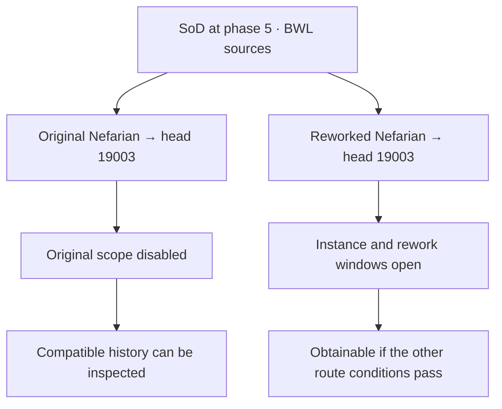
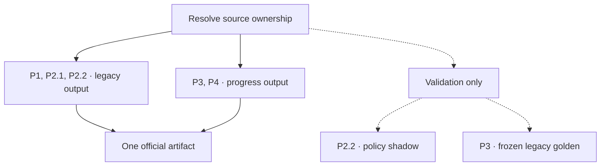

# Phase scheduling and legacy-authoring retirement

**File evolution, before and after: [Blackwing Lair from P1 through P4](https://github.com/NORPG/AllTheThings/blob/codex/phase-interface-examples/.contrib/phase-examples/evolution/blackwing-lair/FILE_EVOLUTION.md).** Read the complete Lua/JSON diffs on one page before the design details below.

**Start with the files you would edit.** This document is the production design. The separate [runnable example](https://github.com/NORPG/AllTheThings/blob/codex/phase-interface-examples/.contrib/phase-examples/README.md) lets you try the Lua/JSON split today. It does not migrate ATT's live database.

## Which Lua and JSON do I actually edit?

For the first runnable walkthrough, use interface A. All of these files are in the [examples PR #2739](https://github.com/ATTWoWAddon/AllTheThings/pull/2739), not this design-only PR.

| What you want to change | Exact file to edit | What you change there |
|---|---|---|
| Which item Nefarian drops | [`.contrib/phase-examples/input/sources.lua`](https://github.com/NORPG/AllTheThings/blob/codex/phase-interface-examples/.contrib/phase-examples/input/sources.lua) | Find `inst(742)`, then the original Nefarian or SoD's `d(201)`. Edit that source's `groups` list. A drop using its boss's opening needs no new JSON entry. |
| When the whole SoD BWL raid opens | [`.contrib/phase-examples/schedule.json`](https://github.com/NORPG/AllTheThings/blob/codex/phase-interface-examples/.contrib/phase-examples/schedule.json) | Change `rules.blackwing-lair["raid.bwl.common"].sod`. The reworked difficulty follows it through `sameAs`. |
| When one new drop opens independently | The **same two files** | Add `progressionKey` to that drop in Lua, then add the matching rule under `rules.blackwing-lair` in the schedule. |

After changing the schedule, run `python .contrib/phase-examples/prepare.py`. It updates the expanded JSON under `input/`. **You do not write a separate release rule in every generated JSON file.** [Follow the complete edit → generate → inspect walkthrough](https://github.com/NORPG/AllTheThings/blob/codex/phase-interface-examples/.contrib/phase-examples/README.md).

The table follows interface A. To change the SoD BWL loot across the full A/B/C comparison, also edit [`.contrib/phase-examples/input/fragments/bwl.rework.lua`](https://github.com/NORPG/AllTheThings/blob/codex/phase-interface-examples/.contrib/phase-examples/input/fragments/bwl.rework.lua), option B's handwritten copy of the reworked loot. `prepare.py` generates JSON. Authors keep that fragment and the A/C source in sync.

For the eventual production migration, the starting file is **`.contrib/.db/standard/01 - Dungeons Raids/01 - Classic/1.6 Blackwing Lair.lua`**. The [full-file walkthrough](https://github.com/NORPG/AllTheThings/blob/codex/phase-interface-examples/.contrib/phase-examples/evolution/blackwing-lair/README.md) shows that exact file at P1 and the proposed edits through P4. Those stage directories are comparison copies, not extra production files to maintain. The final production Lua/JSON interface remains under review.

### Which of the other JSON files are mine?

| Files you see in the examples | How to maintain them |
|---|---|
| `schedule.json` | **Handwritten release schedule.** This is the timing file in the editing table above. |
| `input/profiles/`, `input/catalogs/`, `input/policies/`, `input/selection.json` | **Generated Parser inputs.** Run `prepare.py` and include its changes. |
| `comparison.json` | **Handwritten comparison setup.** Edit only when changing the synthetic replays or option B's source-file slots. |
| `evolution/blackwing-lair/nefarian/p4/profiles/` | **Frozen comparison inputs.** Keep fixed while changing today's schedule. |
| Full profile JSON farther down this document | **Proposed production format.** These are schema references with additional metadata, not extra files required to edit the runnable example, and not the current generator's exact output. |

Read the [BWL schedule below](#what-to-edit-for-a-release-change) first. Continue with [the P1–P4 file changes](https://github.com/NORPG/AllTheThings/blob/codex/phase-interface-examples/.contrib/phase-examples/evolution/blackwing-lair/README.md) when you want to review migration. The rest of this document is the detailed design reference.

[Six dungeon and raid cases](#six-dungeon-and-raid-cases) · [Compare three Lua/JSON interfaces](#three-lua-and-json-authoring-options)

## What to edit for a release change

**Handwritten JSON · `.contrib/phase-examples/schedule.json`, inside `rules.blackwing-lair`.** This is the complete BWL rules object; the actual file also contains the other five instances and the milestone lists. Keep those other sections when editing BWL.

```json
{
  "raid.bwl.common": { "default": "vanilla.3", "sod": "vanilla.5" },
  "raid.bwl.original": { "default": { "sameAs": "raid.bwl.common" }, "sod": "disabled" },
  "raid.bwl.sod20": { "sod": { "sameAs": "raid.bwl.common" } },
  "raid.bwl.draconic-for-dummies": "unknown"
}
```

Moving the SoD opening takes one edit to `raid.bwl.common.sod`. The reworked raid follows its timing while keeping its own loot and prerequisites. `default` supplies timing to the declared phased flavors without an override. **Retail reads its ordinary source without this schedule.** SoD-only source selection belongs to Lua or the selected-source layout, so the timing default cannot introduce reworked loot into Retail.

The proposed migration introduces these rules at P2.2, uses them for progress output at P3, and keeps them at P4. P1–P4 name implementation stages; `vanilla.5` names an in-game opening. [Full migration requirements](#1-required-destination-and-four-stages)

## Raid availability at a glance

In the BWL example, SoD opens the reworked raid at `vanilla.5`. The original 40-player route stays disabled at every viewed milestone.

| Raid source | Phase 4 begins <br>`vanilla.4` | Phase 4 raids <br>`vanilla.4.raids` | Phase 5 onward <br>`vanilla.5` | Retail default |
| --- | --- | --- | --- | --- |
| Original BWL | Disabled | Disabled | Disabled | Ordinary BWL |
| Reworked BWL | Future | Future | **Open** | Absent |

An open raid can still contain a later drop with its own conditions. Inspection can show compatible original records as history while the original SoD route stays disabled. Retail uses its ordinary client-compatible sources and layout without a phase profile. Progression, Anniversary and Era open their original BWL routes at their own `vanilla.3`. [Four-profile BWL comparison](#generated-linkage-and-visible-behavior-in-each-flavor)

### One boss, two loot routes

Both Nefarians use encounter `1536`, but they drop different versions of Ashkandi. The loot and opening results are agreed. How authors divide the work between Lua and JSON remains open.

**Proposed production Lua · schematic excerpt inside BWL.** This shows the key placement, not a complete replacement for the raid file. [Runnable Lua to edit](https://github.com/NORPG/AllTheThings/blob/codex/phase-interface-examples/.contrib/phase-examples/input/sources.lua) · [Full production-file evolution](https://github.com/NORPG/AllTheThings/blob/codex/phase-interface-examples/.contrib/phase-examples/evolution/blackwing-lair/README.md)

```lua
inst(742, {
    progressionKey = "raid.bwl.common",
    groups = {
        e(1536, { -- Original Nefarian
            progressionKey = "raid.bwl.original",
            groups = { i(19364) },
        }),
        d(DIFFICULTY.SOD.PLAYER20, {
            flavors = { "sod" },
            progressionKey = "raid.bwl.sod20",
            groups = {
                e(1536, { groups = { i(230818) } }), -- Reworked Nefarian
            },
        }),
    },
})
```

**Expanded Parser-side JSON · matching `content` entries, shown for reference.** For the runnable example, `prepare.py` generates this shape in `input/profiles/sod/main.json`. Edit the compact `schedule.json` above to change these timings.

```json
{
    "raid.bwl.common":   { "windows": [{ "from": "vanilla.5" }] },
    "raid.bwl.original": { "status": "disabled", "windows": [] },
    "raid.bwl.sod20":    { "windows": [{ "from": "vanilla.5" }] }
}
```

Item `230818` inherits the reworked difficulty's window and the instance window. Item `19364` inherits the disabled original scope. The example omits other loot and intrinsic conditions for space. [Full Lua example](#p4-candidate-for-direct-lua-authoring) · [Progression JSON](#progression-profile) · [Anniversary JSON](#anniversary-profile) · [Era JSON](#era-profile) · [SoD JSON](#sod-profile)

### A shared drop at phase 5

Both boss records also list Head of Nefarian `19003`. A scope is open during any of its windows. On one route, **every** scope from the instance to the drop must be open and its other source conditions must pass (AND). The item is obtainable if **any** complete route passes (OR). A disabled ancestor closes every route through it.



The later BWL book, Draconic for Dummies, has unresolved timing. The disabled original prevents acquisition in SoD, but the book still needs its own mapping and evidence before BWL can advance. [Book and shared-head acceptance cases](#bwl-acceptance-cases)

**Migration** · Each group of source files advances independently through P1, P2.1, P2.2, P3 and P4. Those stages describe how ATT builds the database. The phase columns above describe when players can obtain content. [Migration manifest](#migration-manifest) · [Build diagram](#how-the-two-build-paths-combine) · [Five source groups in one build](#five-source-groups-in-one-build) · [Rollout and acceptance](#10-ordered-rollout-and-acceptance)

**Reference** · [Phase catalog](#11-complete-phase-planning-catalog) · [Repository phase declarations and aliases](#appendix-d-every-repository-phase-definition-and-its-disposition)

## Six dungeon and raid cases

| Dungeons | Raids |
| --- | --- |
| [Blackrock Depths](#blackrock-depths) · open the second half later | [Blackwing Lair](#blackwing-lair) · distinguish original and reworked raid loot |
| [Demon Fall Canyon](#demon-fall-canyon) · add a boss, then a drop on an existing boss | [Temple of Ahn'Qiraj](#temple-of-ahnqiraj) · separate preparations from raid entry |
| [Dire Maul](#dire-maul) · move a summoned encounter between profiles | [Gnomeregan](#gnomeregan) · turn a dungeon into a raid in one flavor |

The Lua excerpts identify where a maintainer would put each proposed key. The matching JSON shows entries inside the named profile's `content` object. The excerpts omit unrelated records. Existing source layout, eligibility, timelines, costs and quest conditions still apply.

### Blackrock Depths

SoD phase 3 opens part of Blackrock Depths. Phase 4 adds the second half. In instance `228`, the source already distinguishes two SoD drops, Gerstahn's Enthralled Sphere and Angerforge's Battle Axe. Put each drop's release on its own occurrence. The whole-dungeon announcements establish the staggered opening. The item records establish the timing of those two rewards. [Phase 3 launch](https://worldofwarcraft.blizzard.com/en-gb/news/24078318) · [Phase 4 dungeon list](https://worldofwarcraft.blizzard.com/en-us/news/24111477) · [Gerstahn source](https://github.com/ATTWoWAddon/AllTheThings/blob/0668031cb5986d021dc12611b1ee040a975132e9/.contrib/.db/standard/01%20-%20Dungeons%20Raids/01%20-%20Classic/Blackrock%20Depths.lua#L2599-L2611) · [Angerforge source](https://github.com/ATTWoWAddon/AllTheThings/blob/0668031cb5986d021dc12611b1ee040a975132e9/.contrib/.db/standard/01%20-%20Dungeons%20Raids/01%20-%20Classic/Blackrock%20Depths.lua#L3022-L3038)

```lua
-- Within the existing SoD loot of each encounter in Blackrock Depths.
e(369, { groups = { i(223539, { progressionKey = "brd.enthralled-sphere" }) } })
e(378, { groups = { i(227948, { progressionKey = "brd.angerforge-axe" }) } })
```

```json
{
    "brd.enthralled-sphere": { "windows": [{ "from": "vanilla.3" }] },
    "brd.angerforge-axe":    { "windows": [{ "from": "vanilla.4" }] }
}
```

**Boundary in SoD.** At phase 3 Gerstahn can supply `223539` while `227948` is future. At phase 4 Angerforge can supply the axe. Assigning one phase to all of `inst(228)` loses that distinction. Mapping every boss to a half requires encounter-level evidence.

### Demon Fall Canyon

The original SoD dungeon belongs to phase 4. A new boss, Azgaloth, arrives in phase 5. In phase 7 Grimroot, an existing boss, gains Ancient Ironwood Branch. Keep Grimroot's earlier drops on their original route. [Demon Fall Canyon source](https://github.com/ATTWoWAddon/AllTheThings/blob/0668031cb5986d021dc12611b1ee040a975132e9/.contrib/.db/standard/01%20-%20Dungeons%20Raids/01%20-%20Classic/Demon%20Fall%20Canyon.lua#L7-L48) · [Blizzard's new phase 5 dungeon boss](https://news.blizzard.com/en-us/article/24139952/season-of-discovery-phase-5-is-now-live)

```lua
inst(2784, {
    flavors = { "sod" }, progressionKey = "dfc.dungeon",
    sourceQuest = 84384, provider = { "i", 228172 },
    groups = {
        n(226923, { groups = { -- Grimroot
            i(228082),         -- Warsong Axe
            i(235787, { progressionKey = "dfc.ironwood-branch" }),
        } }),
        n(232632, { progressionKey = "dfc.azgaloth",
            groups = { i(231913), i(231912) },
        }),
    },
})
```

```json
{
    "dfc.dungeon":         { "status": "unknown", "windows": [] },
    "dfc.azgaloth":        { "windows": [{ "from": "vanilla.5" }] },
    "dfc.ironwood-branch": { "windows": [{ "from": "vanilla.7" }] }
}
```

**Boundary in SoD.** Once the phase-4 entrance is open, an eligible player can get Grimroot's original axe. In phase 5 Azgaloth's loot joins it while the branch is still future. Phase 7 adds the branch without reopening either boss. The selected catalog still lacks the exact phase-4 opening within its ordered batches. The example therefore records the parent as unknown in shadow and blocks promotion until that evidence exists. The two child windows alone cannot open the dungeon. [Pending milestone in the SoD catalog](#season-of-discovery-all-eight-phases-and-staggered-batches)

### Dire Maul

Isalien (`16097`) is summoned in an already open dungeon. Historical Classic placed Dungeon Set 2 in phase 5. Anniversary offers it in phase 4. The same boss can use a different opening in each profile while the summoning requirements stay attached to its source. [Isalien source](https://github.com/ATTWoWAddon/AllTheThings/blob/0668031cb5986d021dc12611b1ee040a975132e9/.contrib/.db/standard/01%20-%20Dungeons%20Raids/01%20-%20Classic/Dire%20Maul.lua#L1442-L1465) · [Classic six-phase plan](https://us.forums.blizzard.com/en/wow/t/classic-content-plan/120346) · [Anniversary Dungeon Set 2 opening](https://news.blizzard.com/en-gb/article/24194658/wow-classic-20th-anniversary-edition-phase-4-now-live)

```lua
-- Isalien in a compatible Classic build, inside Dire Maul East.
n_conditional(16097, {
    progressionKey = "dire-maul.isalien",
    cost = { { "i", 22050, 1 } }, provider = { "i", 22057 },
    timeline = { REMOVED_4_0_3 }, groups = { i(22315) },
})
```

| Profile | Candidate `content["dire-maul.isalien"]` |
| --- | --- |
| Historical progression | `{ "status": "unknown", "windows": [] }` until the phase-5 Dungeon Set 2 batch has a reviewed ordered key. |
| Anniversary | `{ "windows": [{ "from": "vanilla.4" }] }` |

**Boundary.** Compare the two profiles at phase 4 with Dire Maul open. Only Anniversary reaches Isalien's scheduled opening. An eligible summon is still needed to obtain Hammer of Revitalization (`22315`). The historical catalog's pending `vanilla.5.loot` and the SoD legacy aliases cannot supply a verified historical endpoint. The existing client-specific cost and quest conditions keep their source scopes.

### Blackwing Lair

Original and reworked Nefarian both use encounter `1536`. In SoD, `raid.bwl.original` is disabled even after the shared instance opens. At `vanilla.5`, `raid.bwl.sod20` permits reworked Ashkandi `230818`, while original Ashkandi `19364` stays unavailable from the old boss. The original head turn-ins remain separate too. [Paired boss Lua and SoD JSON](#one-boss-two-loot-routes) · [Shared-head diagram](#a-shared-drop-at-phase-5) · [Four profiles and their source evidence](#files-and-evidence)

**Failure to catch.** In the isolated candidate, neutralize the old removal timeline. The original route must still be disabled while a shared head can drop through the complete reworked route. [BWL acceptance cases](#bwl-acceptance-cases)

### Temple of Ahn'Qiraj

The SoD phase-6 schedule separates quest preparation, supply collection, the battle and the opening of the Temple. Only the raid boundary can open C'Thun's boss loot. [Blizzard's SoD event schedule](https://news.blizzard.com/en-us/article/24154449/anniversary-celebration-at-the-november-trading-post-season-of-discovery-phase-6-the-war-within-audio-design-and-more) · [Original C'Thun](https://github.com/ATTWoWAddon/AllTheThings/blob/0668031cb5986d021dc12611b1ee040a975132e9/.contrib/.db/standard/01%20-%20Dungeons%20Raids/01%20-%20Classic/2.6%20Temple%20of%20Ahn%27Qiraj.lua#L1564-L1585) · [SoD C'Thun](https://github.com/ATTWoWAddon/AllTheThings/blob/0668031cb5986d021dc12611b1ee040a975132e9/.contrib/.db/standard/01%20-%20Dungeons%20Raids/01%20-%20Classic/2.6%20Temple%20of%20Ahn%27Qiraj.lua#L2350-L2363)

| Viewed SoD milestone | What opens or closes | Reworked C'Thun loot |
| --- | --- | --- |
| `vanilla.6.scepter` | Scepter questline begins | Future |
| `vanilla.6.war-effort` → `vanilla.6.war-effort-end` | Supplies accepted until the end boundary | Future |
| `vanilla.6.war` | Battle begins | Future |
| `vanilla.6.raids` | Temple raid opens | Open when encounter conditions pass |

```lua
-- Reworked difficulty in inst(744). The original 40-player record stays separate.
d(DIFFICULTY.SOD.PLAYER20, {
    flavors = { "sod" }, progressionKey = "aq40.reworked",
    groups = { e(1551, {
        creatureID = 15727, groups = { i(21221), i(233634) },
    }) },
})
```

SoD `content["aq40.reworked"]` is `{ "windows": [{ "from": "vanilla.6.raids" }] }`. At the supply or battle milestone neither the shared Eye of C'Thun (`21221`) nor reworked Death's Sting (`233634`) is obtainable **from this raid**. The original boss's Death's Sting (`21126`) stays on its own route. Preserve separate realm, quest and event predicates wherever the selected context requires them.

### Gnomeregan

Ordinary Gnomeregan contains the normal dungeon. SoD adds a level-40, ten-player raid in phase 2. The Mechanical Menagerie supplies Glimmering Gizmoblade only on the raid route. [Ordinary Crowd Pummeler](https://github.com/ATTWoWAddon/AllTheThings/blob/0668031cb5986d021dc12611b1ee040a975132e9/.contrib/.db/standard/01%20-%20Dungeons%20Raids/01%20-%20Classic/Gnomeregan.lua#L883-L887) · [SoD difficulty](https://github.com/ATTWoWAddon/AllTheThings/blob/0668031cb5986d021dc12611b1ee040a975132e9/.contrib/.db/standard/01%20-%20Dungeons%20Raids/01%20-%20Classic/Gnomeregan.lua#L953-L962) · [Mechanical Menagerie loot](https://github.com/ATTWoWAddon/AllTheThings/blob/0668031cb5986d021dc12611b1ee040a975132e9/.contrib/.db/standard/01%20-%20Dungeons%20Raids/01%20-%20Classic/Gnomeregan.lua#L1633-L1638) · [Blizzard phase 2 raid details](https://worldofwarcraft.blizzard.com/en-gb/news/24056984/season-of-discovery-phase-2-is-now-live)

```lua
-- Excerpts from the ordinary dungeon and the separate SoD raid in inst(231).
e(418, { groups = { i(9449) } }) -- Manual Crowd Pummeler
d(DIFFICULTY.SOD.PLAYER10, {
    flavors = { "sod" }, progressionKey = "gnomeregan.raid10",
    groups = { n(218242, { groups = { i(213410) } }) },
})
```

SoD `content["gnomeregan.raid10"]` is `{ "windows": [{ "from": "vanilla.2" }] }`. At phase 1 the raid is future. At phase 2 it can supply `213410` to an eligible player. Retail/default retains the ordinary compatible dungeon and publishes no Menagerie occurrence, reward, empty raid difficulty or cache write from that source. The removed normal-dungeon history in SoD retains its own timeline.

## Three Lua and JSON authoring options

All three options must give the same result for BWL. In SoD, original Nefarian's Ashkandi (`19364`) stays disabled and reworked Nefarian's Ashkandi (`230818`) opens at `vanilla.5`. Retail loads ordinary compatible BWL. The options change which file a maintainer edits and how the Parser finds the right occurrence. The full profiles in section 2b describe A’s expanded Parser-side contract. The executable comparison prepares each interface from the shared authoring format above. B and C are alternative input designs with proposed paths and fields. The choice is open.

| Author's question | A · Keys on Lua records | B · Named Lua source groups | C · One policy file per raid |
| --- | --- | --- | --- |
| Where do I add an ordinary boss drop? | Under the boss in the BWL Lua file. It inherits the boss or difficulty key. | In the selected original or reworked Lua fragment. It inherits that group's key. | Under the boss in BWL Lua. Its stable occurrence key links to the raid's JSON. |
| How do I delay only the SoD rework? | Set the SoD value of `raid.bwl.sod20` in the shared schedule. | Same edit. Keep the same selected groups and layouts. | Same edit. The generator updates the SoD row in the BWL policy file. |
| What happens when I add a flavor? | Review Lua applicability, then map all applicable keys in its profile. | Choose its source roots/layout before evaluation, then map all retained group and child keys in its profile. | Add the profile's milestone catalog and review a policy row in each applicable raid file. |
| What is easiest to review? | One flavor's whole schedule in one place. Flat original owners can repeat the same key. | Complete loot groups and early exclusion of their dependencies. Maintaining separate files and layout composition costs more. | One raid across flavors side by side. Reviewing a whole flavor requires reading several raid files. |

### A · Keys on acquisition records

Keep the direct records in `.contrib/.db/standard/01 - Dungeons Raids/01 - Classic/1.6 Blackwing Lair.lua`. The original boss carries `raid.bwl.original`. The reworked difficulty carries `raid.bwl.sod20` and `flavors = { "sod" }`. Both inherit `raid.bwl.common` from `inst(742)`. The SoD decisions are entries in `.contrib/.db/shared/.config/progression/sod/main.json`; other profiles declare their own windows. See the complete matching short pair above. [A · Nefarian Lua and SoD JSON](#one-boss-two-loot-routes)

A later addition to an existing boss needs a new key only if it has an independent release. For SoD-only records in a shared Lua file, the Parser must exclude the complete unsupported expression and its setup before evaluation, or prove isolation before any retained observer can see a rejected write. Keep ordinary originals flat and retain their distinct SoD history layout. [BWL source layout and safe construction](#p4-candidate-for-direct-lua-authoring)

### B · Named groups in selected source files

Put the two groups in separately selectable Lua inputs. For this option the proposed directory is `.contrib/.db/standard/.fragments/bwl/`. The selected source configuration supplies the ordinary `shared/` input and, for SoD, the additional `sod/` input before any acquisition Lua runs. A group declares its stable key in the data. Moving its file need not rename the key. The structural selection lives with the build inputs; the group's availability lives in its flavor profile.

```lua
-- shared/original.lua · returned as a source-only group
return {
    progressionKey = "raid.bwl.original",
    groups = { e(1536, { groups = { i(19364) } }) },
}
```

```lua
-- sod/reworked.lua · evaluated only for the selected SoD inputs
return {
    progressionKey = "raid.bwl.sod20",
    groups = { e(1536, { groups = { i(230818) } }) },
}
```

**Matching entries in SoD's `main.json`** (inside `content`)

```json
{
    "raid.bwl.common":   { "windows": [{ "from": "vanilla.5" }] },
    "raid.bwl.original": { "status": "disabled", "windows": [] },
    "raid.bwl.sod20":    { "windows": [{ "from": "vanilla.5" }] }
}
```

The ordinary layout places the original group's records directly under the instance. The SoD layout uses the original raid-body group under the removed legacy40 difficulty and the reworked group under the separate SoD20 difficulty. It preserves the old quests' separate removal treatment. The instance keeps its common scope. Both groups enter SoD, so the profile must explicitly disable the original. Retail loads the shared original only and reads no phase policy. A SoD-only token helper that writes to a cache from an unselected fragment must never execute. New independently timed drops within a group still require a child key.

### C · One policy file per raid across profiles

Keep the Lua records, source applicability and layouts from A. The change is which JSON owns the windows. A maintainer editing BWL can review its original and reworked decisions for every profile together in a proposed `.contrib/.db/shared/.config/progression/raids/blackwing-lair.json`. Each selected flavor profile still owns its milestone order, default view and chronology. The BWL file alone owns its source windows. The compiler validates the row for the selected flavor/profile against that profile's catalog.

```lua
-- Within the BWL groups under inst(742), which carries raid.bwl.common.
e(1536, { progressionKey = "raid.bwl.original", groups = { i(19364) } })
d(DIFFICULTY.SOD.PLAYER20, {
    flavors = { "sod" }, progressionKey = "raid.bwl.sod20",
    groups = { e(1536, { groups = { i(230818) } }) },
})
```

**BWL policy excerpt** (the shown scopes in two profile rows)

```json
{
    "era:main": {
        "raid.bwl.common":   { "windows": [{ "from": "vanilla.3" }] },
        "raid.bwl.original": { "windows": [{ "from": "vanilla.3" }] }
    },
    "sod:main": {
        "raid.bwl.common":   { "windows": [{ "from": "vanilla.5" }] },
        "raid.bwl.original": { "status": "disabled", "windows": [] },
        "raid.bwl.sod20":    { "windows": [{ "from": "vanilla.5" }] }
    }
}
```

C would require one reviewed policy input per participating raid, selected explicitly for the build. The selected flavor's BWL row joins its milestone catalog at compilation. A second definition of the same policy is an error. Progression and Anniversary would each need their own rows, and the later book needs its own entry wherever retained. The displayed Era row omits the rework because the corresponding Lua source is outside its applicability. Retail can select ordinary Lua without loading a raid policy.

**Acceptance for all three options.** Exercise the two Ashkandis and a shared head before and after phase 5, with history inspection enabled. Each retained occurrence needs an explicit policy or a valid inherited one. Missing expected mappings fail progress compilation, including an independently timed child under a disabled parent. An explicit unknown records an evidence gap and blocks promotion of that chain. An explicit disabled closes the complete route at every view even when the old removal timeline is neutralized in an isolated test. Existing `u`, timelines and events still apply. A successful ordinary build contains no SoD-only encounter, reward, cache write or empty shell. P4 source authoring uses no flavor/season branches. All options retain the same independent legacy, shadow and progress stage gates. [BWL acceptance cases](#bwl-acceptance-cases) · [Five source groups in one build](#five-source-groups-in-one-build)

## 1. Required destination and four stages

**The destination is to stop assigning release phases directly in authored Lua database records.** In the candidate interface authors attach a `progressionKey` to each independently scheduled source. External ruleset/profile policies selected by an explicit output context describe opening, permanent exclusion, removal and reopening. `applyclassicphase`, direct `phase` assignments, and indirect phase-writing helpers are transitional inputs, not permanent fallbacks.

| Stage | Authored source | Official output authority | Advancement gate |
| --- | --- | --- | --- |
| **1. Existing behavior** | Original `applyclassicphase`, direct/propagated phase values, templates, and callbacks. | Existing legacy Parser/runtime. | Inventory every producer and consumer; freeze inputs, tools, build contexts, outputs, and legacy settings vectors for comparison. |
| **2.1. Lua first** | Add valid `progressionKey` / `flavors` annotations; keep all original timing and guards. JSON may be absent. | **Legacy only.** Strip new fields; do not apply new flavor/timing filters. | Owned legacy-output byte equality, valid annotations, no leaks and a pending-key report. Expected missing JSON/policies do not block the legacy build or commit. |
| **2.2. JSON next** | Write/select the external policy files and resolve their mappings in shadow validation. | **Legacy only.** Same owned legacy output as P1/P2.1. | Explicitly selected files must parse and match their identities; shadow coverage and evidence must be complete before P3 promotion. |
| **3. Progress output; legacy golden** | Legacy expressions remain solely for the separate golden compilation. | **Progress only.** Production must not infer, repair, or default any policy from legacy phase values or phase-driven callbacks. | Independent legacy/progress comparison, all boundary fixtures, build eligibility, complete coverage, and authority-isolation tests pass. New capabilities unsupported by legacy have separate reviewed expected results. |
| **4. Remove legacy authoring** | Remove this cohort's old phase writers and every authored flavor/season conditional. Author the actual original and reworked acquisition records as data. Preserve applicable source structure and unrelated source conditions. | Progress only for this cohort; its old golden survives as pinned test evidence. | No structural/technical flavor-guard exception remains in this cohort's construction path. Unresolved selection safety blocks P4. Shared legacy-only helpers and physical inputs remain for other supported consumers until their last use retires. |

**P1–P4 remain four main stages; P2.1/P2.2 split only the authoring sequence within P2.** Stage selection lives only in the temporary migration manifest, never in the permanent availability policy or an authored timing field. `P2` is an umbrella term, not a valid manifest stage value.

**Stages are selected independently for named source cohorts, not once for the whole database.** A cohort is one complete source file or an explicit group of dependent files whose propagation chain can be isolated. P1, P2.1, P2.2, P3 and P4 may all coexist in different cohorts of the same build/artifact; they are not mutually exclusive whole-build modes. The table describes each cohort's authority; section 2d supplies the temporary control file. This is an explicit mixed migration, never a fallback chosen because a policy is missing. A P3/P4 request that fails its gates is an error, not an automatic return to P1. Retiring a cohort's old authoring does not authorize deleting helpers still used by another cohort.

### Blackwing Lair through P1–P4

**P1 is the complete raid file that exists today.** In the example its first line states the stage and original path. Removing that one label recovers every byte of the current 1,144-line file, including the SoD token table, quests, bosses and all loot. [Full P1 file](https://github.com/NORPG/AllTheThings/blob/codex/phase-interface-examples/.contrib/phase-examples/evolution/blackwing-lair/p1/1.6%20Blackwing%20Lair.lua) · [Every stage side by side](https://github.com/NORPG/AllTheThings/blob/codex/phase-interface-examples/.contrib/phase-examples/evolution/blackwing-lair/README.md) · [Full P1 files and worked changes for five other instances](https://github.com/NORPG/AllTheThings/blob/codex/phase-interface-examples/.contrib/phase-examples/evolution/OTHER_INSTANCES.md)

| Transition | What the maintainer actually changes |
|---|---|
| P1 → P2.1 | Add keys to the existing BWL records. Keep the phase calls and season guards. Three shorthand child lists become explicit `groups` so the headers can carry their own keys. [Complete annotated Lua](https://github.com/NORPG/AllTheThings/blob/codex/phase-interface-examples/.contrib/phase-examples/evolution/blackwing-lair/p2.1/1.6%20Blackwing%20Lair.lua) |
| P2.1 → P2.2 | Write the [BWL rules once](https://github.com/NORPG/AllTheThings/blob/codex/phase-interface-examples/.contrib/phase-examples/schedule.json) and generate the required profile views. The legacy path still supplies official output. |
| P2.2 → P3 | Change `"stage": "P2.2"` to `"stage": "P3"` in the [migration control](https://github.com/NORPG/AllTheThings/blob/codex/phase-interface-examples/.contrib/phase-examples/evolution/blackwing-lair/p3/migration.json). The complete [Lua](https://github.com/NORPG/AllTheThings/blob/codex/phase-interface-examples/.contrib/phase-examples/evolution/blackwing-lair/p3/1.6%20Blackwing%20Lair.lua) and four policy files stay byte-identical. Progress supplies the candidate result while the old writers serve the independent legacy golden. |
| P3 → P4 | Retire the old writers and flavor guards. The complete option B candidate selects the [ordinary Classic](https://github.com/NORPG/AllTheThings/blob/codex/phase-interface-examples/.contrib/phase-examples/evolution/blackwing-lair/p4/classic.lua), [SoD](https://github.com/NORPG/AllTheThings/blob/codex/phase-interface-examples/.contrib/phase-examples/evolution/blackwing-lair/p4/sod.lua) or [Retail default](https://github.com/NORPG/AllTheThings/blob/codex/phase-interface-examples/.contrib/phase-examples/evolution/blackwing-lair/p4/retail.lua) source before evaluating it. Existing maps, quest prerequisites, item lists and intrinsic build conditions remain with their source. |

In P1 the SoD rework begins with `applyclassicphase(SOD_PHASE_FIVE, d(DIFFICULTY.SOD.PLAYER20, ...))`. These are the added fields at that location in P2.1:

```diff
 applyclassicphase(SOD_PHASE_FIVE, d(DIFFICULTY.SOD.PLAYER20, {
+    flavors = { "sod" },
+    progressionKey = "raid.bwl.sod20",
     timeline = { ADDED_1_15_4 },
```

At P4 the selected native SoD source opens that same difficulty directly with `d(DIFFICULTY.SOD.PLAYER20, ...)`; its release comes from `raid.bwl.sod20`. In the smaller executable comparison, Nefarian's reworked sword `230818` inherits the common and reworked scopes. The original sword `19364` stays on the disabled 40-player route. These comparisons demonstrate the source change; promotion of the full raid still requires the unresolved book policy and the independent production golden. [Shipped legacy records](https://github.com/NORPG/AllTheThings/blob/codex/phase-interface-examples/.contrib/phase-examples/evolution/blackwing-lair/nefarian/p1/legacy-sod.md) · [Executable two-route comparison](https://github.com/NORPG/AllTheThings/blob/codex/phase-interface-examples/.contrib/phase-examples/evolution/blackwing-lair/nefarian/README.md) · [Generated Lua](https://github.com/NORPG/AllTheThings/blob/codex/phase-interface-examples/.contrib/phase-examples/evolution/blackwing-lair/nefarian/p4/expected-sod.lua)

P2 contains two authoring steps: P2.1 adds Lua and reports pending policy keys; P2.2 writes/selects JSON and validates it in shadow. Both strip the new input fields from that cohort's official legacy output and keep its old guards/authority; another cohort may already contribute progress output to the same artifact. In P3 the source's old `PHASE_THREE`, nested `PHASE_FIVE`, `SOD_PHASE_FIVE`, recipe/cache values, and phase-driven callbacks cannot supply or repair production timing. Every old timing writer is suppressed before normalization/merge in the isolated progress projection for that cohort; legacy-owned cohorts and the independent golden retain their original behavior. In P4 remove those retired writers and authored flavor/season guards after safe source construction is established. Preserve raid data, intrinsic timelines and independent unavailable/event/level conditions. The complete BWL stage-by-stage output and validation table is in section 2b.


## 2. What humans maintain

Keep **what can be obtained and from which actual source** in Lua. Place the scheduling key on the narrowest scope with its own availability: a dungeon, a boss, a reward group, or a particular item/vendor occurrence. Keep **when that scope is available** in the explicitly selected ruleset and schedule profile.

- Rescheduling an annotated source changes one policy entry.
- Adding a later boss or drop adds its actual Lua data and its own key/policy. Existing children inherit their parent; they do not all need duplicate keys.
- A removed source remains in the database for inspection where the configured client supports it. Removing its availability does not delete the item or another acquisition route.
- Shared NPC/item IDs do not prove that two sources are the same. Existing SoD variants and different vendor/reward occurrences remain separate.
- Repeated keys are allowed when occurrences intentionally share policy. The key is not a merge identity.

**In the worked candidate, two input fields have different jobs.** `progressionKey` is the scheduling key (the “progress field”); optional `flavors` restricts which gameplay flavors an actual acquisition subtree belongs to. Shared sources omit `flavors`. Neither field is a global item/NPC identity. There is no alias named `progress`, `fallbackPhase`, or replacement numeric phase field.

| Data layer | Fields and responsibility |
| --- | --- |
| Authored acquisition Lua | `progressionKey`: one nonempty scheduling key; optional `flavors`: a nonempty, duplicate-free array of explicit flavor IDs on a complete acquisition scope. Existing `u`, `e`, timeline, level, and other non-phase conditions keep their meaning. |
| Transitional legacy inputs | `phase`, `applyclassicphase`, numeric recipe-phase parameters, and phase-driven callback code exist only as specified by stages 1–3. They are retired in stage 4. |
| Generated acquisition routes | `progressionScopes`: an array of namespaced policy keys. Parser creates it; authors do not write it directly. |
| Generated `LocalizationDB.lua` | `app.ProgressionProfile`: compiled ordered milestones, scope windows, and view defaults. No positive-only `releasePhases` schema is introduced. |
| Saved settings | One saved `viewPhase` under the `(flavorId, profileId)` pair controls progress-owned routes. Existing numeric phase checkboxes still control legacy-owned routes/callbacks; raw unavailable settings stay independent. Neither set is inferred from or continuously aliased to the other. |

Both input fields are removed before addon export; neither may leak into output. A neutral hint may pass through a source-generation sidecar before becoming an actual acquisition annotation; it must not become a global rule that rewrites every same-ID item/NPC source.

## 2a. Identity and policy selection: flavor is not expansion

Four concepts must remain separate:

| Concept | Meaning | Must not be inferred from it |
| --- | --- | --- |
| Content expansion | Where a dungeon, boss, or item originated. One ruleset can contain content from several expansions. | Gameplay flavor, opening schedule, or loot variant. |
| Build target/source configuration | Resolved client/build compatibility, data roots, preprocessing tags, selected source variants, and load requirements. | A unique gameplay ruleset merely from its filename, `DataPhase`, or build number. |
| `flavorId` | Explicit gameplay ruleset identity. Different flavors can use the same expansion and client build. | Its schedule solely from the expansion label or `IsClassic`/`IsRetail`. |
| `profileId` (`id`) | One stable availability timeline for that flavor, such as a separately selected season or realm policy. | A profile from whichever matching XML happens to load first. |

The existing Era and SoD configurations use the same `DataPatch` (`[1,15,9,70576]`) while selecting different requirements and source variants. The current `season != 2` versus `season == 2` predicates distinguish those existing branches; the negative predicate does not prove that every other or unknown season is the Era ruleset. Likewise, expansion-named configuration files and broad client classifications are not a flavor registry.

### Design flavor families and historical coverage

This plan uses the eight current design families specified for ATT: **Retail (`retail`), progression (`progression`), Anniversary (`anniversary`), SoD (`sod`), Era (`era`), Hardcore (`hardcore`), Forever (`forever`), and Titan (`titan`)**. These are the agreed design categories, not a claim that all eight have verified live support. **Season of Mastery (`som`) is a separate historical flavor.** The historical list is not exhaustive; eight listed families plus SoM is not a claim that only nine flavors have ever existed.

**Retail is outside this phase project.** Its existing behavior is preserved without a `retail/main.json` stub or new phase-policy gate. Retail PTR remains the Retail flavor on a test channel, not another flavor. For the in-scope families, a channel may select different source data or a separately reviewed profile. Expansions such as TBC and Wrath are separate from this list. In particular, an expansion-named target must not automatically select `progression`: the existing TBC configuration includes an Anniversary tag.

Different opening timelines within a family use distinct profile IDs when needed. For example, original and Anniversary Hardcore can remain within `hardcore` while selecting different reviewed profiles; they do not add another current flavor to this list. `main` below is only the proposed initial profile filename, not evidence that one profile covers every context.

Historical classification is documentation, not a new runtime lifecycle field. It does not rewrite SoM's source identity, windows, or `u` conditions. A historical `som` profile supports explicit replay, inspection, and independent golden tests; an unknown live context must never fall back to it. Shared preprocessing tags are not flavor identity: SoD's configuration also contains the `SEASON_OF_MASTERY` preprocessing tag, which does not make SoD and SoM the same flavor.

The concrete profile paths appear in section 9. Section 11 now plans the complete published phase groups for the seven in-scope current families and historical SoM; Appendix D accounts for every repository declaration and alias. Unknown individual dates, realm-state evidence, and runtime selectors are labeled explicitly rather than deleting their scope from the plan.

### One selected context, one artifact, one profile

For progress/shadow processing, a compilation context is the fully resolved build/source configuration plus explicit `flavorId` and `profileId`. A mixed artifact has at most one active progress profile for that context; it may also contain explicitly legacy-owned cohorts. Legacy-only P1/P2.1 output needs no progress profile. A build target may be invoked in several reviewed contexts, and one flavor/profile may span several targets. This is an explicit relationship in the existing configuration/workflow inputs, not a new discovery registry or automatic Cartesian product.

The temporary `ProgressionMigration` selection is available at P2.1 to assign source ownership/stages. `ProgressionFlavor`, `ProgressionProfile` and `ProgressionLegacyEligibility` are introduced for P2.2 shadow validation and required for P3/P4 progress authority. A P2.1 cohort does not require policy selection or an empty placeholder profile, even when another cohort in the artifact selects one:

| Existing configuration/workflow input | Required contract |
| --- | --- |
| Existing base/configuration composition | Resolves data roots, `DataPatch`, preprocessing tags, source variants, and requirements. Record the resolved context, not just the last filename. |
| `ProgressionFlavor` | Explicit expected `flavorId`. Must exactly match the selected profile's `flavorId`. |
| `ProgressionProfile` | Explicit path to one profile file. Its `id` is the selected `profileId`; do not glob a directory or guess by expansion. |
| `ProgressionLegacyEligibility` | Explicit `none` or `preserve-reviewed`. The latter opts this exact context into its independently reviewed legacy eligibility rules; it is not a capability claim for other flavors/targets. |
| `ProgressionMigration` | Explicit path to the temporary manifest in section 2d. It chooses cohort ownership/stages, not windows or runtime profile identity. No manifest means frozen P1 authority, never implicit progress activation. |

For example, a synthetic configuration overlay may select `ProgressionFlavor = "example-a"` and `.contrib/.db/shared/.config/progression/example-a/main.json`. Another invocation of the same base client target may select `example-b/main.json`, with its own reviewed source tags and requirements. Existing configuration composition performs that source selection; the schedule file does not manufacture a loot variant.

| Synthetic context | Client target/content expansion | Flavor/profile | Selected source variant | Availability for the same neutral source key |
| --- | --- | --- | --- | --- |
| A | The same synthetic target and expansion | `example-a` / `main` | Variant A's actual boss/reward data | Opens at `4`, stays open. |
| B | The same synthetic target and expansion | `example-b` / `main` | Variant B's actual boss/reward data | Opens at `4.2`, closes at `4.10`. |

The `example-*` IDs are isolated test fixtures, not additional production flavors. No real flavor detector, game build, or server value is assigned by this example. Different source variants must be selected/preserved before evaluating their windows. A window cannot create a boss or loot list missing from the selected context, and a common NPC/item ID cannot combine variants. The existing `NAXX_10MAN_DROPS_25MAN_LOOT` source tag is an example of an explicit content-selection rule that must not be replaced by a schedule.

A flavor/profile can continue across expansion/configuration changes without resetting its saved view. Its local milestone keys keep their original meaning and order; a later chapter uses new stable keys rather than reassigning `"1"` or `"4"`. A genuinely different timeline uses a different explicit profile ID. Saved state belongs to `flavorId:profileId`, not the target or expansion.

### Compilation errors and runtime uncertainty are different

P2.1 legacy compilation does not fail merely because JSON or new profile selection is absent; it validates/strips annotations and reports pending keys. In P2.2, an explicitly selected missing file, malformed JSON, identity mismatch, multiple profiles or ambiguous shadow binding fails policy validation; it is not silently treated as P2.1 pending. Each requested P3/P4 cohort requires the complete reviewed selection, its own eligibility and coverage, and fails if any is missing. Pending/unknown P2 shadow entries do not prevent an unrelated validated P3/P4 cohort from producing output; malformed explicitly selected shared files are still validation failures. These shadow failures never change a P2 cohort's official legacy projection. Each context has isolated output/staging directories and a manifest naming its flavor/profile, resolved configuration, tags, build values, source variant, and hashes. Reusing a target's old output directory for two contexts must not overwrite one artifact with the other.

At runtime, load requirements must positively and uniquely identify the complete supported context, including profile applicability when one flavor has several realm/region/season policies. A verified flavor match alone cannot choose between two applicable profiles. Existing `DataRequirements` are retained but are not automatically sufficient evidence; where a trusted discriminator is missing, that context remains unsupported until evidence is supplied. Do not invent detection values or infer identity from an expansion, build number, config basename, or a not-other-flavor predicate.

The validated context gate must protect **both** its data and any write of `app.ProgressionProfile`, including `LocalizationDB.lua`. Complete unique-context validation before any profile assignment or variant-data merge; unknown/conflicting selection writes neither and leaves no partially selected progression state. Co-loaded XML files may not overwrite a different flavor/profile singleton. Exactly one complete context activates; no matching trusted context or conflicting matches produce a visible unsupported/ambiguity diagnostic and keep independent progression inactive. They do not choose the first/last profile, silently use a default, or change a progress-owned route back to legacy authority. Legacy-owned routes are not a substitute for failed progress-owned routes; a blocked mixed artifact is reported as unsupported, not as a complete fallback dataset. Repeated fragments of the same context must agree on its profile identity and policy fingerprint.

These activation gates are required as soon as any cohort becomes production progress authority in stage 3; they do not reinterpret the explicitly retained legacy routes. In P2.1 collect source locations/pending keys without requiring policy selection; in P2.2 validate explicitly selected contexts in shadow. Neither changes that cohort's official legacy loading predicates, owned output or controls; its isolated byte-equality gate remains in force even when another cohort uses P4. The profile example below is the shape assigned only after its matching context has been validated, not an unguarded global assignment.

## 2b. Blackwing Lair in progression, Anniversary, Era, and SoD

The full example below follows both Nefarians, their head turn-ins and the later book through four profiles. It also preserves the SoD legacy40 raid as inspectable history and the flat original layout in other builds. The candidate field names, ownership of flavor applicability and construction of the two layouts are open for review. [Example loot and policy](#one-boss-two-loot-routes)

### Files and evidence

| File | Role in this example |
| --- | --- |
| `.contrib/.db/standard/01 - Dungeons Raids/01 - Classic/1.6 Blackwing Lair.lua` | Existing instance, original bosses/loot, SoD legacy-history wrapper, and SoD replacement raid. |
| `.contrib/.db/shared/lib/Constants/Phases.lua` | Existing legacy aliases used only by P1/P2 official authority and P3's separate golden. |
| `.contrib/.db/shared/.config/progression/progression/main.json` | Proposed progression timeline; the full ordered Vanilla, TBC, Wrath, Cataclysm and Mists catalog is shown below with stable chapter-qualified keys. |
| `.contrib/.db/shared/.config/progression/anniversary/main.json` | Proposed Anniversary timeline; never chosen merely because a target is named TBC. |
| `.contrib/.db/shared/.config/progression/era/main.json` | Proposed Era timeline for historical inspection and an explicit later default view, not a restarted live rollout. |
| `.contrib/.db/shared/.config/progression/sod/main.json` | Proposed SoD timeline and occurrence-specific policy. |
| `.contrib/.db/standard/.config/classic/contexts/progression-vanilla.config` | Proposed explicit selection overlay for a reviewed historical progression/Vanilla source context. Not an existing working target. |
| `.contrib/.db/standard/.config/classic/contexts/anniversary-vanilla.config` | Proposed explicit selection overlay for a reviewed Anniversary/Vanilla source context. Not the current Anniversary TBC target. |
| `.contrib/.db/standard/.config/classic/01 - Classic Era.config` and `01 - Classic SOD.config` | Existing source targets; add explicit profile selection only after their complete applicability is reviewed. |

Opening evidence: original Classic BWL opened [February 12, 2020 at 15:00 PST](https://us.forums.blizzard.com/en/wow/t/wow-classic-content-unlock-february-12/406222); Anniversary BWL opened [March 20, 2025, in phase 3](https://news.blizzard.com/en-us/article/24182548/wow-20th-anniversary-edition-phase-3-honor-cap-arathi-basin-and-more-now-live); SoD BWL opened [September 26, 2024, at 13:00 PDT](https://worldofwarcraft.blizzard.com/en-us/news/24135893). SoD's raid is tuned for 20 but permits up to 40 players; `DIFFICULTY.SOD.PLAYER20` is the repository's internal variant name, not a maximum-player assertion. [Official SoD phase-5 details](https://worldofwarcraft.blizzard.com/en-us/news/24139952)

Current Era is not a new phase-3 rollout. Its historical `vanilla.3` key preserves the opening history; a later default view shows BWL already open. A manual view is never claimed to detect the live server's progress.

### Actual source distinctions that must survive

| Source fact at the pinned baseline | Consequence for this design |
| --- | --- |
| Instance `742`; outer `PHASE_THREE`; SoD aliases that symbol to `SOD_PHASE_FIVE` (`1609`). | Progression/Anniversary/Era use their own `vanilla.3`; SoD's shared instance gate opens at `vanilla.5`. Original acquisitions get a separate disabled scope, so opening the instance never activates the original raid. |
| Only the SoD preprocessing path adds `d(DIFFICULTY.LEGACY_RAID.PLAYER40, bubbleDownTimelineEventSelf(REMOVED_1_15_4, ...))`. | Keep the old source for removed-content inspection. Do not invent a new 40-player wrapper in the non-SoD tree. |
| The separate SoD difficulty subtree has `ADDED_1_15_4` and `SOD_PHASE_FIVE`. | Preserve its different loot/quests and its own policy scope. The source occurrence/provenance preserves identity; the key itself is not an identity. |
| Both Nefarian occurrences use encounter `1536`, NPCs `11583`/`10162`, and heads `19003`/`19002`. Original Ashkandi is `19364`; the SoD boss version is `230818`. | Never coalesce the occurrences by boss or head ID and mix their reward pools. |
| Original head turn-ins finish at quests `7782`/`7784` with rewards `19366`/`19383`/`19384`; SoD uses `85643`/`85644` with `230841`/`230840`/`230839`. | The same head does not imply the same quest/reward route. Keep faction, quest prerequisites and the old quest-group removal timeline. |
| `o(180667)` / item `21109`, Draconic for Dummies, has a nested `PHASE_FIVE` plus `ADDED_1_9_0` / `REMOVED_4_0_3`. | Give the later source its own key. Opening BWL at phase 3 cannot open this phase-5 source early. In SoD this is retained legacy history under the removed original variant, not evidence of an obtainable new phase-6 book. |

The complete boss structure has eight encounter occurrences in each variant; the example does not reduce the raid to Nefarian:

| Encounter | Boss | NPC identity retained in both variants |
| --- | --- | --- |
| `1529` | Razorgore the Untamed | `12435` |
| `1530` | Vaelastrasz the Corrupt | `13020` |
| `1531` | Broodlord Lashlayer | `12017` |
| `1532` | Firemaw | `11983` |
| `1533` | Ebonroc | `14601` |
| `1534` | Flamegor | `11981` |
| `1535` | Chromaggus | `14020` |
| `1536` | Nefarian | `11583` / `10162` |

For example, Razorgore's original Untamed Blade is `19334`, while its SoD version is `230242`. Original Nefarian drops Ashkandi `19364`; SoD Nefarian drops `230818`; Shadowflame Ashkandi `232550` belongs to cache `495500`, not automatically to the boss's direct-drop route. Keep all remaining authored loot unchanged. SoD trial objects `495577`, `495578`, `495503`, `495505`, and `495500` depend on trial/weekly encounter conditions. Those are not new release milestones merely because a chest replaces another chest.

Attunement `sourceQuest = 7761` remains the raid's existing prerequisite where the source requires it. The [original announcement](https://us.forums.blizzard.com/en/wow/t/wow-classic-content-unlock-february-12/406222) made Blackhand's Command available before BWL opened; do not automatically apply the raid's opening window to the prerequisite quest's own source.

These facts come from [the existing BWL source](https://github.com/ATTWoWAddon/AllTheThings/blob/0668031cb5986d021dc12611b1ee040a975132e9/.contrib/.db/standard/01%20-%20Dungeons%20Raids/01%20-%20Classic/1.6%20Blackwing%20Lair.lua) and [the ordered phase aliases](https://github.com/ATTWoWAddon/AllTheThings/blob/0668031cb5986d021dc12611b1ee040a975132e9/.contrib/.db/shared/lib/Constants/Phases.lua#L1483). They document current authored assumptions, not new in-game verification of every reward or the old book's availability.

### P1 → P4: exactly what changes for this raid

| Migration stage | BWL Lua and policies | Official generated output | Four-flavor comparison and next gate |
| --- | --- | --- | --- |
| **P1: freeze the existing raid** | Preserve the whole-instance `PHASE_THREE`, later book `PHASE_FIVE`, SoD branch/quest `SOD_PHASE_FIVE`, original/SoD timelines and all guards. Capture each reviewed context's actual alias results. | Existing legacy source `phase`/conditions; no new profile or `progressionScopes`. | Pin four independent source/config/runtime baselines. An unverified progression/Anniversary Vanilla target is a missing baseline, not permission to run the current TBC config and call it Vanilla. |
| **P2.1: annotate Lua first** | Add common, original, later-book and SoD-rework keys and the SoD applicability annotation. Keep every P1 expression/guard; JSON may be absent. | **Exactly BWL's isolated P1-owned legacy bytes**; strip new fields, with no new applicability/timing filter. | Validate annotations/no leaks and report pending keys with source locations. Expected absent policy does not block this legacy build/commit. |
| **P2.2: write JSON next** | Write the BWL rules once in the shared schedule and validate the expanded mappings in shadow. The full JSON below describes the proposed production contract. | **Still BWL's P1-owned legacy bytes**; no policy controls its official output. | Explicit policy/schema/identity errors fail shadow validation. Missing mappings and unknown book timing block P3 promotion, not the already valid P2.1 authoring step. |
| **P3: switch production authority** | The annotated authoring form still exists for the independent legacy run. The BWL progress projection suppresses its old phase writers and uses only the explicitly selected policy; source applicability is validated before side effects/merging. | Matching `app.ProgressionProfile` plus route `progressionScopes`; no authored `phase`, `progressionKey`, or `flavors`. Intrinsic timelines and raw `u` remain. | Compare original vs SoD Nefarian/head/quest routes and later book conditions at every relevant boundary. Poison old phase values: new output must not change. Removing the child key must fail, not fall back to the old phase. |
| **P4: remove the old path** | Delete old phase writers and flavor/season guards after verifying that the direct acquisition data yields the required layout in every affected context. Preserve actual data and intrinsic timelines, including removed old quests/raid history. | Same progress-authoritative behavior as approved P3; the old golden is a pinned snapshot. | Zero flavor/season conditionals in the owned construction path; no source/cache contamination or same-ID loot union. Unresolved structural/technical selection blocks P4. Prove repeated phase writers redundant before removing them. |

The four profiles below are **complete valid examples for the shown scopes, not complete production files**: the common instance, original acquisitions, later book and, where applicable, the SoD rework. The book deliberately uses `status = unknown` and an empty window list. Existing `PHASE_FIVE` (and SoD's phase-6 alias, whose declaration is marked TODO) does not prove a particular War Effort or scepter-quest opening batch.

**This is an explicit P3 promotion blocker for the book's affected propagation chain.** P2's official legacy output remains unchanged. A P3 candidate can test source identity and unknown-content inspection, but cannot claim availability equivalence or complete BWL cutover until that mapping is evidenced and reviewed. Keep the independent golden's actual phase-5/6 result; do not change it, read it as a production fallback, or invent a calendar boundary to make the comparison pass. Design review can proceed with this clearly identified data task. A disabled original ancestor proves the SoD book route cannot be obtained at any view. It supplies no evidence for the book's own historical timing or its availability in another profile. Keep its key, independent coverage and the promotion blocker.

### P2.1: add the Lua keys before writing JSON

P2.1 does **not** require any of the files below. In this candidate add the four BWL keys at the scopes shown below and annotate the SoD subtree first, while keeping every legacy expression and guard. The BWL legacy projection strips these input fields, does not apply a new flavor/timing filter, and keeps its owned output byte-identical; another cohort may already use progress output. A missing profile or unmapped key produces a pending-policy report, not a legacy-build or commit failure.

For each pending key, report its source location, enclosing source scope/variant, existing build context and whether profile selection is still pending. For this example the list includes `raid.bwl.common`, `raid.bwl.original`, `raid.bwl.draconic-for-dummies`, and `raid.bwl.sod20` where that source exists. Do not guess windows from the old phase or create an empty/unphased placeholder file. Malformed keys, invalid `flavors` arrays/placement, and leaked input fields remain errors even without JSON. Tests at this step cover valid annotation handling, legacy byte equality, no leaks and the pending list.

<a id="p22-write-the-complete-json-files"></a>

### P2.2: expanded production profile reference

**Reference format, not an additional authoring step for the runnable examples.** Authors edit the shared `schedule.json`; the example generator creates the Parser inputs. The four full documents below describe a proposed production profile with identity, display and evidence metadata beyond what that generator currently supports. They are not copies you must create or keep synchronized to try the BWL example.

The expanded production-design profiles below show all required root fields, the full **ordered** milestone catalog for each chosen profile, and every BWL key shown in the source walkthrough. There are no omitted fields, comments or ellipses inside the JSON. In the compact authoring proposal the schedule is written once at P2.2. P3 uses the reviewed policy as authority and P4 keeps it while removing legacy Lua timing. A change of authority is not a new JSON lifecycle property.

**Coverage boundary:** these documents completely author the illustrated BWL subset, not every unrelated ATT acquisition. The existing real configurations load much more than BWL. Applying the examples to a real `main.json` must retain/add all other content policies; replacing that production file with only these BWL entries would fail complete coverage. An isolated validation fixture may contain exactly the illustrated sources, but no new source-glob or currently runnable target is assumed here.

| Profile file | Full ordered catalog included | BWL content keys |
| --- | --- | --- |
| `progression/main.json` | 64 milestones: Vanilla, TBC, Wrath, Cataclysm and Mists, without resetting order across chapters. | Shared instance + original raid + unresolved later book. |
| `anniversary/main.json` | 17 milestones: its own Vanilla and TBC cycles, including string key `tbc.3.5`. | Shared instance + original raid + unresolved later book. |
| `era/main.json` | 9 ordered historical Vanilla milestones; default view is later, not a new live rollout. | Shared instance + original raid + unresolved later book. |
| `sod/main.json` | 16 ordered milestones: all eight phases and their evidenced staggered batches. | Shared instance + disabled original + unresolved historical book + reworked SoD raid. |

**What each field means when writing the file:**

| Field | What the author writes |
| --- | --- |
| `schema`, `mode` | Use `2` and `phased` for these files. Missing JSON in P2.1 is not `unphased`. |
| `flavorId`, `id` | Exact selected flavor and stable profile ID; here `main`. Neither is inferred from an expansion filename. |
| `defaultView` | One defined milestone key. It is an initial display choice, not a build cutoff or detected server state. |
| `phases` | The complete known ordered catalog below. Keep keys stable and `order` unique; do not rename/reorder a milestone to reschedule one source. |
| `phaseID` within a milestone | Optional reference to an existing canonical **name locale map only** in these examples. It imports no lore, release date, build cutoff or window. Each ID is used once per profile. |
| `name` within a milestone | Only custom batch captions need the concise English override shown. Native labels use existing localization; ordinary custom numeric labels can use the shared format. Do not repeat hand-maintained `tw`/`cn` phase-name tables. Literal UTF-8 text is valid JSON. |
| `content` | Exact authored `progressionKey` strings, without a generated flavor prefix. Each entry answers when that occurrence scope is available. |
| `windows` | Explicit `{ "from": "key" }`, optionally with exclusive `until`; more than one disjoint window represents reopening. Parent scopes still intersect. |
| `status: disabled` (candidate) | The profile explicitly keeps this applicable source closed for every view. Use an empty `windows` array. Compatible source history may still be inspected. |
| `status: unknown` | Use an empty `windows` array for genuinely unresolved timing, as with the book. This is not an always-open fallback or a passed migration gate. |
| `verificationStatus`, `coverage` | Human-readable evidence/scope notes. They never change availability. |

Optional metadata is not silently required by these examples. `activation` has exactly the array-of-objects shape defined in section 5: each object requires string `at`, `region`, `realm`, and `evidence`; only a verified offset/UTC timestamp and actual scope may be entered. These files omit it rather than invent times. `content[key].eligibility`, if needed by a reviewed context, is exactly `{ "nativePhaseID": integer }` and requires that context's `preserve-reviewed` eligibility mode; it is deliberately omitted here. Do not copy source `phase`, `u`, or existing numeric preferences into either metadata field.

#### Progression profile

<details>
<summary>Full JSON · <code>.contrib/.db/shared/.config/progression/progression/main.json</code></summary>

```json
{
    "schema": 2,
    "flavorId": "progression",
    "id": "main",
    "mode": "phased",
    "defaultView": "vanilla.2",
    "phases": {
        "vanilla.1": {
            "order": 100,
            "phaseID": 11
        },
        "vanilla.1.dire-maul": {
            "order": 110,
            "phaseID": 1101
        },
        "vanilla.2": {
            "order": 120,
            "phaseID": 12
        },
        "vanilla.2.battlegrounds": {
            "order": 130,
            "name": {
                "en": "Vanilla — Warsong Gulch and Alterac Valley"
            }
        },
        "vanilla.3": {
            "order": 140,
            "phaseID": 13
        },
        "vanilla.4.arathi": {
            "order": 160,
            "name": {
                "en": "Vanilla — Arathi Basin"
            }
        },
        "vanilla.4": {
            "order": 170,
            "phaseID": 14
        },
        "vanilla.5.war-effort": {
            "order": 180,
            "phaseID": 1501
        },
        "vanilla.6": {
            "order": 210,
            "phaseID": 16
        },
        "tbc.prepatch": {
            "order": 1000,
            "name": {
                "en": "TBC — prepatch"
            }
        },
        "tbc.1": {
            "order": 1010,
            "phaseID": 17
        },
        "tbc.1.arena": {
            "order": 1020,
            "name": {
                "en": "TBC — Arena Season 1"
            }
        },
        "tbc.2.preparation": {
            "order": 1030,
            "name": {
                "en": "TBC — phase 2 preparation"
            }
        },
        "tbc.2.arena": {
            "order": 1040,
            "name": {
                "en": "TBC — Arena Season 2"
            }
        },
        "tbc.2": {
            "order": 1050,
            "phaseID": 18
        },
        "tbc.3.preparation": {
            "order": 1060,
            "name": {
                "en": "TBC — phase 3 preparation"
            }
        },
        "tbc.3": {
            "order": 1070,
            "phaseID": 19
        },
        "tbc.4.preparation": {
            "order": 1080,
            "name": {
                "en": "TBC — phase 4 preparation"
            }
        },
        "tbc.4": {
            "order": 1090,
            "phaseID": 20
        },
        "tbc.5": {
            "order": 1100,
            "phaseID": 21
        },
        "tbc.5.sunwell": {
            "order": 1110,
            "name": {
                "en": "TBC — Sunwell Plateau"
            }
        },
        "wrath.prepatch": {
            "order": 2000,
            "name": {
                "en": "Wrath — prepatch"
            }
        },
        "wrath.prepatch.zombie": {
            "order": 2010,
            "name": {
                "en": "Wrath — zombie outbreak"
            }
        },
        "wrath.prepatch.invasion": {
            "order": 2020,
            "name": {
                "en": "Wrath — Scourge Invasion"
            }
        },
        "wrath.1": {
            "order": 2030,
            "phaseID": 30
        },
        "wrath.1.arena": {
            "order": 2040,
            "name": {
                "en": "Wrath — Arena Season 5"
            }
        },
        "wrath.1.raids": {
            "order": 2050,
            "name": {
                "en": "Wrath — first raids"
            }
        },
        "wrath.2.preparation": {
            "order": 2060,
            "name": {
                "en": "Wrath — phase 2 preparation"
            }
        },
        "wrath.2": {
            "order": 2070,
            "phaseID": 31
        },
        "wrath.3.preparation": {
            "order": 2080,
            "name": {
                "en": "Wrath — phase 3 preparation"
            }
        },
        "wrath.3": {
            "order": 2090,
            "phaseID": 32
        },
        "wrath.4.preparation": {
            "order": 2100,
            "name": {
                "en": "Wrath — phase 4 preparation"
            }
        },
        "wrath.4": {
            "order": 2110,
            "phaseID": 33
        },
        "wrath.5": {
            "order": 2120,
            "phaseID": 3302
        },
        "wrath.transition-uprising": {
            "order": 2130,
            "phaseID": 3303
        },
        "cata.prepatch": {
            "order": 3000,
            "name": {
                "en": "Cataclysm — prepatch"
            }
        },
        "cata.1": {
            "order": 3010,
            "phaseID": 40
        },
        "cata.1.arena": {
            "order": 3020,
            "name": {
                "en": "Cataclysm — PvP Season 9"
            }
        },
        "cata.1.raids": {
            "order": 3030,
            "name": {
                "en": "Cataclysm — first raids"
            }
        },
        "cata.2": {
            "order": 3040,
            "phaseID": 4001
        },
        "cata.3.molten-front": {
            "order": 3050,
            "phaseID": 4002
        },
        "cata.3.preparation": {
            "order": 3060,
            "name": {
                "en": "Cataclysm — Firelands preparation"
            }
        },
        "cata.3": {
            "order": 3070,
            "phaseID": 41
        },
        "cata.4.preparation": {
            "order": 3080,
            "name": {
                "en": "Cataclysm — Hour of Twilight dungeons"
            }
        },
        "cata.4": {
            "order": 3090,
            "phaseID": 42
        },
        "cata.4.alizabal": {
            "order": 3100,
            "name": {
                "en": "Cataclysm — Alizabal"
            }
        },
        "mists.prepatch": {
            "order": 4000,
            "name": {
                "en": "Mists — prepatch"
            }
        },
        "mists.1": {
            "order": 4010,
            "phaseID": 50
        },
        "mists.1.arena": {
            "order": 4020,
            "name": {
                "en": "Mists — PvP Season 12"
            }
        },
        "mists.1.msv": {
            "order": 4030,
            "phaseID": 5001
        },
        "mists.1.celestial-msv": {
            "order": 4040,
            "phaseID": 5002
        },
        "mists.1.hof": {
            "order": 4050,
            "phaseID": 5003
        },
        "mists.1.sha-tier14": {
            "order": 4060,
            "phaseID": 5004
        },
        "mists.1.celestial-hof": {
            "order": 4070,
            "phaseID": 5005
        },
        "mists.1.toes": {
            "order": 4080,
            "phaseID": 5006
        },
        "mists.1.celestial-toes": {
            "order": 4090,
            "phaseID": 5007
        },
        "mists.2": {
            "order": 4100,
            "phaseID": 51
        },
        "mists.3": {
            "order": 4110,
            "phaseID": 52
        },
        "mists.3.throne": {
            "order": 4120,
            "name": {
                "en": "Mists — Throne of Thunder"
            }
        },
        "mists.3.celestial": {
            "order": 4130,
            "phaseID": 5201
        },
        "mists.3.oondasta": {
            "order": 4140,
            "name": {
                "en": "Mists — Oondasta"
            }
        },
        "mists.4": {
            "order": 4150,
            "phaseID": 53
        },
        "mists.5": {
            "order": 4160,
            "phaseID": 54
        },
        "mists.5.siege": {
            "order": 4170,
            "name": {
                "en": "Mists — Siege of Orgrimmar"
            }
        }
    },
    "content": {
        "raid.bwl.common": {
            "windows": [
                {
                    "from": "vanilla.3"
                }
            ]
        },
        "raid.bwl.original": {
            "windows": [{ "from": "vanilla.3" }]
        },
        "raid.bwl.draconic-for-dummies": {
            "status": "unknown",
            "windows": []
        }
    },
    "verificationStatus": "Design example. Raid opening evidence is in section 11; the book timing is unresolved and blocks promotion of its affected chain.",
    "coverage": "Complete ordered milestone catalog for this profile, with only the shown BWL acquisition keys authored. This is not a replacement policy for the full ATT database."
}
```

</details>

#### Anniversary profile

<details>
<summary>Full JSON · <code>.contrib/.db/shared/.config/progression/anniversary/main.json</code></summary>

```json
{
    "schema": 2,
    "flavorId": "anniversary",
    "id": "main",
    "mode": "phased",
    "defaultView": "vanilla.2",
    "phases": {
        "vanilla.launch": {
            "order": 100,
            "name": {
                "en": "Vanilla — launch"
            }
        },
        "vanilla.1.raids": {
            "order": 110,
            "phaseID": 11
        },
        "vanilla.2": {
            "order": 120,
            "phaseID": 12
        },
        "vanilla.2.battlegrounds": {
            "order": 130,
            "name": {
                "en": "Vanilla — Warsong Gulch and Alterac Valley"
            }
        },
        "vanilla.3": {
            "order": 140,
            "phaseID": 13
        },
        "vanilla.3.pvp": {
            "order": 150,
            "name": {
                "en": "Vanilla — rank cap and Arathi Basin"
            }
        },
        "vanilla.4": {
            "order": 160,
            "phaseID": 14
        },
        "vanilla.5.war-effort": {
            "order": 170,
            "phaseID": 1501
        },
        "vanilla.6": {
            "order": 180,
            "phaseID": 16
        },
        "tbc.prepatch": {
            "order": 1000,
            "name": {
                "en": "TBC — prepatch"
            }
        },
        "tbc.1": {
            "order": 1010,
            "phaseID": 17
        },
        "tbc.1.arena": {
            "order": 1020,
            "name": {
                "en": "TBC — Arena Season 1"
            }
        },
        "tbc.1.raids": {
            "order": 1030,
            "name": {
                "en": "TBC — first raids"
            }
        },
        "tbc.2": {
            "order": 1040,
            "phaseID": 18
        },
        "tbc.3": {
            "order": 1050,
            "phaseID": 19
        },
        "tbc.3.5": {
            "order": 1060,
            "name": {
                "en": "TBC — phase 3.5, Zul’Aman"
            }
        },
        "tbc.4": {
            "order": 1070,
            "name": {
                "en": "TBC — phase 4, Sunwell"
            }
        }
    },
    "content": {
        "raid.bwl.common": {
            "windows": [
                {
                    "from": "vanilla.3"
                }
            ]
        },
        "raid.bwl.original": {
            "windows": [{ "from": "vanilla.3" }]
        },
        "raid.bwl.draconic-for-dummies": {
            "status": "unknown",
            "windows": []
        }
    },
    "verificationStatus": "Design example. Raid opening evidence is in section 11; the book timing is unresolved and blocks promotion of its affected chain.",
    "coverage": "Complete ordered milestone catalog for this profile, with only the shown BWL acquisition keys authored. This is not a replacement policy for the full ATT database."
}
```

</details>

#### Era profile

<details>
<summary>Full JSON · <code>.contrib/.db/shared/.config/progression/era/main.json</code></summary>

```json
{
    "schema": 2,
    "flavorId": "era",
    "id": "main",
    "mode": "phased",
    "defaultView": "vanilla.6",
    "phases": {
        "vanilla.1": {
            "order": 100,
            "phaseID": 11
        },
        "vanilla.1.dire-maul": {
            "order": 110,
            "phaseID": 1101
        },
        "vanilla.2": {
            "order": 120,
            "phaseID": 12
        },
        "vanilla.2.battlegrounds": {
            "order": 130,
            "name": {
                "en": "Vanilla — Warsong Gulch and Alterac Valley"
            }
        },
        "vanilla.3": {
            "order": 140,
            "phaseID": 13
        },
        "vanilla.4.arathi": {
            "order": 160,
            "name": {
                "en": "Vanilla — Arathi Basin"
            }
        },
        "vanilla.4": {
            "order": 170,
            "phaseID": 14
        },
        "vanilla.5.war-effort": {
            "order": 180,
            "phaseID": 1501
        },
        "vanilla.6": {
            "order": 210,
            "phaseID": 16
        }
    },
    "content": {
        "raid.bwl.common": {
            "windows": [
                {
                    "from": "vanilla.3"
                }
            ]
        },
        "raid.bwl.original": {
            "windows": [{ "from": "vanilla.3" }]
        },
        "raid.bwl.draconic-for-dummies": {
            "status": "unknown",
            "windows": []
        }
    },
    "verificationStatus": "Design example. Raid opening evidence is in section 11; the book timing is unresolved and blocks promotion of its affected chain.",
    "coverage": "Complete ordered milestone catalog for this profile, with only the shown BWL acquisition keys authored. This is not a replacement policy for the full ATT database."
}
```

</details>

#### SoD profile

<details>
<summary>Full JSON · <code>.contrib/.db/shared/.config/progression/sod/main.json</code></summary>

```json
{
    "schema": 2,
    "flavorId": "sod",
    "id": "main",
    "mode": "phased",
    "defaultView": "vanilla.4",
    "phases": {
        "vanilla.1": {
            "order": 100,
            "phaseID": 1605
        },
        "vanilla.2": {
            "order": 110,
            "phaseID": 1606
        },
        "vanilla.3": {
            "order": 120,
            "phaseID": 1607
        },
        "vanilla.4": {
            "order": 130,
            "phaseID": 1608
        },
        "vanilla.4.world-bosses": {
            "order": 140,
            "name": {
                "en": "Phase 4 — world bosses"
            }
        },
        "vanilla.4.raids": {
            "order": 150,
            "name": {
                "en": "Phase 4 — raids"
            }
        },
        "vanilla.5": {
            "order": 170,
            "phaseID": 1609
        },
        "vanilla.6.scepter": {
            "order": 180,
            "name": {
                "en": "Phase 6 — scepter questline"
            }
        },
        "vanilla.6.war-effort": {
            "order": 190,
            "name": {
                "en": "Phase 6 — War Effort begins"
            }
        },
        "vanilla.6.war-effort-end": {
            "order": 200,
            "name": {
                "en": "Phase 6 — War Effort ends"
            }
        },
        "vanilla.6.war": {
            "order": 210,
            "name": {
                "en": "Phase 6 — battle begins"
            }
        },
        "vanilla.6.raids": {
            "order": 220,
            "name": {
                "en": "Phase 6 — raids"
            }
        },
        "vanilla.7": {
            "order": 230,
            "phaseID": 1611
        },
        "vanilla.7.naxxramas": {
            "order": 240,
            "name": {
                "en": "Phase 7 — Naxxramas"
            }
        },
        "vanilla.8": {
            "order": 250,
            "phaseID": 1612
        },
        "vanilla.8.scarlet-enclave": {
            "order": 260,
            "name": {
                "en": "Phase 8 — Scarlet Enclave"
            }
        }
    },
    "content": {
        "raid.bwl.common": {
            "windows": [
                {
                    "from": "vanilla.5"
                }
            ]
        },
        "raid.bwl.original": {
            "status": "disabled",
            "windows": []
        },
        "raid.bwl.draconic-for-dummies": {
            "status": "unknown",
            "windows": []
        },
        "raid.bwl.sod20": {
            "windows": [
                {
                    "from": "vanilla.5"
                }
            ]
        }
    },
    "verificationStatus": "Design example. Raid opening evidence is in section 11; the book timing is unresolved and blocks promotion of its affected chain.",
    "coverage": "Complete ordered milestone catalog for this profile, with only the shown BWL acquisition keys authored. This is not a replacement policy for the full ATT database."
}
```

</details>

### Catalog entries that deliberately have no invented order

The files contain every numerically ordered row in section 11. The following already-listed scopes are still accounted for, but cannot be turned into guessed selectable milestones:

| Profile | Pending chronology or independent condition | Treatment before complete production promotion |
| --- | --- | --- |
| Era and progression | `vanilla.3.darkmoon`; `vanilla.5.loot` | Establish their source-specific order before adding milestone definitions. Existing recurring-event predicates remain independent. |
| Era and progression | `vanilla.5.raids` | AQ realm completion/gong conditions remain independent; do not fabricate one global raid timestamp. |
| Progression | `tbc.5.isle-*`; `mists.3.isle-stages` | Preserve realm/personal subobjectives under the corresponding chapter window. They are not one invented total ordering. |
| Anniversary | `vanilla.5.transport`, `.gong`, `.war`, `.raids` | Completion-dependent realm progression; record its source conditions instead of guessing calendar phases. |
| SoD | `vanilla.4.demon-fall` | Exact release order remains pending; do not assign the next unused integer just to fill the file. |

These pending rows are a review ledger, not unsupported JSON properties or a second policy registry. They do not authorize dropping their acquisition sources or passing full real-database coverage. The chapter catalogs and existing source conditions remain in section 11/Appendix D.

### How the Lua keys connect to the JSON

| Acquisition owner in the example | Applicable policy and inheritance |
| --- | --- |
| `inst(742)` carries `raid.bwl.common`. | Preserves the whole-instance opening, including genuinely shared records. Every branch inherits it. |
| Original quest group, treasure group, zone drops and the eight original bosses carry `raid.bwl.original`. | The original Nefarian and his drops require common AND original. Repeating the key on the flat owners keeps the normal layout. The SoD rework is their sibling. |
| Original book `o(180667)` carries `raid.bwl.draconic-for-dummies`. | Its route requires common AND original AND book, plus its own timeline. The book's independent policy remains unknown. |
| `d(DIFFICULTY.SOD.PLAYER20, …)` carries `raid.bwl.sod20` and `flavors = { "sod" }`. | The rework requires common AND sod20. All eight reworked bosses and ordinary drops inherit those scopes. Other profiles select no such occurrence and need no rework entry. |

The four full profiles contain entries per independently timed scope. A new ordinary drop inherits its boss's policy. A later drop at a different milestone needs its own key. Repeated encounter, head or item IDs never merge these acquisition conditions.

### Concrete editing operations

Do not copy fictional changes into BWL's real schedule. Section 3 contains one complete, clearly synthetic operations profile with all opening/removal/reopening fields. These are exact edits to that full file, not another schema or a set of incomplete real-world policies:

| Desired edit in the synthetic file | Exact JSON edit | Effect |
| --- | --- | --- |
| Delay the dungeon from `4` to `4.1` | Change `content["example.dungeon"].windows` from `[{"from":"4"}]` to `[{"from":"4.1"}]`; leave the phase catalog/order unchanged. | All descendants remain closed until the parent opens, even if a child has an earlier window. |
| Add a later drop | Add its actual Lua occurrence/key `example.later-drop` and the full entry `{ "windows": [{ "from": "4.2" }] }` under `content`, exactly as section 3 shows. | Only that acquisition occurrence starts at `4.2`; no global item-ID rewrite. |
| Remove an existing drop | The full `example.original-drop` entry is `{ "windows": [{ "from": "4", "until": "4.2" }] }`. | Available at `4`; unavailable from `4.2`, without deleting its data or clearing intrinsic `u`. |
| Remove and reopen a boss | The full `example.new-boss` entry has `[{"from":"4.1","until":"4.2"},{"from":"4.10"}]`. | Active, then removed, then reopened. Its child routes still require the dungeon window. |

For the runnable BWL example, edit `rules.blackwing-lair` in `schedule.json` after evidence review and regenerate the Parser inputs. In the expanded production reference, the corresponding rule is the selected flavor's `content` entry. The candidate SoD rework requires both the shared instance and reworked difficulty to open at `vanilla.5`: moving only the child earlier would not open the raid earlier. An earlier opening requires reviewing all applicable ancestors; a later child opening affects that child scope. Never change the entire `phases[key].order` to reschedule one source. The original remains disabled even if either opening moves. A genuinely new milestone needs a new stable key and a reviewed unique order first. The unresolved book cannot be changed to a guessed confirmed window simply to make a coverage/golden check pass.

### Four explicit configuration selections

The following are **overlay excerpts**, not runnable complete configurations. Existing composition must first select a reviewed source/build context and safe output directory. The example adds no real client discriminator. In particular, `.contrib/.db/standard/.config/classic/02 - TBC.config` contains `CLASSIC_ANNIVERSARY`; it is not the historical Vanilla baseline for either of the first two examples.

Use the complete manifest shape in section 2d with these **BWL authoring states**. Its five-cohort demonstration is a separate, intentionally unready request. For these BWL-only policy examples, keep every other example cohort (`onyxias-lair`, `ruins-of-ahn-qiraj`, `temple-of-ahn-qiraj`, and `zul-gurub`) at P1 with its frozen legacy source; omit one only while it remains in that reviewed P1 baseline.

| BWL authoring step | Exact manifest settings | New configuration selection |
| --- | --- | --- |
| P2.1: Lua first | `blackwing-lair.stage = "P2.1"`; keep all four other example cohorts at `"P1"` as specified above. | Set only `ProgressionMigration` to `.contrib/progression/migration.json`; policy selection is not required. |
| P2.2: JSON next | Change only `blackwing-lair.stage` to `"P2.2"`; keep all four other example cohorts at `"P1"`. | Select the matching policy properties below and the complete BWL example file. Official BWL remains legacy. |
| Later BWL promotion | Request P3/P4 only after BWL's book/coverage/golden and cross-context retirement gates pass. | Keep the approved policy; changing the stage never fills a missing mapping. |

The manifest is selected for the resolved context. Reusing the same example path in four invocations does not authorize incompatible deletion of a shared Lua writer; the cross-context retirement rule in section 2d still applies. Different explicit contexts can select separate reviewed manifest paths if their stages differ.

**`.contrib/.db/standard/.config/classic/contexts/progression-vanilla.config`** — NEW proposed overlay; historical progression Vanilla source/config snapshot and positive applicability still required.

```json
{
    "ProgressionFlavor": "progression",
    "ProgressionProfile": ".contrib/.db/shared/.config/progression/progression/main.json",
    "ProgressionLegacyEligibility": "none",
    "ProgressionMigration": ".contrib/progression/migration.json"
}
```

**`.contrib/.db/standard/.config/classic/contexts/anniversary-vanilla.config`** — NEW proposed overlay; Anniversary Vanilla source/config snapshot and positive applicability still required.

```json
{
    "ProgressionFlavor": "anniversary",
    "ProgressionProfile": ".contrib/.db/shared/.config/progression/anniversary/main.json",
    "ProgressionLegacyEligibility": "none",
    "ProgressionMigration": ".contrib/progression/migration.json"
}
```

**`.contrib/.db/standard/.config/classic/01 - Classic Era.config`** — Existing target; its negative not-SoD requirement is not a complete positive ruleset detector.

```json
{
    "ProgressionFlavor": "era",
    "ProgressionProfile": ".contrib/.db/shared/.config/progression/era/main.json",
    "ProgressionLegacyEligibility": "none",
    "ProgressionMigration": ".contrib/progression/migration.json"
}
```

**`.contrib/.db/standard/.config/classic/01 - Classic SOD.config`** — Existing target; verify the complete selected context rather than infer identity from its filename.

```json
{
    "ProgressionFlavor": "sod",
    "ProgressionProfile": ".contrib/.db/shared/.config/progression/sod/main.json",
    "ProgressionLegacyEligibility": "none",
    "ProgressionMigration": ".contrib/progression/migration.json"
}
```

The four overlays select profiles for P2.2 shadow validation and, after promotion, P3/P4 authority. `none` requests no native-phase eligibility rule in these examples. Each real configuration still needs reviewed eligibility, an isolated output directory and a unique runtime guard. P2.1 needs only the migration manifest. Retail's existing `.contrib/.db/standard/.config/retail/retail.config` needs no phase configuration.

### P4 candidate for direct Lua authoring

In `.contrib/.db/standard/01 - Dungeons Raids/01 - Classic/1.6 Blackwing Lair.lua`, the two Nefarians are separate Lua occurrences. This excerpt shows the author's data and key placement. The remaining bosses, quest fields, tokens and drops retain their original source owners. Construction and the SoD history layout are addressed below.

```lua
root(ROOTS.Instances, expansion(EXPANSION.CLASSIC, {
    inst(742, {
        progressionKey = "raid.bwl.common",
        timeline = { ADDED_1_6_0 },
        groups = {
            n(QUESTS, {
                progressionKey = "raid.bwl.original",
                groups = {
                    -- Original head quests 7781–7784 and their rewards.
                },
            }),
            n(TREASURES, {
                progressionKey = "raid.bwl.original",
                groups = {
                    o(180667, {
                        progressionKey = "raid.bwl.draconic-for-dummies",
                        timeline = { ADDED_1_9_0, REMOVED_4_0_3 },
                        groups = { i(21109) },
                    }),
                },
            }),
            -- The original zone drops and bosses 1529–1535 use the same original key.
            e(1536, {
                progressionKey = "raid.bwl.original",
                crs = { 11583, 10162 },
                groups = {
                    i(19003, { races = ALLIANCE_ONLY }),
                    i(19002, { races = HORDE_ONLY }),
                    i(19364), -- Original Ashkandi.
                },
            }),
            d(DIFFICULTY.SOD.PLAYER20, {
                flavors = { "sod" },
                progressionKey = "raid.bwl.sod20",
                timeline = { ADDED_1_15_4 },
                groups = {
                    -- SoD head quests 85643/85644, trial caches, and bosses 1529–1535.
                    e(1536, {
                        crs = { 11583, 10162 },
                        groups = {
                            i(19003), i(19002),
                            i(230818), -- Reworked Ashkandi.
                        },
                    }),
                },
            }),
        },
    }),
}))
```

**Source layout.** In an ordinary build the original quest header, treasures, zone drops and encounters stay directly under the instance. In the SoD build the old quests stay under the quest header with their existing `sharedData({ timeline = { REMOVED_1_15_4 } }, …)` treatment. Its original treasures, zone drops and bosses go under `d(DIFFICULTY.LEGACY_RAID.PLAYER40, bubbleDownTimelineEventSelf(REMOVED_1_15_4, …))`. The legacy40 occurrence itself carries the original scope in this projection. The reworked difficulty is a sibling of this history. Preserve the timeline effects on each actual descendant and keep independent quest, event and `u` conditions. JSON alone cannot supply the old wrapper, quest layout or recursive timeline. Disabling a route changes availability, not its parentage.

**Construction choices still open.** For example, keep the flat Lua authoring above and let the Parser select a complete literal subtree before evaluating it. The SoD layout could then use a reviewed source-only grouping of the original records, with the old wrapper and quest timeline expressed in Lua. The ordinary projection would splice the same original records directly under the instance. The history grouping must distinguish quests from the raid body and cannot be inferred from a shared ID, status or key. Compared with repeating the original key on each flat owner, such grouping reduces repetition but requires proof that it adds no generated parent in ordinary output. A second option is to select ordinary Lua source fragments with the resolved build inputs before loading them. Both layouts can consume the same original acquisition list. SoD alone also loads the reworked difficulty and its dependencies. This keeps mutating helpers out of rejected inputs but requires verifying selection wherever those files would normally be auto-loaded. The choice of source layout, location of flavor applicability (Lua data or input composition), and spelling of the never-open policy can be decided against the same fixtures. No per-raid author callback or selector map is required by the behavior.

**Selection must protect all observers.** Lua evaluates the arguments of `d(...)` before calling it. Scanning the constructed tree for `flavors` cannot undo a write from a nested item helper. In the same-file option, exclude the complete unsupported expression and any exclusive setup or imports before Lua evaluation. For example, keep the SoD `TOKENS` dependency and its token-cost calls with their selected input. If a helper cannot be separated, select the complete file before execution or keep the cohort below P4. Any staged alternative has to isolate reads as well as writes per occurrence before a rejected write can reach a retained sibling, ItemDB, RecipeDB, headers, events or lookup caches. Isolating only the whole build or deleting rejected results at export cannot provide that guarantee. Preserve provenance and validate the retained occurrences before merge/indexing.

For an entirely SoD-exclusive instance the applicability belongs on the outermost `inst(...)` or its complete input file. In Retail and other ordinary contexts the resulting tree has no instance, encounters, rewards, empty expansion/root, registration or related cache entries from that input. A shared instance such as BWL retains its normal records. Retail's normal build/version filters still apply and it consumes no phase JSON, saved view or phase UI. Any newly shared source requires the same check in all other affected contexts, including SoM, Hardcore and Forever.

### Generated linkage and visible behavior in each flavor

The Parser exports namespaced `progressionScopes` on each retained route and the matching policy in `app.ProgressionProfile.content`. Only validated, progress-owned production policies ship in a mixed artifact. For the isolated candidate the scope sets below use local key suffixes. Every key in a row is prefixed with that row's `flavorId:main:raid.bwl.`.

| Context | Original Nefarian / head routes | Book route | Reworked Nefarian / head routes |
| --- | --- | --- | --- |
| `progression:main` | common + original | common + original + draconic-for-dummies | Absent |
| `anniversary:main` | common + original | common + original + draconic-for-dummies | Absent |
| `era:main` | common + original | common + original + draconic-for-dummies | Absent |
| `sod:main` | common + original (disabled) | common + disabled original + unknown book | common + sod20 |

For example, inside the validated matching SoD context guard, this **P3 candidate** demonstrates the generated shape (all 16 SoD milestones are included; locale maps show only their English entries here) while the book remains unresolved. It is not a promoted P4 policy; P4 requires an approved resolved window and the corresponding golden check:

```lua
app.ProgressionProfile = {
    schema = 2, flavorId = "sod", id = "main", mode = "phased",
    defaultView = "vanilla.4",
    phases = {
        ["vanilla.1"] = { order = 100, name = { en = "Season of Discovery" } },
        ["vanilla.2"] = { order = 110, name = { en = "Phase 2" } },
        ["vanilla.3"] = { order = 120, name = { en = "Phase 3" } },
        ["vanilla.4"] = { order = 130, name = { en = "Phase 4" } },
        ["vanilla.4.world-bosses"] = { order = 140, name = { en = "Phase 4 — world bosses" } },
        ["vanilla.4.raids"] = { order = 150, name = { en = "Phase 4 — raids" } },
        ["vanilla.5"] = { order = 170, name = { en = "Phase 5" } },
        ["vanilla.6.scepter"] = { order = 180, name = { en = "Phase 6 — scepter questline" } },
        ["vanilla.6.war-effort"] = { order = 190, name = { en = "Phase 6 — War Effort begins" } },
        ["vanilla.6.war-effort-end"] = { order = 200, name = { en = "Phase 6 — War Effort ends" } },
        ["vanilla.6.war"] = { order = 210, name = { en = "Phase 6 — battle begins" } },
        ["vanilla.6.raids"] = { order = 220, name = { en = "Phase 6 — raids" } },
        ["vanilla.7"] = { order = 230, name = { en = "Phase 7" } },
        ["vanilla.7.naxxramas"] = { order = 240, name = { en = "Phase 7 — Naxxramas" } },
        ["vanilla.8"] = { order = 250, name = { en = "Phase 8" } },
        ["vanilla.8.scarlet-enclave"] = { order = 260, name = { en = "Phase 8 — Scarlet Enclave" } },
    },
    content = {
        ["sod:main:raid.bwl.common"] = { windows = { { from = "vanilla.5" } } },
        ["sod:main:raid.bwl.original"] = { status = "disabled", windows = {} },
        ["sod:main:raid.bwl.sod20"] = { windows = { { from = "vanilla.5" } } },
        ["sod:main:raid.bwl.draconic-for-dummies"] = {
            status = "unknown", windows = {},
        },
    },
}
-- On the retained SoD Nefarian/head acquisition occurrence:
progressionScopes = {
    "sod:main:raid.bwl.common",
    "sod:main:raid.bwl.sod20",
},
```

The following are acceptance results for compatible BWL data. “Open” assumes the route's other requirements pass. The unresolved book still blocks promotion of its cohort. The two SoD rows refer to **game** phases 4 and 5, independently of migration stages P3/P4.

| Context and viewed milestone | Original Nefarian → `19364` | Reworked Nefarian → `230818` | Other checks |
| --- | --- | --- | --- |
| Progression `vanilla.2` → `vanilla.3` | Future → open | Absent | Direct original boss layout. Book timing needs separate evidence. |
| Anniversary `vanilla.2` → `vanilla.3` | Future → open in its own cycle | Absent | No SoD difficulty, drops or history wrapper. |
| Era default `vanilla.6` | Open | Absent | Earlier historical views use Era's own opening. |
| SoD `vanilla.4`, including `vanilla.4.raids` | Disabled | Future | Compatible old quests/legacy40 remain inspectable under existing visibility controls. Neither Ashkandi is obtainable from these bosses. |
| SoD `vanilla.5` and later | Disabled at every view | Open from phase 5 | Only the reworked encounter supplies its Ashkandi. The old book's route remains disabled and its independent timing remains unknown. |
| Retail ordinary build | Existing client-compatible original route and layout | Absent | No SoD helpers, registrations, caches or empty exclusive instance. No phase lookup. |

Changing the rework's opening affects only the selected profile's reworked branch, subject to the shared parent. Compare the separate phase-4 and phase-5 raid openings in the [MC and BWL milestone table](#raid-availability-at-a-glance).

## 2c. P4 removes authored flavor/season conditionals

A P4 cohort has zero authored flavor/season branches in its acquisition source and the code it uses to select or construct those records. This includes technical/setup guards, renamed tags, `IsSoD` branches and branches hidden behind helper calls. P1/P2/P3 guards can remain while shared dependencies are resolved. P4 retirement waits for every consumer of a physical source (section 2d). Genuine build/API compatibility remains independent and requires its own regression checks.

Source applicability determines which complete occurrences and dependencies enter a resolved build. Scheduling determines when a retained route can be obtained. In the candidate, the rework's `flavors = { "sod" }` restricts it to SoD. Omission permits ordinary shared data within the reviewed build. Explicit lists contain known IDs and reject duplicates and empty lists. Ancestor and child restrictions intersect. The original source is applicable to SoD as history and therefore has an explicit SoD policy. Unknown contexts cannot activate progression or acquire special content through a missing mapping.

For a progress/shadow run, resolve context and ownership, isolate or select the source before excluded operations can affect retained inputs, validate applicability and policy coverage per occurrence, then merge/index complete routes and strip author annotations. The section 2b alternatives must pass that order. P2.1 and P2.2 official legacy projections retain their old guards and bytes. Retail uses ordinary source composition without a progression profile.

| Existing directive purpose | What the rewrite must preserve |
| --- | --- |
| Opening, later reward, removal or reopening | Policy on the affected occurrence and complete parent/child coverage at each boundary. |
| Flavor-only content | Only applicable records and dependencies reach the selected output. Excluding a whole instance creates no empty parent or other registration. |
| Old/reworked fields, wrappers or rewards | Direct records preserve their particular parentage, recursive timeline, source identity and reward list in each context. |
| Helper, import, constant or incompatible syntax | Select safe inputs before execution or prove isolation before any retained observer can see rejected writes. Unresolved construction blocks P4. |

The pinned lexical inventory finds **1,664 `SEASON_OF_DISCOVERY`-related `#if` sites in 131 DB source files** (1,640 positive, 24 negative). Its syntax triage counts 2 phase-metadata/alias blocks, 327 field patches, 1,263 data/structure blocks, 35 program/callback blocks, 21 constructor/wrapper fragments, 4 closing fragments and 12 string/comment/empty blocks. Of these, 38 occur in shared preload, 10 in global ItemDB/RecipeDB sources and 1,616 in acquisition trees. Eleven conditions are implied true and four false by enclosing conditions. Record each unresolved span and its owning cohort in the temporary migration report. An annotation on an acquisition tree cannot by itself protect an earlier global preload.

P4 acceptance exercises the normal and SoD BWL layouts, an entirely SoD-only instance and independent same-ID routes. Inject a cache write into a rejected helper, then read the same ID from a retained sibling before export and compare the result against the clean baseline. Reverse input order and repeat with a fresh context. Require identical retained data and indices, no input metadata leaks and no flavor/season branch on the P4 path. Corrupt or remove one expected source or mapping and require a diagnostic before publication. Sections 5 and 7 cover disabled/unknown behavior and independent golden results.

## 2d. Choose P independently for each source cohort

### Migration manifest

**Edit one temporary control file to say which raid is at which migration stage.** A scheduling JSON answers *when content opens*; this manifest answers *which implementation currently owns that source*. It is neither a second scheduling catalog nor an addon setting. It is removed only after the entire supported migration has retired the legacy path.

Proposed path: **`.contrib/progression/migration.json`**. This complete control-file example requests **all four main stages simultaneously in one build/artifact**, including both P2 steps, on five distinct existing raid files:

```json
{
    "schema": 1,
    "defaultStage": "P1",
    "cohorts": [
        {
            "id": "onyxias-lair",
            "sources": [
                ".contrib/.db/standard/01 - Dungeons Raids/01 - Classic/1.5 Onyxia's Lair.lua"
            ],
            "stage": "P1"
        },
        {
            "id": "blackwing-lair",
            "sources": [
                ".contrib/.db/standard/01 - Dungeons Raids/01 - Classic/1.6 Blackwing Lair.lua"
            ],
            "stage": "P2.1"
        },
        {
            "id": "ruins-of-ahn-qiraj",
            "sources": [
                ".contrib/.db/standard/01 - Dungeons Raids/01 - Classic/2.5 Ruins of Ahn'Qiraj.lua"
            ],
            "stage": "P2.2"
        },
        {
            "id": "temple-of-ahn-qiraj",
            "sources": [
                ".contrib/.db/standard/01 - Dungeons Raids/01 - Classic/2.6 Temple of Ahn'Qiraj.lua"
            ],
            "stage": "P3"
        },
        {
            "id": "zul-gurub",
            "sources": [
                ".contrib/.db/standard/01 - Dungeons Raids/01 - Classic/1.7 Zul'Gurub.lua"
            ],
            "stage": "P4"
        }
    ]
}
```

A reviewed context selects this file explicitly. For example, the following is the complete set of **new selection properties** for an Era overlay; it is not a replacement for the existing build/source configuration. BWL is still P2.1 here. These profile settings serve the other shadow/progress cohorts:

```json
{
    "ProgressionFlavor": "era",
    "ProgressionProfile": ".contrib/.db/shared/.config/progression/era/main.json",
    "ProgressionLegacyEligibility": "none",
    "ProgressionMigration": ".contrib/progression/migration.json"
}
```

**These are illustrative stage assignments, not claims that the raids are already ready for those stages.** The four full JSON files in section 2b cover BWL acquisition scopes only. Selecting this manifest with those files must report Ruins' unresolved P2.2 shadow coverage, Temple's missing P3 policies/child transitions and independent golden evidence, and `zul-gurub: requested P4; missing source policies/child transitions and retirement evidence`. The P3/P4 failures refuse the requested artifact; they never select P1 automatically. No new raid availability or live-client value is invented here.

For example, `raid.zg.common` alone cannot cover ZG: its existing source includes the outer `PHASE_FOUR`, later `PHASE_FIVE` item sources (20757, 20756, 22216), `PHASE_SIX` quests (9210, 9208, 9209), and SoD-specific transitions. Every advancing cohort still needs its own reviewed annotations, complete propagation-chain coverage and stage gates. ZG's P4 additionally requires writer removal and retirement evidence; Temple's P3 retains its old syntax for separate golden validation.

### What to edit, and what each value means

| Maintainer action | Exact edit | Required result |
| --- | --- | --- |
| Start BWL Lua annotations | Set its `stage` to `"P2.1"`; add source annotations while retaining the legacy expressions. | Official BWL uses legacy authority. Missing JSON/keys appear in its pending report, even if ZG already has a profile. |
| Write BWL JSON next | Change only its `stage` to `"P2.2"` and select the policy file. | Validate BWL mappings in shadow; official BWL is still legacy. The unknown book remains unresolved, not a fabricated opening. |
| Promote BWL output | Request `"P3"`. | Fail until BWL's complete propagation chain, book timing, context eligibility and independent golden pass. ZG's successful gates cannot satisfy BWL's gates. |
| Retire BWL's old syntax | After those gates, request `"P4"` and remove BWL's old timing expressions and flavor/season guards after safe construction is proven. | BWL keeps the same approved policy JSON. Other cohorts retain their isolated legacy helpers; incomplete source-applicability or layout proof blocks BWL P4. |
| Leave another old source alone | Keep it in the frozen baseline and omit it from `cohorts`. | Explicit `defaultStage: "P1"` preserves its legacy authority; this is not a missing-policy fallback. |

`sources` names resolved execution entrypoints. Their imported fragments inherit that invocation's owner; record the full import/dependency closure in its hashes and isolation checks. An inline import must not switch stage midway through Lua execution based on the imported filename. A shared physical fragment may be evaluated separately for different owners in isolated projections; it is not an additional independently selected authoritative output. Conflicting entrypoint ownership is still an error.

This first version selects **whole source files or explicit groups of files**. A cohort's `sources` may contain several exact paths when a source generator/cache/consumer chain must move together. It does not accept arbitrary subtrees, globs, NPC/item IDs or `progressionKey` selectors. Different nodes in one file can have different content windows, but not conflicting migration stages. If a dependency cannot be isolated, report both owners and put that complete propagation chain in one cohort; do not force unrelated raids or the entire database into the same stage.

| Manifest field | Contract |
| --- | --- |
| `schema` | Required integer `1`. |
| `defaultStage` | Required literal `"P1"`; applies only to source files/writers present in the pinned, reviewed legacy inventory. |
| `cohorts` | Required array; an empty array leaves the frozen baseline at P1. |
| `cohorts[].id` | Required unique stable name matching `[a-z0-9][a-z0-9._-]*`; diagnostic/ownership identity, not a schedule or entity ID. |
| `cohorts[].sources` | Required nonempty array of canonical repository-relative Lua file paths. Each must exist; duplicates, overlapping ownership, traversal and globs are errors. |
| `cohorts[].stage` | Required exact string `P1`, `P2.1`, `P2.2`, `P3` or `P4`. `P2` alone is invalid. |

Reject duplicate JSON properties, unknown fields and unknown stage values. Different explicit contexts may select different manifest files, with their paths/hashes recorded in evidence; there is no automatic discovery or precedence rule. New files, newly introduced legacy writers and unowned generation paths must be assigned/reviewed instead of slipping through `defaultStage`. In the absence of a manifest, only the reviewed legacy baseline runs; no policy presence promotes a source. Valid Lua-first annotations may be collected and stripped under that unchanged authority, but new acquisition sources still need ownership review.

**P4 deletion is also checked across contexts sharing a physical source.** Before deleting any old expression, callback branch or helper, verify that every supported context still using that file no longer depends on it. If Era has P3 progress output but SoD still needs that same file's P2 legacy expressions, keep the source at P3 until both can retire, or first provide explicitly separated and reviewed source inputs. Reject the premature P4 request. A pinned golden cannot silently replace another context's live legacy production inputs. This last-consumer rule applies to source-local expressions as well as shared helper definitions; it does not require unrelated raids to migrate together. P3 sources may still contain old wrapper calls even though their timing is suppressed: retain a callable, side-effect-free compatibility shim for that projection, or prove the reviewed projection rewrite removes the call before Lua execution. Do not delete the function while any live P3 caller still needs it; wait for those callers to reach P4 or for that explicit no-call proof. Pinned goldens retain their own old toolchain independently.

### How the two build paths combine

Before loading acquisition Lua, the Parser resolves each source file, its dependencies and its owner from the migration manifest. Each cohort contributes official output through exactly one of the two solid paths. Dotted paths run separate checks.



| Step | What the build must preserve |
| --- | --- |
| Run each projection in isolated state | Use separate Lua states/processes and separate ItemDB, RecipeDB, header, event and lookup caches. Execute only files assigned to that projection. Shared support code needs reviewed side effects. Attribute each producer's writes to its consumers or group the dependent files under one owner. |
| Produce the official routes | Legacy uses its original helpers, phases and callbacks. It reports and strips P2 annotations. Progress resolves external policies and suppresses every legacy timing writer before normalization or merging, including recipe caches and phase-driven callbacks. |
| Compose the artifact | Take each occurrence once from its owner, with its full ancestry and independent `u`, event and level conditions. Merge/index complete alternatives so a same-ID route cannot overwrite another owner's route. Record both projection hashes and cohort ownership in build evidence. |
| Check each boundary | P2.2 checks candidate policy and coverage in shadow. P3 compares progress output to the separately pinned legacy source/runtime at every relevant opening, closing and reopening boundary. Neither validation run contributes occurrences to the artifact. |

Fail a build that cannot preserve cross-cohort parent/child conditions or isolate a shared cache. Report the affected owners. A future single-pass implementation would need to demonstrate the same isolation and provenance.

### Coverage, settings and an actual mixed-artifact acceptance case

Coverage is counted **by context, cohort and source occurrence before aggregation by key**. P2.1 keys remain pending even when another P4 cohort selects the same profile or uses the same key. P2.2's valid but unresolved/unknown shadow mappings block only that cohort's promotion. P3/P4 requires complete confirmed policies, child transitions, eligibility and its own golden/retirement gates. An invalid explicitly selected shared JSON file is still a validation error; ownership does not excuse malformed syntax or identities.

Export `app.ProgressionProfile.content` only for keys actually required by validated P3/P4-owned output. A BWL-only unknown book entry used solely by P2 shadow work is not exported or treated as a production coverage failure. If a production-owned occurrence uses that same unknown key, its own gate fails. Profile milestone IDs remain stable; ownership selection does not rewrite their order or create another policy inheritance layer.

#### Five source groups in one build

After the five cohorts pass their individual gates, one acceptance fixture must verify them together in the same generated artifact.

| Cohort and stage in that one artifact | Authored source and validation | Official output authority |
| --- | --- | --- |
| Onyxia's Lair — **P1** | Unannotated frozen legacy source and its pinned baseline. | Legacy projection; original phases/callbacks. |
| Blackwing Lair — **P2.1** | Valid Lua annotations with original expressions/guards retained; its JSON policies may be absent. Validate stripping, pending reports and owned legacy-byte equality. | Legacy projection; no new applicability/timing filter. |
| Ruins of Ahn'Qiraj — **P2.2** | Annotated legacy source plus explicitly selected valid JSON; mappings are checked in a separate shadow run. Unresolved coverage blocks promotion. | Legacy projection, equal to its pinned owned bytes; shadow output is not shipped. |
| Temple of Ahn'Qiraj — **P3** | Keep old syntax for the independent legacy golden using pinned inputs/tools and separate checks; pass complete progress policy/coverage gates. | Progress projection only; retained old syntax never supplies production timing. |
| Zul'Gurub — **P4** | Remove local old timing syntax and flavor/season conditionals after safe construction/retirement gates; retain pinned golden evidence. Shared legacy-only definitions remain for other supported callers. | Progress projection only, with the approved P3 behavior preserved. |

In that same fixture, verify all of the following against the composed artifact and each isolated owned output:

- Onyxia, BWL and Ruins retain legacy checkbox behavior; changing `viewPhase` does not change their availability. Temple and ZG respond only to the new view, not legacy phase checkboxes.
- Missing BWL policies and valid but unresolved Ruins shadow mappings remain pending/promotion blockers for their own cohorts; they do not block unrelated validated Temple/ZG production policies. Missing or invalid required Temple/ZG policy fails the requested artifact, never falls back.
- The legacy projection contributes P1/P2.1/P2.2 once; the progress projection contributes P3/P4 once. Ruins' shadow and Temple's golden are isolated validation outputs and contribute no duplicate official occurrences.
- Reversing projection execution order and poisoning same-ID cache writes leaves every cohort's owned output unchanged. Poisoning Temple's retained legacy timing also leaves its progress output unchanged; pinned golden inputs stay independent.
- Where an item has legacy and progress acquisition alternatives, retain each complete source route and its inherited conditions. Test the composed result, not only the isolated raids.

This is an acceptance contract **after the missing cohort work is supplied**, not a claim that the example manifest/profile currently passes. BWL's unresolved book blocks BWL P3/P4, not all progress adoption. No runtime authority is inferred from a missing key, profile presence or load order. Existing numeric phase controls remain active for legacy-owned routes; the new view controls progress-owned routes. `phaseID` metadata may supply labels but cannot globally alias the two control systems. Raw `u` filtering remains independent of both. Complete inherited route conditions combine with AND; complete alternative acquisition routes combine with OR. No new permanent `authority` field is needed if compiler provenance and the exported condition families preserve this separation.

P2 equality is measured on its **isolated owned legacy output**, not the whole mixed artifact: another P4 cohort may legitimately change that artifact. Also validate the composed artifact so a merge cannot silently alter the protected routes. Delete a shared legacy helper/reader or physical source expression only after its last supported consumer in every affected context has retired; remove the temporary stage manifest only when there is no remaining legacy production path and a separately reviewed final configuration makes progress authority explicit.

## 3. Opening, later additions, removal, and reopening

A source that opens at least once has **half-open windows**. `from` is inclusive and `until` is exclusive. Missing `until` means no recorded closing boundary. Several windows on one scope combine with OR. Ancestor and child scopes combine with AND. Different acquisition routes combine with OR while retaining each complete condition set. A disabled scope makes its entire route unavailable at every milestone. A child may still have unknown timing: retain both reasons, require evidence for its independent transition and never label the disabled route obtainable. A different valid acquisition route can still supply the same item.

The following complete example is **synthetic**, not new game data. Symbolic IDs are placeholders. It demonstrates a dungeon opened at `4`, a new boss at `4.1`, a new drop from the original boss at `4.2`, removal, and reopening at `4.10`.

### Example Lua after stage 4

```lua
inst(EXAMPLE_DUNGEON_ID, {
    progressionKey = "example.dungeon",
    groups = {
        n(EXAMPLE_ORIGINAL_BOSS_ID, {
            groups = {
                i(EXAMPLE_RETIRED_DROP_ID, {
                    progressionKey = "example.original-drop",
                }),
                i(EXAMPLE_LATER_DROP_ID, {
                    progressionKey = "example.later-drop",
                }),
                -- Other original drops inherit the dungeon window.
            },
        }),
        n(EXAMPLE_NEW_BOSS_ID, {
            progressionKey = "example.new-boss",
            groups = {
                -- This boss's drops inherit its windows and the dungeon's.
            },
        }),
    },
})
```

### External policy

```json
{
    "schema": 2,
    "id": "main",
    "flavorId": "example-ruleset",
    "mode": "phased",
    "defaultView": "4",
    "phases": {
        "4": { "order": 1 },
        "4.1": { "order": 2 },
        "4.2": { "order": 3 },
        "4.10": { "order": 4 }
    },
    "content": {
        "example.dungeon": {
            "windows": [{ "from": "4" }]
        },
        "example.original-drop": {
            "windows": [{ "from": "4", "until": "4.2" }]
        },
        "example.later-drop": {
            "windows": [{ "from": "4.2" }]
        },
        "example.new-boss": {
            "windows": [
                { "from": "4.1", "until": "4.2" },
                { "from": "4.10" }
            ]
        }
    },
    "verificationStatus": "illustrative"
}
```

| Viewed milestone | Dungeon/base content | Original drop | Later drop from original boss | New boss and its drops |
| --- | --- | --- | --- | --- |
| `4` | Active | Active | Future | Future |
| `4.1` | Active | Active | Future | Active |
| `4.2` | Active | Removed | Active | Removed |
| `4.10` | Active | Removed | Active | Active again |

This table describes schedule state, not a guarantee that other `u`, event, level, or client conditions pass. A child cannot reopen a closed parent. The later drop is deliberately under the original boss, not the removed new boss. A replacement/remade boss must retain its separately authored variant and any removal conditions; the design does not infer replacement or deletion from a shared ID.

Parser would place `progressionScopes = { "example-ruleset:main:example.new-boss" }` on the new-boss route and retain the dungeon requirement through ancestry. It would not copy the boss window to unrelated sources for the same rewards.

### Generated contract (excerpt)

```lua
app.ProgressionProfile = {
    schema = 2,
    id = "main",
    flavorId = "example-ruleset",
    mode = "phased",
    defaultView = "4",
    phases = {
        ["4"] = { order = 1, name = { en = "Phase 4" } },
        -- Other declared phases and materialized locale maps.
    },
    content = {
        ["example-ruleset:main:example.dungeon"] = {
            windows = { { from = "4" } },
        },
        -- Every other compiled source policy.
    },
}
-- On an individual generated acquisition occurrence:
-- progressionScopes = { "example-ruleset:main:example.dungeon" }
```

`phases` keys, window endpoints, `defaultView`, and the saved `viewPhase` are local milestone strings. Saved views are stored under `flavorId:profileId`. Generated `content` keys and each route's `progressionScopes` values are namespaced as `flavorId:profileId:progressionKey`; lookup is exact. Neither namespace includes expansion, DataPatch, or a build-target filename. `content` is the sole generated policy dictionary, not an additional `scopes` registry. Names are materialized locale maps; activation records may remain display metadata. Build eligibility is checked by Parser before export and is not re-evaluated from a legacy phase field at runtime. An explicitly validated unphased context may omit the runtime profile/scopes entirely; that omission never selects a compilation policy implicitly.


## 4. Subphases, time, and the display viewpoint

Migration stages 1–4 describe how the implementation is replaced; they are unrelated to content milestones. An official content Phase 4 may open in several timed batches. Local scheduling milestones such as `4.1` and `4.2` can describe those batches without claiming that corresponding official numeric phase IDs exist. Record each known batch time on its own milestone's activation metadata.

`4`, `4.1`, `4.2`, and `4.10` are distinct **string identifiers**. Their unique integer `order` determines chronology; never parse the key as a decimal or infer order from spelling. A new subphase has no native numeric `phaseID` unless an actual independent legacy definition exists. It must not reuse its parent's ID merely because its name begins with `4`.

The player explicitly selects one **viewed milestone**. This is a display scenario, not detection or a claim about the live server. `defaultView` applies only when there is no valid saved view. Preserve old checkbox values but do not derive a viewpoint from their highest enabled order or an arbitrary non-contiguous selection. Independent phase checkboxes cannot define a removal/reopening timeline and are not the new chronology control. They remain active with their original semantics for legacy-owned cohorts during mixed migration; the new view does not replace or alias those controls.

Optional activation metadata may record a milestone's known release instant, with an unambiguous ISO-8601 offset/UTC timestamp, region/realm scope, and evidence. Unknown times remain absent; date-only values or `os.time` calls with unspecified timezone must not be promoted into verified UTC instants. Known milestone order does not require a known date. Initial behavior is manual selection: timestamps do not silently advance the view, and no automatic calendar/live-server mode is included.

Evaluation separates **availability** from **inspection visibility**:

- A profile-disabled source is unavailable at every view. Compatible history can be shown under inspection settings.
- Before a first window, the scope is future; between/after completed windows it is removed/inactive; inside any window it is active. Explicitly unconfirmed policies remain unknown.
- Showing future/unknown sources is an inspection choice. Scheduled removals can be shown through the removed-content display control. These controls do not label the route obtainable at the viewed milestone.
- No schedule result writes or clears `u`. An independently removed/unavailable source remains subject to its raw unavailable filter even if a schedule reopens. Event/level restrictions also remain independent.
- Multiple inactive ancestor/child reasons remain relevant. Showing a removed parent cannot bypass a future child or unrelated unavailable condition.

## 5. Policy schema and complete build coverage

The candidate JSON schema illustrated here applies once a policy is explicitly authored/selected in P2.2 and under P3 authority; P2.1 does not have to instantiate it. There is one canonical availability representation: a policy object with a `windows` list. Do not add string/opening-only shorthand. Keys match `[a-z0-9][a-z0-9._-]*`; a colon is reserved for generated namespacing. The special boundary `start` means no local opening restriction before the first selectable milestone; it is not a selectable phase key.

| Field | Type and rule |
| --- | --- |
| `schema` | Required integer `2`. |
| `id` | Required stable schedule-profile ID within its declared flavor; this is `profileId`. Never derive it from expansion or configuration filename. |
| `flavorId` | Required stable gameplay ruleset identity, separate from content expansion and client/build target. |
| `mode` | Required `phased` or explicitly verified `unphased`; never inferred from missing configuration. |
| `defaultView` | Required normal phase key in phased mode. It is not a generation/build cutoff. |
| `phases` | Required phase definitions in phased mode. Each normal phase has a unique positive integer `order`. |
| `phases[key].phaseID` | Optional one-to-one native metadata reference for labels and explicit legacy compatibility evidence. It is not a production fallback input or a way to derive a viewpoint. |
| `phases[key].name` | Optional locale map. Prefer canonical native text when available; otherwise use the shared localized phase-label format with the literal key. Custom English text may override it. |
| `phases[key].activation` | Optional array of record objects containing a known timestamp, region/realm applicability, and evidence. Metadata only; no implicit clock behavior. |
| `content[key].windows` | A scheduled source requires a nonempty, ordered, non-overlapping list. Each `from` is `start` or a declared phase; optional `until` must name a strictly later phase. |
| `content[key].status` | Candidate values are `disabled` (known unavailable at every view) and `unknown` (insufficient evidence). Both require `"windows": []`. Omitting status requires at least one valid window. A missing date alone does not make the schedule unknown. |
| `content[key].eligibility` | Optional context-local legacy restriction independent of view. A `nativePhaseID` reference is valid only under the selected context's explicit reviewed eligibility mode; it is not a universal capability bound and cannot read legacy source assignments. |
| `verificationStatus`, `coverage` | Optional evidence/scope notes; never inputs to availability. |

A retained `disabled` occurrence has an explicit mapping and counts toward its own coverage once reviewed. Children with independent transitions still require their own mappings and evidence. An `unknown` entry records outstanding work and blocks promotion of the affected chain. A missing expected key is an error at P3/P4 even when an ancestor is disabled. A source outside the selected flavor is excluded before policy lookup. In this candidate, reject an unqualified empty window list, an unsupported status, or a disabled/unknown entry containing a window. An omitted mapping can never silently disable, open or remove a retained source.

The only allowed eligibility object in this version remains `{ "nativePhaseID": <positive integer> }`, with no extra properties. The ID must resolve to a known canonical release-phase definition, not an unavailable status; unknown IDs and `u` status IDs are rejected. This is a request to preserve a **context-specific legacy compilation rule**, not evidence of universal client capability or flavor availability. The selected context must set `ProgressionLegacyEligibility = "preserve-reviewed"` and have independently reviewed legacy baseline cases for that rule. The evaluator receives the full target/flavor/profile context and uses only that context's reviewed legacy restriction; it must not apply a global `DataPhase`/`MAX_PHASE_ID` ceiling merely because another context used the same number. With `none`, a requested native-phase eligibility rule is a compile error rather than an ignored restriction. Labels/compatibility `phaseID` never activate this eligibility path automatically. Even in stage 4, `preserve-reviewed` reads only the external policy, read-only canonical metadata, and the reviewed context rule; it must not read retired source assignments, helper arguments, caches, or legacy callback values.

Reusing the same profile on another target requires eligibility review for that new binding; changing flavors in the same expansion cannot inherit another flavor's cutoff. Genuine client/data compatibility, source preprocessing, intrinsic timelines, and old target policy are documented separately. Changing a legacy exclusion requires an explicit reviewed behavior difference, not an automatic expansion-based decision. No new condition DSL or runtime detector values are introduced.

`activation`, when present, is an array of objects. Each record has exactly four required nonempty string fields: `at` (an ISO-8601 timestamp with explicit UTC/offset), `region`, `realm`, and `evidence`. Extra properties are rejected. Region/realm values identify the actual applicable scope; an explicit `"all"` requires evidence of global applicability. `evidence` identifies an accessible supporting screenshot/report or source link. Absence of a record means timing is not established. These metadata fields do not determine window endpoints or select the view.

The initial phase validation inventory covers target entries labeled Era, SoD, TBC, Wrath, Cataclysm, Mists, and Forever; Retail is excluded from phase changes and retains an unchanged-output regression check. This is not an exhaustive repository configuration inventory and is not a claim of eight gameplay flavors or eight sufficient test contexts. Other configurations exist; every declared supported context still needs coverage. Each explicitly supported target/flavor/profile binding must be covered independently. For a supported P3/P4 cohort/context, a missing UI does **not** imply missing policy authority; this requirement does not create a JSON prerequisite for P2.1.

In P3/P4 phased production every retained acquisition key owned by that projection needs a policy; missing entries are errors. P2.1 instead records missing JSON/mappings as expected pending work without failing the legacy build or commit. P2.2 validates the explicitly selected JSON and reports missing/unknown mappings as unresolved shadow coverage; they block that cohort's P3 promotion. A nonexistent selected file or invalid schema/identity is a shadow-validation failure, not an implicit unphased policy. A profile reused across targets may also describe keys outside one target's selected source set. Zero-hit exceptions require explicit context applicability/exclusion evidence from the reviewed source selection or context-specific eligibility; they cannot be inferred from expansion names or silently skipped. A key expected for a given context/cohort but absent is an error, including misspellings and missing child transitions. Count coverage per occurrence/owner before key aggregation: another cohort's hit cannot satisfy it. Export only the context-applicable, production-owned policy subset, preserving the profile's milestone identities; shadow-only pending keys do not become production policy. This is ownership selection, not policy inheritance.

A minimal complete unphased declaration is:

```json
{
    "schema": 2,
    "id": "main",
    "flavorId": "example-unphased-ruleset",
    "mode": "unphased",
    "verificationStatus": "illustrative"
}
```

This example names no actual build. In unphased mode only required `schema`, `id`, `flavorId`, `mode`, and optional `verificationStatus`/`coverage` are allowed. `phases`, `defaultView`, and `content` are not silently ignored; they are rejected. This mode has no implicit per-source window table. If a selected context needs any external opening, permanent exclusion, or per-scope native-phase eligibility restriction, use a complete phased policy instead, even if its old UI had no phase selector.

A selected unphased context/profile explicitly declares that its progress-owned cohorts impose no phase-based restriction; it does not erase restrictions in explicitly legacy-owned cohorts. It still preserves intrinsic build, timeline, event, and unavailable conditions and reports every input key. It may omit runtime phase UI after that policy is validated. This is permitted only when the full legacy baseline proves the intended behavior; do not infer it from a flavor name. In particular, Forever defines `ANYCLASSIC` and cannot automatically be treated as a no-op build.

### Build eligibility remains separate

Preprocessing, `DataPatch`, intrinsic timeline rules, and verified client/source compatibility remain in force; an old target policy cutoff is not automatically a technical capability limit. Any exclusion previously carried only by an authored phase must be classified before cutover: preserve a reviewed context-local policy through explicit external eligibility, or document and validate its deliberate replacement. A native-phase reference can reproduce only that selected context's approved legacy rule without consulting the old source assignment. A window cannot bypass a genuine client/source constraint, while an old expansion cutoff is not automatically such a constraint for another ruleset.

Neither a P3 nor a P4 progress projection may use legacy phase assignments, propagated child values or old callback outputs to fill missing eligibility or schedule information. That prohibition does not disable the deliberately retained legacy projection for other cohorts. Changing `viewPhase` or `defaultView` changes display evaluation, not the set of client-compatible records generated. Removal windows retain compatible records; they do not override existing rules that omit unsupported/deleted client data.

## 6. Coexistence during migration and after cutover

| Situation | Stage 2 | Stage 3 / final behavior |
| --- | --- | --- |
| Existing `applyclassicphase` or direct phase input | Produces official output; new marker has no effect. | Golden-only in stage 3; absent/rejected in stage 4. Never a production fallback. |
| New annotated source missing an external policy | P2.1: pending-key report, not a legacy-build/commit blocker. P2.2: unresolved shadow coverage blocks P3 promotion; official output is unchanged. | Error. Do not infer policy from the old phase or silently open it. |
| Retained source explicitly disabled in one profile | P2.2 validates the candidate mapping in shadow. | Unavailable at every view, including when its ancestor opens. Preserve source history and independent child coverage. |
| Later child has an independent legacy transition | Annotate it or prove it redundant under all relevant builds. | Its own progress key/window must express the transition. Missing keys fail golden/expected-result checks. |
| Same inherited restriction repeated by old helpers | Keep it for the unchanged legacy path. | Remove a redundant writer only after proof; no need to invent a key for every repeated call. |
| Parent and child have different windows | Collect both alongside the legacy form. | Intersect them. A child cannot escape a closed parent. |
| Repeated A → B → A conditions | Preserve and inventory the actual legacy scopes. | Explicit source scopes/ancestry determine conditions. No legacy-value-based nearest-phase adapter exists. |
| In-scope context has no phase UI | Still inventory all legacy restrictions. | Requires an explicit policy or verified unphased declaration; absence of UI is not an opt-out. Retail is excluded and unchanged. |
| Same NPC/item appears in multiple routes | Record every occurrence. | Keep separate windows, `u`, events, and ancestry; sharing an ID does not combine source identity. |
| A phase-driven callback assigns `u`, `rwp`, or `phase` | Keep original callback as legacy evidence. | Replace only its phase-driven behavior with scope evaluation. Preserve separate level/event/season/unavailable logic. |

These columns describe each cohort, not mutually exclusive whole-build modes. Legacy-owned routes and callbacks keep their original numeric phase checkboxes; progress-owned routes use `viewPhase` and windows. Loading a progress profile must not globally redirect a numeric phase getter or disable the legacy Phase toggle. Neither control set changes the other's routes, and raw `u` remains independent. Native `phaseID` supplies metadata/labels, not a continuous preference alias. The end state retires direct DB phase authoring only after every supported cohort has migrated.

## 7. Golden comparison without circular proof

Freeze the legacy source/runtime/toolchain, complete dependency chain and build context for each cohort before its new policy becomes authoritative. Run legacy and progress compilation in separate fresh processes with isolated mutable state. Record exact source/version, input hashes, full resolved target/flavor/profile context, preprocessing/source selection, runtime applicability, and tool versions. Golden production must not call the new converter or derive its expected settings from candidate windows or candidate `phaseID` mappings.

- **P2.1:** with JSON absent, verify annotation shape, input stripping, pending-key/source-location reports and equality of that cohort's isolated official legacy output to its baseline. No new applicability/timing selection runs for that cohort.
- **P2.2:** validate explicit policy files, identity, mappings and shadow coverage; compare the cohort's owned legacy-projection bytes to the same baseline. Explicit diagnostic artifacts are separate. Missing/unknown mappings cannot be promoted to P3; malformed or missing explicitly selected files fail shadow validation.
- **Stage 3:** compare complete acquisition structures and route conditions using independently reviewed legacy settings vectors and matching candidate viewpoints. Test all meaningful opening/closing/reopening boundaries, plus unavailable/event combinations. Do not compare only loot IDs, hit counts, or aggregate totals.
- A testing-only projection may explain representation changes, but its expected behavior comes from the pinned old runtime/data and reviewed vectors, not a round-trip through the candidate.
- Legacy checkbox combinations are not all representable as one chronological view. Do not claim equivalence for arbitrary old UI states. New subphases, windows, or behavior corrections that legacy cannot express require separate approved fixtures and data evidence, not invented golden agreement.
- **Authority-isolation checks:** changing legacy-only timing inside a progress-owned cohort must not change its candidate output; changing a new policy window must not change any legacy-owned output or the independent golden. Legacy-owned timing changes still have their original effect on that cohort. Reverse projection execution order and poison same-ID shared-cache writes to prove no cross-owner influence. A missing child key must cause failure, never be repaired from legacy phase.
- After stage 4, preserve pinned snapshots/small expected fixtures as evidence. New content is authored once through progress policy; do not require it to be dual-written into retired legacy syntax.

### BWL acceptance cases

Keep the legacy comparison and the new disabled-route test separate. The frozen baseline includes the old source, runtime, removal timeline and historical settings. The candidate fixture below changes one input at a time.

| What to exercise | Expected result |
| --- | --- |
| Compare the supported historical views with the frozen baseline. | Preserve the outer `PHASE_THREE` (SoD phase 5), the nested `PHASE_FIVE` on book `o(180667)` / `i(21109)` (SoD phase-6 alias), original flat groups, removed SoD quests, legacy40 ancestry and both Nefarian/head-turn-in routes. |
| At SoD phase 5, neutralize only the old `REMOVED_1_15_4` effect in the isolated candidate. | With other conditions satisfied, only reworked Nefarian → `230818` opens. The original route to `19364` stays disabled. A shared head (`19003` or `19002`) passes only via a complete valid route. |
| Repeat with the book unknown, with an artificially early child window, and with all inspection controls enabled. | The original branch stays disabled in every case. The book's unknown timing still blocks BWL promotion. Unrelated validated cohorts can advance. |
| Remove the book mapping or its annotation. | Coverage fails even under the disabled ancestor. |

Normal runs and the independent golden use the real removal timeline. A difference in historical visibility requires its own reviewed expectation. The [synthetic dungeon example](#3-opening-later-additions-removal-and-reopening) supplies separate expected results at `4.1`, `4.2` and `4.10`. These are proposed checks. Record-level game evidence for the book is still outstanding.

## 8. Full authoring inventory and retirement gates

The inventory uses `master` at `0668031cb5986d021dc12611b1ee040a975132e9` and a research cutoff of November 5, 2026. All 14 source blobs in the declaration/configuration comparison also matched `master` at `9dba6e6d3faa901ae63fe6f0c744cc76415e2b2c`. The earlier prototype used positive-only `releasePhases` and independent checkboxes. Appendix C records that prototype as historical reference. [Unmerged prototype](https://github.com/NORPG/AllTheThings/tree/0317bae99cad879ebb045b48663ad7306da744ee)

The previous nine-raid/17-key pilot is not the full migration. The read-only lexical inventory at the pinned master found:

| Producer or dependency | Observed scope | Required treatment |
| --- | --- | --- |
| Explicit `applyclassicphase(...)` calls | **5,554 sites in 344 files**: standard 5,162; shared 388; forever 4. | Resolve every call and propagation scope before helper removal. These are source sites, not emitted-node counts or a requirement for 5,554 keys. |
| Currency helpers `champ`, `emoc`, `emof`, `emoh`, `emot`, `emov`, `writ` | **898 indirect calls** through seven helpers. | Migrate their source-generation policy, not just the helper name. |
| Direct data-field phase writes | **12 sites in 10 files**, including two shared writers, two cache-copy helpers, and eight serialized callback writes. | Retire all production phase writes and inspect their consumers. |
| Recipe-phase parameters | Five identified phase-valued calls in `standard/00 - Profession DB/Enchanting.lua`; 33 profession-helper aliases require coverage. | Move neutral source policy hints through generation to the actual acquisition occurrences; preserve unavailable/timeline arguments. |
| `GenerateOnUpdateRemovedWithPhase` | **31 calls in 20 files**, plus a phase-dependent tooltip template. | Migrate phase-driven removal queries/writes while preserving independent conditions. Ulduar's six sites are only a subset. |

The direct/cached writers include `shared/functions/Shortcuts.lua`, `standard/10 - Professions/Jewelcrafting.lua`, `Inscription.lua`, and `Cooking.lua`, and zone callbacks in Ashenvale, Desolace, Dustwallow Marsh, Arathi Highlands, Stranglethorn Vale, and The Cape of Stranglethorn. The callback template is `shared/lib/Functions/Function Templates.lua`. Paths in this paragraph are relative to `.contrib/.db/`.

Recipe migration is a deliberate source-generation case: a neutral hint can be retained in a generator sidecar, then attached to each actual acquisition occurrence with provenance. Do not mechanically rename `RecipeDB.phase` to a global `progressionKey`, or target every same-ID item. Once consumers are migrated, remove the numeric recipe-phase producer and cached phase copies. Other third-argument unavailable/timeline meanings remain intact.

Serialized callbacks need explicit template/occurrence review. Do not globally delete `t.u = ...`: only the phase-dependent branch moves to the schedule evaluator. Independent level, event, seasonal, and unavailable predicates remain.

### Enforcement by stage

1. Stage 1 records exact existing writer/caller locations and emitted provenance. Lexical scans include code and separately inspected generated callback strings; dynamic construction also requires compiled-output coverage.
2. P2.1/P2.2 rejects newly introduced direct phase authoring outside the frozen legacy baseline. Changed legacy expressions require explicit baseline review. The temporary manifest selects each cohort's authority; it contains no availability policy. P2.1 missing policies remain pending even beside P4 cohorts.
3. P3 rejects legacy-timing dependence in that cohort's progress projection. Cover its complete propagation chain and all supported contexts before promotion; unrelated cohorts may remain P1/P2. Failure does not authorize an implicit downgrade.
4. P4 rejects authored flavor/season conditionals in its construction path, including structural/technical or disguised helper branches, as well as `applyclassicphase`, direct or propagated authored phase values, retired numeric phase helper parameters and new aliases such as `fallbackPhase` in the retired cohort. Shared definitions still used by a legacy cohort remain restricted to its isolated projection. Reject release IDs misfiled in `u` as an authoring bypass; real unavailable `u` is unchanged. The old upstream normalizer may remain for internal/legacy fixtures but cannot supply production scheduling.
5. Remove the legacy reader/shadow writer or any physical source expression only when no supported context, live source, template, callback or consumer still requires it. A source shared by P3 and P2 contexts must retain the legacy expressions for the latter; premature P4 removal is rejected unless inputs have been explicitly separated and reviewed. Keep canonical phase definitions/labels and unrelated numeric UI metadata; deleting the writer does not mean deleting all phase knowledge.

## 9. Exact implementation foundation and broader source scope

**This PR adds only `.contrib/progression/PHASE_DESIGN.md`.** The following files are a planned foundation after approval, classified against the pinned master. They are not the complete data-migration count: the 344-file legacy cohort and indirect writers/consumers are additional work. The old fixed 48-file/pilot plan is not a claim of global completion. The source-selection implementation in section 2b is open. The listed responsibilities identify the checks and existing components concerned without selecting a new Lua API. Include the existing `.contrib/.db/standard/.config/retail/retail.config` in ordinary-output regression tests without adding phase settings.

### Exact proposed profile files and remaining binding evidence

The following **NEW files are proposed after approval**. No profile file is added by this design-only PR. The directory names are the agreed flavor IDs; `main` is a proposed initial profile ID, not an existing file, a detected live policy, or a promise that every context can share one timeline.

| Design coverage | Flavor ID | Proposed new path |
| --- | --- | --- |
| Current family: progression | `progression` | `.contrib/.db/shared/.config/progression/progression/main.json` |
| Current family: Anniversary | `anniversary` | `.contrib/.db/shared/.config/progression/anniversary/main.json` |
| Current family: SoD | `sod` | `.contrib/.db/shared/.config/progression/sod/main.json` |
| Current family: Era | `era` | `.contrib/.db/shared/.config/progression/era/main.json` |
| Hardcore: original launch | `hardcore` | `.contrib/.db/shared/.config/progression/hardcore/original-2023.json` |
| Hardcore: Anniversary timeline | `hardcore` | `.contrib/.db/shared/.config/progression/hardcore/anniversary-2024.json` |
| Current family: Forever live | `forever` | `.contrib/.db/shared/.config/progression/forever/main.json` |
| Forever historical beta channel | `forever` | `.contrib/.db/shared/.config/progression/forever/beta-2026.json` |
| Current family: Titan | `titan` | `.contrib/.db/shared/.config/progression/titan/main.json` |
| Historical flavor: Season of Mastery | `som` | `.contrib/.db/shared/.config/progression/som/main.json` |

These cover seven current families plus historical SoM; Retail has no proposed policy file. Original and Anniversary Hardcore require separate profiles, and Forever beta is separate from its live timeline. Section 11 supplies the full phase/batch planning catalog. Additional independently reviewed timelines use their own `<profileId>.json`; none is automatically selected from an expansion or guessed client value. It adds no universal registry or lifecycle field.

Before validating P2.2 selected policies and promoting to P3, the context matrix must identify, for each supported invocation: resolved existing configuration, flavor ID, profile ID/path, source variant selection, positive runtime applicability, context-local legacy eligibility decision, and expected/explicitly excluded source keys. The concrete filenames are settled as proposals; their complete contents and actual target/runtime bindings are **not yet verified**. Missing identity/selector evidence blocks promotion of that context. Historical SoM replay uses independently pinned historical inputs, not an assumption that today's SoD configuration reproduces SoM. Unknown live contexts do not select historical policies.

Expansion-named targets such as TBC, Wrath, Cataclysm, and Mists are not mechanically assigned to `progression`. The existing source tags and requirements must be reviewed for each invocation. `example-a/main.json` and `example-b/main.json` may remain isolated contract-test fixtures; they are not extra production flavors. The concrete non-profile foundation paths below remain planned.

### NEW foundation files after approval

| Path | Responsibility |
| --- | --- |
| `.contrib/.db/standard/.config/classic/contexts/progression-vanilla.config` | Proposed explicit historical progression/Vanilla selection overlay; requires a reviewed source baseline and positive context applicability before activation. |
| `.contrib/.db/standard/.config/classic/contexts/anniversary-vanilla.config` | Proposed explicit Anniversary/Vanilla selection overlay; do not reuse the current Anniversary TBC target as its Vanilla baseline. |
| `.contrib/.db/shared/lib/Strings/Settings/Phases/PROGRESSION_PHASE_LABEL.lua` | Provide one localized format for ordinary phase/subphase labels. |
| `.contrib/.db/shared/lib/Strings/Settings/Phases/PROGRESSION_UNKNOWN.lua` | Define one shared localized unknown-phase label. |
| `.contrib/.tools/Parser.build-manifest.json` | Record the exact CI source, run, and matching payload hashes. |
| `.contrib/build-parser.ps1` | Build a clean Windows x64 payload and record provenance. |
| `.contrib/progression/migration.json` | Temporary exact source-cohort ownership and stage manifest; frozen-baseline P1 default, no permanent availability policy. |
| `.contrib/progression/PIPELINE.md` | Document manifest selection, the two isolated projections, ownership diagnostics and implemented validation steps. |
| `.contrib/progression/ParserIntegrationFixture.cs` | Provide shared compiled-test setup and reflection support. |
| `.contrib/progression/ProgressionParserIntegrationTests.cs` | Exercise mixed cohort stages, ownership before execution, cache isolation, scoped policy coverage, eligibility and complete routes. |
| `.contrib/progression/RUNTIME_PROGRESSION.md` | Document the implemented generated schema and runtime behavior. |
| `.contrib/progression/Test-Parser.ps1` | Run compiled fixtures against the CI payload and selected policy configuration. |
| `.contrib/progression/benchmark-progression.lua` | Measure synthetic route-handling overhead with Lua 5.1. |
| `.contrib/progression/compare-legacy.py` | Compare per-cohort owned legacy bytes and independent progress goldens, then composed route behavior; never generate the golden through the new converter. |
| `.contrib/progression/validate-authoring.py` | Enforce writer retirement, input-field placement/allowlists, complete source ownership and zero flavor/season conditionals in each P4 construction path; unresolved sites are blockers, not exceptions. |
| `.contrib/progression/validate-generated.lua` | Check active/future/removed/disabled/unknown/reopened routes at every ordered boundary. |
| `.contrib/progression/validate-generated.py` | Validate scope windows, per-context policy coverage, generated artifacts, and no input-marker leaks. |
| `.contrib/src/Parser/ProgressionCatalog.cs` | Validate the selected migration manifest/policies, cohort ownership, stage gates and occurrence-bucketed coverage; export only production-owned scope policy. |
| `.contrib/tests/test_validate_db.py` | Test required-output validation, policy coverage failures, and comparison manifests. |
| `.contrib/validate-db.py` | Validate generated database manifests, required files, and flavor outputs. |
| `src/Modules/Progression.lua` | Evaluate window unions, ancestor intersections, alternatives, and availability reasons at one selected view phase. |
| `tests/flavor-progression.lua` | Test runtime merges, clones, window evaluation, settings isolation, and progress authority isolation. |

### MODIFY foundation files after approval

| Path | Responsibility |
| --- | --- |
| `.contrib/.db/forever/.config/forever.config` | Declare the reviewed output context/profile selection and staged compilation authority; filename is not flavor identity. |
| `.contrib/.db/shared/.config/root.config` | Pass through generated `progressionScopes` while keeping source annotations out of addon output. |
| `.contrib/src/Parser/CustomConfiguration.cs` | Read the proposed profile, migration and eligibility settings through existing configuration composition. |
| `.contrib/.db/shared/functions/Shortcuts.lua` | Preserve reusable source helpers and isolate their mutations. Retire legacy phase writers only after the last supported caller. |
| `.contrib/.db/shared/lib/Constants/Phases.lua` | Retain canonical phase metadata and fill missing labels; remove no metadata merely because writers retire. |
| `.contrib/.db/shared/lib/Functions/Function Templates.lua` | Replace phase-driven callback/tooltip paths with scope-aware progress queries while retaining independent conditions. |
| `.contrib/.db/standard/.config/classic/01 - Classic Era.config` | Declare the reviewed output context/profile selection and staged compilation authority; filename is not flavor identity. |
| `.contrib/.db/standard/.config/classic/01 - Classic SOD.config` | Declare the reviewed output context/profile selection and staged compilation authority; filename is not flavor identity. |
| `.contrib/.db/standard/.config/classic/02 - TBC.config` | Declare the reviewed output context/profile selection and staged compilation authority; filename is not flavor identity. |
| `.contrib/.db/standard/.config/classic/03 - Wrath.config` | Declare the reviewed output context/profile selection and staged compilation authority; filename is not flavor identity. |
| `.contrib/.db/standard/.config/classic/04 - Cataclysm.config` | Declare the reviewed output context/profile selection and staged compilation authority; filename is not flavor identity. |
| `.contrib/.db/standard/.config/classic/05 - Mists of Pandaria.config` | Declare the reviewed output context/profile selection and staged compilation authority; filename is not flavor identity. |
| `.contrib/.tools/Parser.exe` | Replace with the CI-built executable matching the committed C# source. |
| `.contrib/src/Parser/Framework/Framework.Merge.cs` | Compose designated occurrences exactly once from isolated projections; preserve complete mixed legacy/progress alternatives before any coalescing/identity lookup. |
| `.contrib/src/Parser/Framework/Framework.Objects.cs` | Preserve complete source conditions through matching, merging, and copies. |
| `.contrib/src/Parser/Framework/Framework.Processing.cs` | Preserve build/timeline eligibility without authored phase; enforce retired-authoring gates. |
| `.contrib/src/Parser/Framework/Framework.cs` | Initialize profile processing and export the generated profile. |
| `.contrib/src/Parser/MiniJSON.cs` | Add scoped strict duplicate-property rejection for policy/migration JSON; leave unrelated readers unchanged. |
| `.contrib/src/Parser/Program.cs` | Resolve source ownership and dependencies before acquisition Lua. Validate source applicability and isolate writes before they can influence retained occurrences. Publish each complete owned route once. |
| `.github/workflows/Parser.yml` | Run staged legacy/progress authorities in fresh processes, coverage of the reviewed output contexts for the initially listed build-target entries and any additional supported contexts, boundary checks, and provenance artifacts. |
| `AllTheThings.toc` | Load the new progression module before source-handling modules. |
| `src/Classes/base.lua` | Preserve acquisition conditions when cloning base objects. |
| `src/DataHandling.lua` | Retain complete alternative acquisition routes during merges. |
| `src/Modules/Filter.lua` | Combine complete mixed-authority routes; retain legacy numeric phase filtering, progress windows and raw u as independent condition families. |
| `src/Settings/Pages/Phases.lua` | Add viewed-milestone/inspection controls for progress routes while retaining legacy phase controls for remaining legacy-owned routes. |
| `src/Settings/Settings.lua` | Store the viewed milestone per flavor/profile identity; keep active legacy numeric settings and raw u controls independent, without global aliases. |

### Existing data cohorts to modify and legacy pieces to retire

All legacy writer files in Appendix A must be resolved, including unchanged-looking helper callers. Appendix B lists the removal-callback cohort. Add source annotations, move release policy outside Lua, and ultimately remove the legacy calls/assignments from those existing files; do not delete unrelated source files or their loot.

No existing master file is slated for wholesale deletion. Retire the legacy helper definitions, numeric phase-writing parameters/cache fields, and phase-only template branches after their callers migrate. Do not introduce prototype `bindings.json`, `ProgressionBindings`, `phaseMappings`, or a permanent path-selector inventory. Generated database files remain CI artifacts. Parser companion libraries are not changed merely to update the executable.

Future C# source-change commits must include their matching CI-built Parser binary/provenance. Stage activation must be coherent and reviewable; do not pretend every intermediate code/configuration commit can generate all builds before its dependencies exist. No local production Parser build is part of this design work.

## 10. Ordered rollout and acceptance

1. Pin the legacy inventory and independent baseline; define exact non-overlapping source cohorts and their dependencies. Select the temporary manifest explicitly. Default P1 protects only the frozen baseline, not new unowned files or writers. Resolve each advancing cohort's context/source selection and policy from evidence.
2. Implement P2.1 annotation collection/validation, stripping and pending-key reporting with JSON absent, preserving legacy bytes. Then P2.2 authors/selects complete JSON and validates schema/identity/coverage in shadow. Start with representative raids, then cover all indirect producers and source files; do not require simultaneous Lua/JSON commits.
3. Fill external windows and independent eligibility for every real transition; add all distinct child/boss/drop scopes. Record reviewed never-open decisions independently of unknown or missing mappings. Complete canonical localization and shared subphase/unknown labels. Do not invent timestamps, native IDs, or removal dates.
4. Exercise each cohort's P3 candidate in isolation; advance only that cohort after its complete coverage, golden comparison, independent new-capability fixtures and invariance gates pass. Compose it with explicitly legacy-owned cohorts using the two isolated projections. The new path must work when legacy timing expressions are poisoned or disabled.
5. Remove that cohort's old timing expressions and every authored flavor/season guard at P4 after complete safe construction is available; unresolved structural/technical selection blocks this step. Rerun its checks and the composed-artifact route/control/cache-isolation checks. Other cohorts keep their stages. Delete shared legacy helpers and finally the temporary manifest only after the last supported legacy consumer retires, preserving pinned evidence without future dual authoring.

Acceptance must demonstrate:

- The same exact client build or expansion supports two synthetic flavors with distinct source variants, windows, and saved views; neither profile overwrites the other.
- One flavor/profile spanning targets keeps its namespace and milestone meaning; target changes cannot reset its view or implicitly inherit a foreign legacy cutoff.
- P2.1 missing policy/selection is diagnostic pending work, while malformed annotations and input leaks fail. P2.2 explicitly selected file/schema/identity errors fail shadow validation. P3 missing/mismatched compile selection fails. Runtime unknown, a merely negative discriminator, conflicting guards, or two applicable profiles produces a visible diagnostic without selecting by load order or falling back to legacy authority.
- Cross-target zero-hit exceptions require explicit applicability evidence. Missing mappings are pending in P2.1, unresolved coverage in P2.2, and failures under P3 authority; absent required child transitions block promotion.
- P2.1/P2.2 preserve their owned isolated legacy bytes even beside a P4 cohort. P3 has no legacy-child or missing-policy fallback. Only the temporary manifest selects stage; permanent policy JSON gets no lifecycle field, empty placeholder or implicit unphased fallback.
- The complete five-cohort manifest reports Ruins P2.2 shadow gaps and rejects Temple P3 / ZG P4 missing coverage/golden/retirement gates against BWL-only policies. After the required work, one fixture and one composed artifact must demonstrate Onyxia P1, BWL P2.1, Ruins P2.2, Temple P3 and ZG P4 simultaneously, including isolated authorities, controls, complete routes and non-shipped shadows/goldens; pairwise-only cases are insufficient.
- Duplicate/nonexistent/overlapping source ownership and unknown stages fail before Lua execution; new files/writers cannot evade review through default P1. A P4 deletion of a physical source writer shared with another supported P1/P2 context fails; that context cannot silently be rebuilt from a golden snapshot. Separate cohort occurrences of a repeated key cannot satisfy each other's coverage.
- Both projections are isolated from shared-cache poisoning and order changes; each occurrence is selected exactly once. Legacy checkboxes affect only legacy routes, the new view only progress routes, and mixed same-ID alternatives retain full ancestry and independent u/event conditions.
- Active/future/removed/disabled/unknown/reopened results at every milestone boundary; `4.10` distinct from `4.1`; timestamps absent or region-scoped without implicit advancement.
- Dungeon/child intersection and alternative-route union; a removed boss cannot expose its child's later drop; another valid source for that item remains usable.
- Independent `u`/event/level conditions and availability-vs-inspection distinction; reopening a schedule does not clear native unavailable state.
- Full per-context policy coverage, including targets without new phase UI and Forever's Classic preprocessing behavior; target labels do not prove all supported rulesets/profiles were tested; Retail remains unchanged.
- No client/expansion eligibility bypass and no generated record-set change from merely selecting another view.
- No legacy writer/helper/cache/normalization bypass in any retired P4 cohort, including serialized callbacks and indirect recipe/currency paths. Shared legacy definitions remain only for explicit legacy consumers; global deletion waits for the last consumer.
- P4 preserves the identities and reward lists of the original and reworked sources wherever those sources apply. All technical and structural flavor guards retire for that cohort. Prove that rejected source operations cannot influence any retained read/write before merge/indexing. Ordinary BWL stays flat; SoD keeps the old quests and removed legacy40 branch beside its reworked raid. A wholly exclusive instance contributes no ordinary root, empty group, helper side effect or cache entry.
- Verify the section 2b four-profile results, including original Nefarian → `19364` disabled at every SoD view and reworked Nefarian → `230818` opening at `vanilla.5`. Check all descendants, the independent book blocker, and the disabled result with the old removal timeline neutralized only in the section 7 candidate fixture. Missing expected mappings fail; inspection preserves the history and conditions.
- Run the [paired SoD boundary fixture](#raid-availability-at-a-glance) at `vanilla.4`, `vanilla.4.raids` and `vanilla.5`. Only reworked Molten Core opens at the first raid batch. Reworked BWL follows at phase 5, both originals stay disabled and independently later child drops still require their own windows.
- Every source occurrence preserved, including SoD variants and repeated NPC/item identities. Only proven redundant inherited writers may disappear without a new key.
- Matching CI binaries and complete generated-data/runtime checks; localization-only differences separately reviewed. Test success is not evidence of actual game availability.

## 11. Complete phase planning catalog

This catalog covers **Era, progression, Anniversary, SoD, Hardcore, Forever, Titan, and historical SoM**. Retail has no phase plan here. Expansion headings below are chapters of a flavor's timeline, not additional flavors. The catalog includes every published primary phase and named opening batch found in the cited primary sources, every finer repository declaration, and every alias/placeholder in Appendix D. It does not invent a future Classic expansion cycle from a leftover constant.

**How to read the tables:** keys are proposed stable profile-local identifiers. Review-order integers propose the relative chronology for a selected profile, not official phase numbers or Unix timestamps; they increase across the progression/Anniversary chapters. A pending or conditional row has no numeric order until its relative timing is established; it cannot be emitted as a ready policy milestone. Separate profiles never compare these integers. Rows marked realm/source condition are not assigned a fabricated total chronological order: use their containing phase window plus the independent realm/personal unlock predicate. Native IDs are reconciled individually in Appendix D; they do not automatically select a flavor or overwrite its schedule. Dates record the source's actual region/global wording; a date-only announcement is not a UTC timestamp.

An opening usually begins a window. An ending, replacement, reward transfer, or reopening needs its own explicit source evidence; the next raid's opening is not an automatic closing date. The table's full content groups must be resolved into actual acquisition occurrences, including dungeons, quests, professions, reputation vendors, PvP rewards, later boss/drop additions and temporary events. This is complete planning coverage, **not a claim that every individual item window has been verified in-game**. Repository-only or unresolved boundaries remain visible and block promotion of those affected policies, not their inclusion in this design.

| Profile | Planned timeline and default treatment |
| --- | --- |
| `era/main` | Historical Vanilla openings retained for inspection; current Era is not a new restart. A reviewed current/default view is selected explicitly, never assumed to be launch. |
| `progression/main` | Vanilla → TBC → Wrath → Cataclysm → Mists, with chapter-qualified stable keys and one increasing order. No later cycle is inferred. |
| `anniversary/main` | Anniversary Vanilla followed by its own TBC schedule, including officially named 3.5; never copy original TBC numbering/timing mechanically. |
| `sod/main` | All eight phases, staggered openings, later source additions, and explicit closing boundaries. |
| `hardcore/original-2023` | One all-original-PvE-phases launch, with Hardcore source restrictions; no fabricated six-step unlocking. |
| `hardcore/anniversary-2024` | Full Anniversary Vanilla PvE sequence only; no battlegrounds or TBC continuation. |
| `forever/main` | Live launch and announced first raids; further announced scope remains pending ordered evidence. |
| `forever/beta-2026` | Historical beta level-20/30 stages; not the live launch/raid keys. |
| `titan/main` | Chrono launch and all ten announced numbered phases, with separately evidenced later-source batches. Future phases remain labeled announced. |
| `som/main` | Historical SoM's six-phase cycle and its distinct first-phase availability. Not a live fallback or SoD alias. |

`progression` uses chapter-qualified keys (`vanilla.*`, `tbc.*`, `wrath.*`, `cata.*`, `mists.*`) with one increasing profile order, not a reset at expansion boundaries. Era's historical 2019 opening sequence is separate evidence for `era`; present Era is not represented as restarting that cycle. SoD and historical SoM remain independent profiles/source variants. An opening normally begins a window; a dated patch does not prove every earlier source closed. Closures, replacements, and reward-transfer routes need their own recorded endpoints.

### Classic / Era historical opening groups

The March 2019 six-phase plan is a planning baseline, **not the final date schedule**. Dire Maul and battlegrounds were subsequently moved earlier. The complete six primary groups and the known distinct release batches must be retained separately. [Original official plan](https://us.forums.blizzard.com/en/wow/t/classic-content-plan/120346), [official BWL release](https://worldofwarcraft.blizzard.com/en-us/news/23302787), [official ZG release](https://worldofwarcraft.blizzard.com/en-us/news/23391283).

| Review order | Proposed key | Required content scope | Official evidence / date qualification |
| --- | --- | --- | --- |
| 100 | `vanilla.1` | Molten Core, Onyxia, Maraudon; initial world/quest/profession source set. | Six-phase plan, launch group. World content is not assumed to share a raid's marker. |
| 110 | `vanilla.1.dire-maul` | Dire Maul and its dependent class/profession/quest chains. | [2019-10-15 10:00 PDT](https://us.forums.blizzard.com/en/wow/t/dire-maul-releases-at-10-00am-pdt/333837), ahead of the original plan's phase-2 placement. |
| 120 | `vanilla.2` | Azuregos, Kazzak; Honor/rank rewards are a separate policy scope. | Six-phase plan for bosses; PvP needs its separately announced schedule, not inferred from PvE. |
| 130 | `vanilla.2.battlegrounds` | Warsong Gulch, Alterac Valley, associated vendors; elemental invasions are a separately named concurrent scope. | [2019-12-10 US / Dec 11 EU](https://worldofwarcraft.blizzard.com/en-gb/news/23237900); separate from BWL. |
| 140 | `vanilla.3` | Blackwing Lair, level-50 class quests, reputation-reward additions. | [2020-02-12 release](https://worldofwarcraft.blizzard.com/en-us/news/23302787). |
| Pending order | `vanilla.3.darkmoon` | Darkmoon Faire and deck sources. | Same release article confirms availability; recurring event availability remains an event predicate, not a permanent phase toggle. |
| 160 | `vanilla.4.arathi` | Arathi Basin and battleground holiday/vendor changes. | [2020-03-11 15:00 PDT](https://us.forums.blizzard.com/en/wow/t/wow-classic-arathi-basin-unlocks-march-11/461697), before ZG. The earlier week-of-March-10 announcement is not the actual opening time. |
| 170 | `vanilla.4` | Zul'Gurub, Dragons of Nightmare, Silithus additions, Stranglethorn Fishing Extravaganza. | [2020-04-15 official release](https://worldofwarcraft.blizzard.com/en-us/news/23391283). Fishing recurrence remains independent. |
| 180 | `vanilla.5.war-effort` | AQ War Effort and scepter/gong chain. | [Six-phase plan](https://us.forums.blizzard.com/en/wow/t/classic-content-plan/120346); do not collapse collection, gate opening, and the limited battle into one instant. |
| — (realm condition) | `vanilla.5.raids` | Ruins and Temple of Ahn'Qiraj after that realm's gate conditions. | Official plan makes raid opening depend on War Effort; a universal guessed date is wrong. |
| Pending source order | `vanilla.5.loot` | Dungeon set 0.5, relics, loot-table relocation/reconfiguration and later vendor/recipe groups. | Official plan explicitly separates the loot changes; every repository subphase must be reconciled. |
| 210 | `vanilla.6` | Naxxramas and Scourge Invasion; associated world-PvP/source groups remain explicit. | [2020-12-03 Naxxramas announcement](https://worldofwarcraft.blizzard.com/en-us/news/23584140), six-phase plan. Invasion ending is not inferred from raid opening. |

The two source-backed plans do not prove every fine-grained recipe/vendor date. Those entries stay in the complete repository catalog with a repository-evidence label rather than disappearing from the plan.

### Historical Season of Mastery: all six primary phases

The official SoM outline defines a different sequence from 2019: Honor, battlegrounds, and Dire Maul are available in its first phase. Do not reuse Era's windows. [Official six-phase outline](https://news.blizzard.com/en-us/article/23738002/wow-classic-season-of-mastery-is-now-live).

| Review order | Proposed key | Complete announced primary group | Additional evidence / treatment |
| --- | --- | --- | --- |
| 100 | `vanilla.1` | Molten Core, Onyxia, Maraudon, Dire Maul, Honor and battlegrounds. | SoM-specific first phase; historical profile only. |
| 110 | `vanilla.2` | Azuregos and Kazzak. | Separate world-boss opening. |
| 120 | `vanilla.3` | Blackwing Lair, Darkmoon Faire/decks. | [BWL opened 2022-02-10 15:00 PST](https://worldofwarcraft.blizzard.com/en-us/news/23764288). |
| 130 | `vanilla.4` | Zul'Gurub and Dragons of Nightmare. | Official outline; date not invented. |
| 140 | `vanilla.5.war-effort` | AQ War Effort. | Realm progression separate from raid access. |
| 150 | `vanilla.5.raids` | AQ raids once the War Effort permits them. | SoM boss/reward variants remain distinct. |
| 160 | `vanilla.6` | Naxxramas and Scourge Invasion. | [2022-07-28 release](https://worldofwarcraft.blizzard.com/en-us/news/23826539); SoM-specific encounters/rewards. |

A single repository SoM-specific constant is not evidence that SoM had only one phase. Historical source captures, availability windows, and comparison outputs must be preserved independently of current SoD's reuse of a `SEASON_OF_MASTERY` preprocessing tag.

### Season of Discovery: all eight phases and staggered batches

| Review order | Proposed key | Required content group / transition | Official evidence / date qualification |
| --- | --- | --- | --- |
| 100 | `vanilla.1` | Level 25, Blackfathom Deeps raid, initial runes/profession sources, Battle for Ashenvale. | [Launch 2023-11-30 / BFD](https://worldofwarcraft.blizzard.com/en-us/news/24025494); [phase-2 article identifies prior Ashenvale event](https://worldofwarcraft.blizzard.com/en-us/news/24056979). |
| 110 | `vanilla.2` | Level 40, Gnomeregan, new runes and dungeon skill books, profession recipes/cap 225, Blood Moon and rewards. | [2024-02-08 release](https://worldofwarcraft.blizzard.com/en-us/news/24056984). Ashenvale timing/level-limited buff changes are distinct conditions, not deletion of the event. |
| 120 | `vanilla.3` | Level 50, Sunken Temple, new runes, Nightmare Incursions / Emerald Wardens; profession specializations. | [2024-04-04 schedule](https://worldofwarcraft.blizzard.com/en-us/news/24078320), [content overview](https://news.blizzard.com/en-us/article/24078318/season-of-discovery-phase-3-now-live). Incursions occupy four zone scopes; preserve each source. |
| 130 | `vanilla.4` | Level 60, new runes, late dungeons, profession/reputation and PvP updates, Blackrock Eruption. | [2024-07-11 release](https://worldofwarcraft.blizzard.com/en-us/news/24111477), [official development inventory](https://worldofwarcraft.blizzard.com/en-us/news/24107635). Development-only details are not silently promoted to final facts. |
| 140 | `vanilla.4.world-bosses` | Instanced Kazzak and Azuregos. | [2024-07-18 13:00 PDT globally](https://news.blizzard.com/en-us/article/24115314/twiw-the-war-within-pre-expansion-season-of-discovery-phase-4-and-more). |
| 150 | `vanilla.4.raids` | Reworked Molten Core and Onyxia; MC difficulty-dependent reward routes. | [2024-07-25 13:00 PDT globally](https://news.blizzard.com/en-us/article/24115314/twiw-the-war-within-pre-expansion-season-of-discovery-phase-4-and-more). Not all phase-4 content opens July 11. |
| Pending order | `vanilla.4.demon-fall` | Demon Fall Canyon dungeon and original encounter set. | Phase-4 source cohort; exact release scope must be joined to the current repository/official patch record. Do not conflate with phase-5 added boss. |
| 170 | `vanilla.5` | Blackwing Lair / Tier 2, Zul'Gurub, Honor cap increases to 13, new Crystal Vale/Thunderaan encounter, additional Demon Fall Canyon boss. | [2024-09-26 release](https://worldofwarcraft.blizzard.com/en-us/news/24139952). Later boss/drop occurrences need their own keys. |
| 180 | `vanilla.6.scepter` | Scepter of the Shifting Sands questline. | [2024-11-12 regional resets](https://worldofwarcraft.blizzard.com/en-us/news/24154449). |
| 190 | `vanilla.6.war-effort` | AQ supply collection begins. | [2024-11-21 13:00 PST globally](https://worldofwarcraft.blizzard.com/en-us/news/24154449). |
| 200 | `vanilla.6.war-effort-end` | Supply-collection phase ends. | [2024-11-29](https://worldofwarcraft.blizzard.com/en-us/news/24154449); an explicit closing boundary, not just another opening. |
| 210 | `vanilla.6.war` | Anubisath/qiraji battle period begins. | [2024-12-04](https://worldofwarcraft.blizzard.com/en-us/news/24154449). |
| 220 | `vanilla.6.raids` | Temple/Ruins of AQ and Nightmare Grove. | [2024-12-06](https://worldofwarcraft.blizzard.com/en-us/news/24154449). Raid-specific difficulty/loot options remain separate sources. |
| 230 | `vanilla.7` | Karazhan Crypts, Scourge Invasions, rune-broker acquisitions. | [NA 2025-01-28 maintenance](https://worldofwarcraft.blizzard.com/en-us/news/24171906), [EU Jan 29](https://worldofwarcraft.blizzard.com/en-gb/news/24171906/season-of-discovery-phase-7-naxxramas-now-live). |
| 240 | `vanilla.7.naxxramas` | Reworked Naxxramas, empowered rewards, Sanctified gear/Seal of the Dawn. | [2025-02-06 13:00 PST globally](https://worldofwarcraft.blizzard.com/en-us/news/24171906). |
| 250 | `vanilla.8` | New Avalon outdoor/quest/profession content. | [2025-04-08](https://worldofwarcraft.blizzard.com/en-us/news/24188044). |
| 260 | `vanilla.8.scarlet-enclave` | Scarlet Enclave raid and legendary weapon questline. | [2025-04-10 13:00 PDT globally](https://worldofwarcraft.blizzard.com/en-us/news/24188044). |

The published opening batches do not erase repository-defined nested later loot, removed legacy raid variants, runes, currencies, or recipe changes. Each of those definitions and aliases is covered by the full repository appendix. No phase 9 is invented. A synthetic `4.1`/`4.2` example demonstrates the interface; the named keys above describe actual distinct batches without pretending Blizzard named them decimal phases.

### Progression chapter: Burning Crusade (original Classic cycle)

The February 2021 overview was explicitly provisional and put Arena seasons in different phase slots. Actual release announcements below supersede those pairings. This is the historical progression cycle, not the Anniversary cycle. [Provisional plan](https://news.blizzard.com/en-us/article/23625673/world-of-warcraft-burning-crusade-classic-deep-dive).

| Review order | Proposed key | Required content group | Official evidence / date qualification |
| --- | --- | --- | --- |
| 1000 | `tbc.prepatch` | Blood Elf/Draenei access and pre-expansion systems; time-limited old-source closure decisions remain separate. | Provisional overview confirms early race access; exact source windows require prepatch evidence. |
| 1010 | `tbc.1` | Outland, Karazhan, Gruul, Magtheridon; initial dungeons, professions, and reputations. | [Classic launch 2021-06-01](https://investor.activisionblizzard.com/node/34151/pdf). |
| 1020 | `tbc.1.arena` | Arena Season 1 and its vendor/reward sources. | [2021-06-15 release](https://worldofwarcraft.blizzard.com/en-us/news/23685040). |
| 1030 | `tbc.2.preparation` | Guild banks, group browser, arena standings; season-1 ending/offseason pricing. | [2.5.2 timeline](https://us.forums.blizzard.com/en/wow/t/burning-crusade-classic-patch-252-content-timeline/1077822): Aug 31 patch; Sept 6 season end, region-qualified. |
| 1040 | `tbc.2.arena` | Arena Season 2. | Same timeline: Sept 14 regional reset. |
| 1050 | `tbc.2` | SSC, The Eye; Sha'tari Skyguard and Ogri'la. | Same timeline: 2021-09-15 15:00 PDT globally. |
| 1060 | `tbc.3.preparation` | Arena Season 3, Netherwing and related updates. | [Phase 3 release article](https://news.blizzard.com/en-us/article/23764312/burning-crusade-classic-phase-3-is-now-live); preserve its preparation/raid separation. |
| 1070 | `tbc.3` | Hyjal and Black Temple, related reputations and attunement rewards. | Same source: 2022-01-27 raids. |
| 1080 | `tbc.4.preparation` | Dungeon/key changes, badge vendor/drop additions, greater drums, epic-gem and world-boss loot changes. | [2022-03-22 update](https://worldofwarcraft.blizzard.com/en-us/news/23783585). |
| 1090 | `tbc.4` | Zul'Aman and timed Amani War Bear route. | [2022-03-24 raid](https://worldofwarcraft.blizzard.com/en-us/news/23783585). Closing of the original bear route needs its own later evidence. |
| 1100 | `tbc.5` | Shattered Sun Offensive / Isle of Quel'Danas campaign and Arena Season 4. | [2022-05-10 update / regional maintenance](https://news.blizzard.com/en-us/article/23789253/burning-crusade-classic-the-sunwell-plateau-is-now-open). |
| — (realm/source condition) | `tbc.5.isle-*` | Every named island stage, subobjective, service and vendor unlock. | Same source: realm participation controls advancement. Preserve all 2101–2107 repository groups; a fixed global date is not established. |
| 1110 | `tbc.5.sunwell` | Sunwell Plateau. | [2022-05-12 raid](https://news.blizzard.com/en-us/article/23789253/burning-crusade-classic-the-sunwell-plateau-is-now-open). |

### Progression chapter: Wrath

| Review order | Proposed key | Required content group | Official evidence / date qualification |
| --- | --- | --- | --- |
| 2000 | `wrath.prepatch` | Death Knight, Inscription, new systems and fresh-start realms. | [2022-08-30 regional maintenance](https://worldofwarcraft.blizzard.com/en-us/news/23833257). |
| 2010 | `wrath.prepatch.zombie` | Zombie outbreak window. | Same source: Sept 6–13. |
| 2020 | `wrath.prepatch.invasion` | Scourge Invasion window. | Same source: Sept 13 to launch; retain event/source conditions. |
| 2030 | `wrath.1` | Northrend and level-80 dungeons/professions/reputations. | Same source: 2022-09-26 15:00 PDT global launch. |
| 2040 | `wrath.1.arena` | Arena Season 5. | Same source: Oct 4/5 regional resets. |
| 2050 | `wrath.1.raids` | Naxxramas, Eye of Eternity, Obsidian Sanctum. | Same source: Oct 6 15:00 PDT. |
| 2060 | `wrath.2.preparation` | Emblem/vendor redistribution, Titan Rune Alpha, Arena Season 6, Argent Tournament initial content. | [January 2023 update](https://worldofwarcraft.blizzard.com/en-us/news/23897173/), week of Jan 16 / Jan 17 regional reset. |
| 2070 | `wrath.2` | Ulduar and hard-mode source routes. | Same source: 2023-01-19 15:00 PST. |
| 2080 | `wrath.3.preparation` | Titan Rune Beta, Sidereal Essence vendor, Trial of the Champion, expanded tournament quests, Arena Season 7. | [2023-06-20 update](https://worldofwarcraft.blizzard.com/en-us/news/23951684). |
| 2090 | `wrath.3` | Trial of the Crusader/Grand Crusader; level-80 Onyxia. | Same source: June 22 15:00 PDT. |
| 2100 | `wrath.4.preparation` | Forge of Souls, Pit of Saron, Halls of Reflection; random dungeon finder; Titan Rune Gamma. | [Week of 2023-10-10](https://worldofwarcraft.blizzard.com/en-us/news/24013831). |
| 2110 | `wrath.4` | Icecrown Citadel and Shadowmourne chain. | Same source: Oct 12 15:00 PDT globally. |
| 2120 | `wrath.5` | Ruby Sanctum. | [2024-01-11 15:00 PST](https://worldofwarcraft.blizzard.com/en-us/news/24042881). |
| 2130 | `wrath.transition-uprising` | Operation Gnomeregan / Zalazane's Fall and associated temporary acquisitions. | [2024-03-26](https://worldofwarcraft.blizzard.com/en-us/news/24078320). No inferred permanent reopening of prior sources. |

### Progression chapter: Cataclysm

| Review order | Proposed key | Required content group | Official evidence / date qualification |
| --- | --- | --- | --- |
| 3000 | `cata.prepatch` | Shattering/source replacements and systems. | Full repository prepatch definitions are required; no raid date substitutes for old-source removal. |
| 3010 | `cata.1` | Level 85 zones, initial dungeons, Tol Barad, professions/reputations. | [2024-05-20 global launch](https://worldofwarcraft.blizzard.com/en-us/news/24095669). |
| 3020 | `cata.1.arena` | PvP Season 9, Battle for Gilneas/Twin Peaks. | [2024-05-28 regional resets](https://worldofwarcraft.blizzard.com/en-us/news/24097846). |
| 3030 | `cata.1.raids` | Bastion of Twilight, Blackwing Descent, Throne of Four Winds. | Same source: May 30 15:00 PDT globally. Baradin Hold bosses retain their independent rows. |
| 3040 | `cata.2` | Rise of the Zandalari: heroic Zul'Gurub/Zul'Aman, Stranglethorn chain/pet, replacement raid/dungeon and mount routes. | [2024-07-30](https://worldofwarcraft.blizzard.com/en-us/news/24117140). New versions do not merge with old raid sources. |
| 3050 | `cata.3.molten-front` | Regrowth / Molten Front daily progression and four vendors. | [2024-09-17 early opening](https://news.blizzard.com/en-us/article/24135893/get-ready-for-the-molten-front-and-season-of-discovery-phase-5); personal quest unlocks remain requirements. |
| 3060 | `cata.3.preparation` | Elemental Bonds, Elemental Rune Protocol Inferno and reward sources. | [Rage of the Firelands update](https://news.blizzard.com/en-gb/article/24148553/wow-20th-anniversary-celebration-rage-of-the-firelands-and-firelands-raid-for-cataclysm-classic-and-more): EU Oct 30; region-qualified. |
| 3070 | `cata.3` | Firelands and Dragonwrath chain. | [2024-11-07 15:00 PST globally](https://worldofwarcraft.blizzard.com/en-us/news/24154449). |
| 3080 | `cata.4.preparation` | End Time, Well of Eternity, Hour of Twilight dungeons and associated source additions. | [2025-02-18 maintenance](https://worldofwarcraft.blizzard.com/en-us/news/24173042); EU Feb 19. |
| 3090 | `cata.4` | Dragon Soul, Fangs of the Father. | Same source: Feb 20 15:00 PST globally. |
| 3100 | `cata.4.alizabal` | Baradin Hold Alizabal. | Same source: Feb 25 NA / Feb 26 EU maintenance. |

### Progression chapter: Mists of Pandaria

| Review order | Proposed key | Required content group | Official evidence / date qualification |
| --- | --- | --- | --- |
| 4000 | `mists.prepatch` | Pandaren, Monk, talent systems, pet battles, Theramore scenario. | [2025-07-01](https://worldofwarcraft.blizzard.com/en-us/news/24213954). Retail promotional rewards are outside this Phase plan. |
| 4010 | `mists.1` | Level 90 zones, dungeons, scenarios, challenge modes, professions/reputations, Sunsong Ranch. | [2025-07-21 launch](https://worldofwarcraft.blizzard.com/en-us/news/24224134). |
| 4020 | `mists.1.arena` | PvP Season 12, new arena/battleground sources. | Same source: week after launch. |
| 4030 | `mists.1.msv` | Mogu'shan Vaults. | Same source: July 31 15:00 PDT globally. |
| 4040 | `mists.1.celestial-msv` | Celestial Dungeons and MSV reward pool. | [2025-08-12 regional maintenance](https://worldofwarcraft.blizzard.com/en-gb/news/24223022). |
| 4050 | `mists.1.hof` | Heart of Fear. | Same source: Aug 21 23:00 BST. |
| 4060 | `mists.1.sha-tier14` | Sha of Anger gains Tier 14 drops. | Same source: Aug 26 regional maintenance; exact later-drop scope, not whole-boss reopening. |
| 4070 | `mists.1.celestial-hof` | HoF Celestial reward pool. | Same source: Sept 2 regional maintenance. |
| 4080 | `mists.1.toes` | Terrace of Endless Spring. | Same source: Sept 4 23:00 BST; no Classic HoF-clear prerequisite. |
| 4090 | `mists.1.celestial-toes` | ToES Celestial reward pool. | Same source: Sept 16 regional maintenance. |
| 4100 | `mists.2` | Landfall factions/campaign, five scenarios, Brawler's Guild ranks 1–7, Wrathion socket chapter, gear-upgrade/vendor changes. | [2025-09-23](https://worldofwarcraft.blizzard.com/en-us/news/24229242). |
| 4110 | `mists.3` | Isle of Thunder/Isle of Giants, factions, legendary meta-gem chapter, Thunderforging, new scenarios. | [2025-12-09 NA / Dec 10 EU update](https://worldofwarcraft.blizzard.com/en-gb/news/24242434/mists-of-pandaria-classic-the-thunder-king-content-update-is-now-live). |
| 4120 | `mists.3.throne` | Throne of Thunder normal/heroic and Ra-den prerequisite. | Same source: Dec 11 23:00 GMT. |
| 4130 | `mists.3.celestial` | Updated Celestial rewards and challenge-mode season. | Same source: week of Dec 16/17 regional maintenance. |
| 4140 | `mists.3.oondasta` | Oondasta. | Same source's Dec 12 correction: Dec 18 23:00 GMT globally. Do not use the earlier initial article's assumed date. |
| — (realm/source condition) | `mists.3.isle-stages` | Every island war-effort stage, associated services/quests, final Nalak access. | Same source: final-stage dependent; no invented universal Nalak date. |
| 4150 | `mists.4` | Escalation campaign, Northern Barrens, four new scenarios/six heroic versions, legendary chapter, Brawler's Guild higher ranks/challenge cards. | [2026-03-31 regional update](https://worldofwarcraft.blizzard.com/en-us/news/24267939). |
| 4160 | `mists.5` | Timeless Isle, Emperor Shaohao, final legendary-cloak chapter, four Celestials/Ordos, Proving Grounds, season-14 and challenge/Celestial season-3 sources. | [2026-06-02 update](https://worldofwarcraft.blizzard.com/en-us/news/24264421). |
| 4170 | `mists.5.siege` | Siege of Orgrimmar. | [2026-06-04 raid](https://worldofwarcraft.blizzard.com/en-us/news/24252017). |

No WoD, Legion, BfA, Shadowlands, Dragonflight, or War Within Classic cycle is inferred from leftover numeric constants. They remain classified repository metadata outside the evidenced progression timeline until actual support is specified. Appendix D retains every definition and its disposition.

### Evidence limits that must survive integration

- Official announcement/source groups are verified as published plans/releases, not new in-game observation of every item. Record-level availability still needs the repository's required source evidence.
- Every finer repository phase/subphase/alias must appear in a reconciliation table; unknown date is acceptable, silently omitted definition is not.
- Region reset dates, realm-wide war efforts, and player-specific unlocks are different axes. A single chronological view does not erase the latter two predicates.
- Raid opening does not prove that a whole expansion's unrelated quests, vendors, or profession recipes share its phase.
- Cross-expansion removals, changed loot pools, PvP reward season closure, limited invasions, and later boss/drop additions are full-route window work. Where the sources above do not establish an endpoint, mark that specific endpoint unresolved; never fill it with the next raid's date.

### Anniversary: Vanilla cycle

| Review order | Proposed key | Opening / scope | Primary evidence |
| --- | --- | --- | --- |
| 100 | `vanilla.launch` | November 2024 fresh level-60 world; raid opening is separate. | [Launch overview](https://news.blizzard.com/en-us/article/24156594/relive-your-adventure-with-the-wow-classic-20th-anniversary-edition) |
| 110 | `vanilla.1.raids` | Dec 12, 2024 PST: Molten Core and Onyxia. | Same launch overview. |
| 120 | `vanilla.2` | Jan 9, 2025 14:00 PST: Dire Maul, Azuregos, Kazzak; Honor rank cap 11. | [Official timetable](https://news.blizzard.com/en-us/article/24165126/wow-weekly-the-siren-isle-content-update-is-now-live-and-more) |
| 130 | `vanilla.2.battlegrounds` | Jan 16: Warsong Gulch and Alterac Valley. | Same timetable; keep separate from Jan 9. |
| 140 | `vanilla.3` | Mar 20: Blackwing Lair, level-50 class quests, reputation reward additions, Eternal Quintessence, Darkmoon Faire. | [Phase 3 timetable](https://news.blizzard.com/en-us/article/24182548/wow-20th-anniversary-edition-phase-3-honor-cap-arathi-basin-and-more-now-live) |
| 150 | `vanilla.3.pvp` | Apr 3: rank-11 cap lifted to 14, Arathi Basin and BG holidays. | Same phase-3 timetable. |
| 160 | `vanilla.4` | May 1: Zul'Gurub, Dragons of Nightmare, Silithus additions, fishing tournament and dungeon set 0.5. Set 0.5 is earlier than the original Classic phase-5 grouping. | [Phase 4](https://news.blizzard.com/en-us/article/24194658/wow-classic-20th-anniversary-edition-phase-4-now-live) |
| 170 | `vanilla.5.war-effort` | Jul 10 at 15:00 PDT: resource turn-ins begin. | [Phase 5](https://news.blizzard.com/en-gb/article/24213950/wow-classic-20th-anniversary-edition-phase-5-now-live) |
| — (realm/source condition) | `vanilla.5.transport`, `.gong`, `.war`, `.raids` | Completion-dependent five-day transport, realm gong, limited battle, AQ20/AQ40 access. Do not invent one universal raid date. Preserve separately timed acquisition routes. | Same phase-5 article. |
| 180 | `vanilla.6` | Oct 2 at 23:00 BST: Naxxramas and Scourge Invasion, with associated world-PvP content. An invasion's closing endpoint needs independent evidence. | [Official announcement recap](https://worldofwarcraft.blizzard.com/en-gb/news/24229248) |

### Anniversary: Burning Crusade cycle

The official 2026 roadmap explicitly numbers this cycle **1, 2, 3, 3.5, 4**, not the original Classic TBC 1–5. The [official roadmap](https://bnetcmsus-a.akamaihd.net/cms/content_entry_media/tq/TQEKUSQ6MZFT1769706584394.png) linked from [State of Azeroth](https://news.blizzard.com/en-us/article/24250385/catch-up-on-the-state-of-azeroth-in-our-recap). It places Zul'Aman at 3.5 and Sunwell at 4, both within the autumn planning band. Later exact announcements supersede broad roadmap windows.

| Review order | Proposed key | Opening / scope | Primary evidence |
| --- | --- | --- | --- |
| 1000 | `tbc.prepatch` | Jan 13, 2026: prepatch/new races and systems; source-removal windows require their own evidence. | [Launch/prepatch article](https://news.blizzard.com/en-us/article/24242436/wow-burning-crusade-classic-anniversary-edition-now-live) |
| 1010 | `tbc.1` | Feb 5: Outland, level 70, Jewelcrafting, flying and guild banks at launch. Guild-bank timing differs from original Classic. | Same launch article. |
| 1020 | `tbc.1.arena` | Feb 17 regional reset: Arena S1. | Same launch article. |
| 1030 | `tbc.1.raids` | Feb 19 at 15:00 PST: Karazhan, Gruul, Magtheridon. | Same launch article. |
| 1040 | `tbc.2` | May 14 at 15:00 PDT: SSC, The Eye, Ogri'la, Skyguard, Swift Flight Form and profession additions. Arena S2 is listed but reward season closure/offseason remains a separate scope. | [Dated announcement](https://worldofwarcraft.blizzard.com/en-us/news/24272608), [content and off-season details](https://news.blizzard.com/en-us/article/24276751/bcc-anniversary-edition-overlords-of-outland-now-live) |
| 1050 | `tbc.3` | Aug 27 at 15:00 PDT: Black Temple, Hyjal, Netherwing, epic gems and Arena S3. | [Official dated announcement recap](https://worldofwarcraft.blizzard.com/en-us/news/24293051) |
| 1060 | `tbc.3.5` | Oct 22 at 15:00 PDT: Zul'Aman/timed bear; additional badge drops/vendor pools, epic gems in newly acquired containers, reputation/attunement changes, profession recipes and tradeability changes. Keep new container acquisitions distinct from old unopened containers. | [Zul'Aman update](https://worldofwarcraft.blizzard.com/en-us/news/24310652) |
| 1070 | `tbc.4` | Announced Sunwell Plateau, Isle of Quel'Danas and Arena S4. Exact dates and island subobjective timing not verified at cutoff; retain full prospective scope without assigning original-Classic 2101–2107 dates or phase-5 numbers. | Official 2026 roadmap above. |

All named island subobjectives from the repository remain in the reconciliation inventory; whether each exists and its eligibility in Anniversary requires evidence. No Wrath Anniversary cycle is inferred from discussion/speculation.

### Hardcore: two distinct actual timelines

- `hardcore/original-2023.json`: opened Aug 24, 2023 at 15:00 PDT with all original content phases available. A single `launch` milestone can include all eligible PvE scopes; do not make players unlock six historical phases again. Battlegrounds/battlemasters are disabled and Wargames grant no Honor/PvP reputation. These are source-applicability restrictions, not future unlocks. [Official patch notes](https://news.blizzard.com/en-us/article/23987544/world-of-warcraft-classic-era-1-14-4-update-notes), [rules](https://news.blizzard.com/en-us/article/23973734/rules-of-engagement-classic-hardcore-is-coming-to-world-of-warcraft).
- `hardcore/anniversary-2024.json`: independently record the complete Anniversary Vanilla launch, raid, Dire Maul/world-boss, BWL, ZG, AQ flow and Naxx sequence above. Officially follows the normal Anniversary PvE openings; excludes BG/battlemaster unlocks and **does not progress to TBC**. Do not import the entire Anniversary policy without its restrictions. [Official Anniversary rules](https://news.blizzard.com/en-us/article/24156594/relive-your-adventure-with-the-wow-classic-20th-anniversary-edition).
- Self-Found is a gameplay constraint, not another global phase schedule. Review its trade/acquisition restrictions separately. An all-content-at-launch announcement does not prove all historical one-time events or temporary rewards repeat; endpoints such as AQ battle/scepter and invasions remain explicit evidence questions.
- Future Forever Hardcore belongs to a Forever ruleset/context, not these Classic Hardcore histories.

### Titan: every currently announced numbered phase

Profile: `titan/main.json` (Chrono); no native release-phase IDs exist in the audited master catalog. Keep Titan source variants independent from Wrath/TBC/Vanilla originals.

| Review order | Proposed key | State at cutoff | Opening/content | Evidence |
| --- | --- | --- | --- | --- |
| 100 | `chrono.launch` | Historical opening boundary; exact general-access versus early-access boundary needs reconciliation | Leveling/client baseline before first raid opening. Official launch article is dated Nov 13, 2025; earlier previews mention Nov 18. Do not silently select one as a universal activation time. | [Launch announcement](https://wow.blizzard.cn/news/20251113/40565_1270773.html) |
| 110 | `chrono.1` | Opened | Dec 4, 2025: reworked Molten Core; first ranked world-PvP cycle. | [Launch/first-raid announcement](https://wow.blizzard.cn/news/20251113/40565_1270773.html) |
| 120 | `chrono.2` | Opened | Jan 29, 2026: Tempest Keep, Serpentshrine Cavern, Doom Lord Kazzak/Doomwalker, Titan Thunderfury and upgrades of earlier legendary equipment; S2. | [Phase 2](https://wow.blizzard.cn/news/20260114/40565_1281658.html) |
| 130 | `chrono.3` | Opened | Apr 2, 2026: Naxxramas, Obsidian Sanctum, Eye of Eternity; Titan Atiesh; S3. | [Phase 3](https://wow.blizzard.cn/news/trr/20260402/43039_1294320.html) |
| 140 | `chrono.3.1` | Opened; local subphase, not an official numbered phase | Apr 9: a separate merchant/acquisition route for old T3 appearances and mounts becomes available. Keep it distinct from the raid-opening boundary and historical original routes. | [Phase 3 merchant date](https://wow.blizzard.cn/news/trr/20260402/43039_1294320.html) |
| 150 | `chrono.4` | Opened | May 28, 2026: Trial of the Crusader and Zul'Gurub (level-80/25-player variants), new legendary dagger and S4. | [Phase 4](https://wow.blizzard.cn/news/trr/20260528/43039_1302020.html) |
| 160 | `chrono.4.1` | Opened; local subphase | Jun 11 after maintenance: new weekly quest on Yojamba Isle awarding a reputation gem. This is a later source within phase 4. | [New weekly](https://wow.blizzard.cn/news/trr/20260610/43039_1303733.html) |
| 170 | `chrono.5` | Opened | Aug 6, 2026: Sunwell Plateau and 25-player Zul'Aman, revised Thori'dal and S5. | [Phase 5 announcement](https://wow.blizzard.cn/news/trr/20260724/43039_1308957.html), [Aug 6 confirmation](https://wow.blizzard.cn/news/trr/20260806/43039_1309932.html) |
| 180 | `chrono.6` | Opened | Oct 8, 2026: Ulduar, its explicitly retained encounter-triggered hard modes, revised healing/damage Val'anyr options and S6. | [Phase 6](https://wow.blizzard.cn/news/trr/20261010/43039_1315082.html), [Oct 9 live raid adjustments](https://wow.blizzard.cn/news/trr/20261009/43039_1316105.html) |
| 190 | `chrono.6.1` | Announced for Oct 12; separate feature boundary | Raid challenge rankings begin after the raid. Apply this boundary only to actual ATT acquisition scopes tied to that feature, not every Ulduar drop. | [Phase 6 leaderboard date](https://wow.blizzard.cn/news/trr/20261010/43039_1315082.html) |
| 200 | `chrono.7` | Announced, not established as released at cutoff | Winter 2026: 25-player Karazhan, Gruul and Magtheridon. | [Official future roadmap](https://wow.blizzard.cn/news/20260913/43790_1313712.html) |
| 210 | `chrono.8` | Announced future | Spring 2027: Blackwing Lair, Onyxia and Ruins of Ahn'Qiraj. | [Roadmap](https://wow.blizzard.cn/news/20260913/43790_1313712.html) |
| 220 | `chrono.9` | Announced future | Summer 2027: Temple of Ahn'Qiraj and Dragons of Nightmare. | [Roadmap](https://wow.blizzard.cn/news/20260913/43790_1313712.html) |
| 230 | `chrono.10` | Announced future | Summer 2027: Icecrown Citadel and Ruby Sanctum. Preserve the stated phase-9/10 order; do not invent separate dates from a shared season window. | [Roadmap](https://wow.blizzard.cn/news/20260913/43790_1313712.html) |

The phase-6 page header is dated September 25 and its URL may contain September 24 or October 10, while the body explicitly gives October 8 for the opening. The body schedule and October 9 live adjustment evidence support the opening boundary; neither publication date nor URL date is the opening date.

The Jun 25 gem adjustment changes the holding limit and removes surplus copies from inventory; it does **not** announce that the weekly acquisition route was removed. Do not invent `until = chrono.4.2` from that announcement. [Adjustment](https://wow.blizzard.cn/news/trr/20260622/43039_1304959.html)

World-PvP ranking seasons have close/settlement periods independent of raid availability. For example, S4 scoring ends Jul 26 at 23:59:59 and S5 starts Aug 6. End a ranking/reward route only where its actual reward eligibility is evidenced; closing the ranking does not close the raid. Temporary commercial/holiday reward routes retain their own event/availability evidence rather than making all event changes global raid phases.

### Forever: live milestones and beta phases are different

Sol's source audit identifies `FOREVER_PHASE_ONE = 600` and `FOREVER_PHASE_TWO = 601` as **beta level-20/level-30** declarations. These are not evidence that live launch and first raids are native phases 600/601.

| Review order | Proposed profile/key | State | Scope/evidence |
| --- | --- | --- | --- |
| 100 (beta profile) | `forever/beta-2026.json`: `beta.20` | Historical beta level-20 stage; native ID 600 | Preserve the repository stage; verify its date separately. Not the live launch. |
| 110 (beta profile) | `forever/beta-2026.json`: `beta.30` | Historical beta level-30 stage; native ID 601 | Follows the beta level-20 stage; verify its date separately. Not the first live raids. |
| 100 (live profile) | `forever/main.json`: `launch` | Launched by the research cutoff | Nov 4, 2026 15:00 PST = Nov 5, 2026 07:00 Asia/Taipei. Baseline level-1–60 world, not an invented numbered phase. [Official panel recap](https://worldofwarcraft.blizzard.com/en-us/news/24303862/world-of-warcraft-forever-whats-next) |
| 110 (live profile) | `forever/main.json`: `first-raids` | Announced upcoming | Dec 9: Barrow Deeps (10), Hyjal Summit (20), Onyxia (40). Use new local keys; no verified native numeric mapping. [Official raid overview](https://news.blizzard.com/en-gb/article/24303009/world-of-warcraft-forever-raid-overviewlocations-raid-sizes-and-attunement) |
| Pending announcement/order | Future roadmap entries, not assigned chronological keys yet | Announced scope, dates/order not fully established in the accessible primary text | Further raids/dungeons, PvP updates, world content and quests, Hardcore, and a reworked iconic raid. Preserve them in a pending roadmap ledger instead of manufacturing phases 3–6. [Panel recap](https://worldofwarcraft.blizzard.com/en-us/news/24303862/world-of-warcraft-forever-whats-next) |

The official ruleset overview explicitly puts Forever Hardcore after launch. It remains a Forever ruleset/context, not evidence that classic Hardcore or Anniversary Hardcore's schedule applies to Forever. [Rulesets](https://worldofwarcraft.blizzard.com/en-us/news/24302070)

The complete [official panel recap](https://news.blizzard.com/en-us/article/24303862/world-of-warcraft-forever-whats-next-panel-recap) confirms the launch, September 17 beta, and December 9 raid sequence. Later scope is announced without a complete ordered/date roadmap in that text; no additional phase number or date is inferred.

## Appendix A: existing explicit-call source cohort

This is a **one-time migration inventory**, not a policy registry. It records the 344 files with explicit legacy calls at the pinned baseline. Indirect dependencies and serialized writers described above are additional obligations; a clean search alone does not prove cutover correctness.

<details>
<summary>344 repository-relative source paths</summary>

```text
.contrib/.db/forever/holidays/darkmoon faire.lua
.contrib/.db/shared/functions/Shortcuts.lua
.contrib/.db/shared/lib/Structures/Common Vendor Recipes/Battle For Azeroth.lua
.contrib/.db/shared/lib/Structures/Professions/Alchemy.lua
.contrib/.db/shared/lib/Structures/Professions/Blacksmithing.lua
.contrib/.db/shared/lib/Structures/Professions/Cooking.lua
.contrib/.db/shared/lib/Structures/Professions/Enchanting.lua
.contrib/.db/shared/lib/Structures/Professions/Engineering.lua
.contrib/.db/shared/lib/Structures/Professions/First Aid.lua
.contrib/.db/shared/lib/Structures/Professions/Fishing.lua
.contrib/.db/shared/lib/Structures/Professions/Herbalism.lua
.contrib/.db/shared/lib/Structures/Professions/Inscription.lua
.contrib/.db/shared/lib/Structures/Professions/Jewelcrafting.lua
.contrib/.db/shared/lib/Structures/Professions/Leatherworking.lua
.contrib/.db/shared/lib/Structures/Professions/Mining.lua
.contrib/.db/shared/lib/Structures/Professions/Poisons.lua
.contrib/.db/shared/lib/Structures/Professions/Skinning.lua
.contrib/.db/shared/lib/Structures/Professions/Tailoring.lua
.contrib/.db/shared/lib/Structures/Tier Sets/Tier 10.lua
.contrib/.db/shared/lib/Structures/Tier Sets/Tier 11.lua
.contrib/.db/shared/lib/Structures/Tier Sets/Tier 12.lua
.contrib/.db/shared/lib/Structures/Tier Sets/Tier 13.lua
.contrib/.db/shared/lib/Structures/Tier Sets/Tier 7.lua
.contrib/.db/shared/lib/Structures/Tier Sets/Tier 8.lua
.contrib/.db/shared/lib/Structures/Tier Sets/Tier 9.lua
.contrib/.db/standard/01 - Dungeons Raids/01 - Classic/0.5 Tier 0.5 Sets.lua
.contrib/.db/standard/01 - Dungeons Raids/01 - Classic/0.9 World Bosses.lua
.contrib/.db/standard/01 - Dungeons Raids/01 - Classic/1.0 Molten Core.lua
.contrib/.db/standard/01 - Dungeons Raids/01 - Classic/1.5 Onyxia's Lair.lua
.contrib/.db/standard/01 - Dungeons Raids/01 - Classic/1.5 Storm Cliffs.lua
.contrib/.db/standard/01 - Dungeons Raids/01 - Classic/1.5 The Tainted Scar.lua
.contrib/.db/standard/01 - Dungeons Raids/01 - Classic/1.6 Blackwing Lair.lua
.contrib/.db/standard/01 - Dungeons Raids/01 - Classic/1.6 The Crystal Vale.lua
.contrib/.db/standard/01 - Dungeons Raids/01 - Classic/1.7 Zul'Gurub.lua
.contrib/.db/standard/01 - Dungeons Raids/01 - Classic/2.4 Nightmare Grove.lua
.contrib/.db/standard/01 - Dungeons Raids/01 - Classic/2.5 Ruins of Ahn'Qiraj.lua
.contrib/.db/standard/01 - Dungeons Raids/01 - Classic/2.6 Temple of Ahn'Qiraj.lua
.contrib/.db/standard/01 - Dungeons Raids/01 - Classic/3.0 Naxxramas.lua
.contrib/.db/standard/01 - Dungeons Raids/01 - Classic/3.5 Scarlet Enclave.lua
.contrib/.db/standard/01 - Dungeons Raids/01 - Classic/Blackfathom Deeps.lua
.contrib/.db/standard/01 - Dungeons Raids/01 - Classic/Blackrock Depths.lua
.contrib/.db/standard/01 - Dungeons Raids/01 - Classic/Blackrock Spire.lua
.contrib/.db/standard/01 - Dungeons Raids/01 - Classic/Deadmines.lua
.contrib/.db/standard/01 - Dungeons Raids/01 - Classic/Demon Fall Canyon.lua
.contrib/.db/standard/01 - Dungeons Raids/01 - Classic/Dire Maul.lua
.contrib/.db/standard/01 - Dungeons Raids/01 - Classic/Gnomeregan.lua
.contrib/.db/standard/01 - Dungeons Raids/01 - Classic/Karazhan Crypts.lua
.contrib/.db/standard/01 - Dungeons Raids/01 - Classic/Maraudon.lua
.contrib/.db/standard/01 - Dungeons Raids/01 - Classic/Razorfen Downs.lua
.contrib/.db/standard/01 - Dungeons Raids/01 - Classic/Scarlet Halls.lua
.contrib/.db/standard/01 - Dungeons Raids/01 - Classic/Scarlet Monastery.lua
.contrib/.db/standard/01 - Dungeons Raids/01 - Classic/Scholomance.lua
.contrib/.db/standard/01 - Dungeons Raids/01 - Classic/Shadowfang Keep.lua
.contrib/.db/standard/01 - Dungeons Raids/01 - Classic/Stratholme.lua
.contrib/.db/standard/01 - Dungeons Raids/01 - Classic/The Temple of Atal'hakkar.lua
.contrib/.db/standard/01 - Dungeons Raids/01 - Classic/Uldaman.lua
.contrib/.db/standard/01 - Dungeons Raids/01 - Classic/Wailing Caverns.lua
.contrib/.db/standard/01 - Dungeons Raids/01 - Classic/Zul'Farrak.lua
.contrib/.db/standard/01 - Dungeons Raids/02 - Burning Crusade/0 - Achievements.lua
.contrib/.db/standard/01 - Dungeons Raids/02 - Burning Crusade/0.1 World Bosses.lua
.contrib/.db/standard/01 - Dungeons Raids/02 - Burning Crusade/1 Karazhan (Raid).lua
.contrib/.db/standard/01 - Dungeons Raids/02 - Burning Crusade/2 Gruul's Lair.lua
.contrib/.db/standard/01 - Dungeons Raids/02 - Burning Crusade/3 Magtheridon's Lair.lua
.contrib/.db/standard/01 - Dungeons Raids/02 - Burning Crusade/4 Serpentshrine Cavern.lua
.contrib/.db/standard/01 - Dungeons Raids/02 - Burning Crusade/5 The Eye.lua
.contrib/.db/standard/01 - Dungeons Raids/02 - Burning Crusade/6 The Battle for Mount Hyjal.lua
.contrib/.db/standard/01 - Dungeons Raids/02 - Burning Crusade/7 The Black Temple.lua
.contrib/.db/standard/01 - Dungeons Raids/02 - Burning Crusade/7.5 Zul'Aman.lua
.contrib/.db/standard/01 - Dungeons Raids/02 - Burning Crusade/8 Sunwell Plateau.lua
.contrib/.db/standard/01 - Dungeons Raids/02 - Burning Crusade/Auchenai Crypts.lua
.contrib/.db/standard/01 - Dungeons Raids/02 - Burning Crusade/Hellfire Ramparts.lua
.contrib/.db/standard/01 - Dungeons Raids/02 - Burning Crusade/Magisters' Terrace.lua
.contrib/.db/standard/01 - Dungeons Raids/02 - Burning Crusade/Mana Tombs.lua
.contrib/.db/standard/01 - Dungeons Raids/02 - Burning Crusade/Old Hillsbrad Foothills.lua
.contrib/.db/standard/01 - Dungeons Raids/02 - Burning Crusade/Sethekk Halls.lua
.contrib/.db/standard/01 - Dungeons Raids/02 - Burning Crusade/Shadow Labyrinth.lua
.contrib/.db/standard/01 - Dungeons Raids/02 - Burning Crusade/The Arcatraz.lua
.contrib/.db/standard/01 - Dungeons Raids/02 - Burning Crusade/The Black Morass.lua
.contrib/.db/standard/01 - Dungeons Raids/02 - Burning Crusade/The Blood Furnace.lua
.contrib/.db/standard/01 - Dungeons Raids/02 - Burning Crusade/The Botanica.lua
.contrib/.db/standard/01 - Dungeons Raids/02 - Burning Crusade/The Mechanar.lua
.contrib/.db/standard/01 - Dungeons Raids/02 - Burning Crusade/The Shattered Halls.lua
.contrib/.db/standard/01 - Dungeons Raids/02 - Burning Crusade/The Slave Pens.lua
.contrib/.db/standard/01 - Dungeons Raids/02 - Burning Crusade/The Steamvault.lua
.contrib/.db/standard/01 - Dungeons Raids/02 - Burning Crusade/The Underbog.lua
.contrib/.db/standard/01 - Dungeons Raids/03 - Wrath of the Lich King/0 - Metadata.lua
.contrib/.db/standard/01 - Dungeons Raids/03 - Wrath of the Lich King/0.5 - Achievements.lua
.contrib/.db/standard/01 - Dungeons Raids/03 - Wrath of the Lich King/1 Vault of Archavon.lua
.contrib/.db/standard/01 - Dungeons Raids/03 - Wrath of the Lich King/2 Naxxramas.lua
.contrib/.db/standard/01 - Dungeons Raids/03 - Wrath of the Lich King/3 The Obsidian Sanctum.lua
.contrib/.db/standard/01 - Dungeons Raids/03 - Wrath of the Lich King/4 The Eye of Eternity.lua
.contrib/.db/standard/01 - Dungeons Raids/03 - Wrath of the Lich King/5 Ulduar.lua
.contrib/.db/standard/01 - Dungeons Raids/03 - Wrath of the Lich King/6 Trial of the Crusader.lua
.contrib/.db/standard/01 - Dungeons Raids/03 - Wrath of the Lich King/8 Icecrown Citadel.lua
.contrib/.db/standard/01 - Dungeons Raids/03 - Wrath of the Lich King/9 The Ruby Sanctum.lua
.contrib/.db/standard/01 - Dungeons Raids/03 - Wrath of the Lich King/Ahn'kahet The Old Kingdom.lua
.contrib/.db/standard/01 - Dungeons Raids/03 - Wrath of the Lich King/Azjol-Nerub.lua
.contrib/.db/standard/01 - Dungeons Raids/03 - Wrath of the Lich King/Drak'Tharon Keep.lua
.contrib/.db/standard/01 - Dungeons Raids/03 - Wrath of the Lich King/Gundrak.lua
.contrib/.db/standard/01 - Dungeons Raids/03 - Wrath of the Lich King/Halls of Lightning.lua
.contrib/.db/standard/01 - Dungeons Raids/03 - Wrath of the Lich King/Halls of Reflection.lua
.contrib/.db/standard/01 - Dungeons Raids/03 - Wrath of the Lich King/Halls of Stone.lua
.contrib/.db/standard/01 - Dungeons Raids/03 - Wrath of the Lich King/Pit of Saron.lua
.contrib/.db/standard/01 - Dungeons Raids/03 - Wrath of the Lich King/The Culling of Stratholme.lua
.contrib/.db/standard/01 - Dungeons Raids/03 - Wrath of the Lich King/The Forge of Souls.lua
.contrib/.db/standard/01 - Dungeons Raids/03 - Wrath of the Lich King/The Nexus.lua
.contrib/.db/standard/01 - Dungeons Raids/03 - Wrath of the Lich King/The Oculus.lua
.contrib/.db/standard/01 - Dungeons Raids/03 - Wrath of the Lich King/The Violet Hold (Wrath).lua
.contrib/.db/standard/01 - Dungeons Raids/03 - Wrath of the Lich King/Trial of the Champion.lua
.contrib/.db/standard/01 - Dungeons Raids/03 - Wrath of the Lich King/Utgarde Keep.lua
.contrib/.db/standard/01 - Dungeons Raids/03 - Wrath of the Lich King/Utgarde Pinnacle.lua
.contrib/.db/standard/01 - Dungeons Raids/04 - Cataclysm/0 - Metadata.lua
.contrib/.db/standard/01 - Dungeons Raids/04 - Cataclysm/0.5 - Achievements.lua
.contrib/.db/standard/01 - Dungeons Raids/04 - Cataclysm/1 - Raids/0.1 World Bosses.lua
.contrib/.db/standard/01 - Dungeons Raids/04 - Cataclysm/1 - Raids/1 Baradin Hold.lua
.contrib/.db/standard/01 - Dungeons Raids/04 - Cataclysm/1 - Raids/2 Blackwing Descent.lua
.contrib/.db/standard/01 - Dungeons Raids/04 - Cataclysm/1 - Raids/3 The Bastion of Twilight.lua
.contrib/.db/standard/01 - Dungeons Raids/04 - Cataclysm/1 - Raids/4 Throne of the Four Winds.lua
.contrib/.db/standard/01 - Dungeons Raids/04 - Cataclysm/1 - Raids/5 Firelands.lua
.contrib/.db/standard/01 - Dungeons Raids/04 - Cataclysm/1 - Raids/6 Dragon Soul.lua
.contrib/.db/standard/01 - Dungeons Raids/04 - Cataclysm/2 - Dungeons/Blackrock Caverns.lua
.contrib/.db/standard/01 - Dungeons Raids/04 - Cataclysm/2 - Dungeons/End Time.lua
.contrib/.db/standard/01 - Dungeons Raids/04 - Cataclysm/2 - Dungeons/Grim Batol.lua
.contrib/.db/standard/01 - Dungeons Raids/04 - Cataclysm/2 - Dungeons/Halls of Origination.lua
.contrib/.db/standard/01 - Dungeons Raids/04 - Cataclysm/2 - Dungeons/Hour of Twilight.lua
.contrib/.db/standard/01 - Dungeons Raids/04 - Cataclysm/2 - Dungeons/Lost City of the Tol'vir.lua
.contrib/.db/standard/01 - Dungeons Raids/04 - Cataclysm/2 - Dungeons/The Stonecore.lua
.contrib/.db/standard/01 - Dungeons Raids/04 - Cataclysm/2 - Dungeons/The Vortex Pinnacle.lua
.contrib/.db/standard/01 - Dungeons Raids/04 - Cataclysm/2 - Dungeons/Throne of the Tides.lua
.contrib/.db/standard/01 - Dungeons Raids/04 - Cataclysm/2 - Dungeons/Well of Eternity.lua
.contrib/.db/standard/01 - Dungeons Raids/04 - Cataclysm/2 - Dungeons/Zul'Aman.lua
.contrib/.db/standard/01 - Dungeons Raids/04 - Cataclysm/2 - Dungeons/Zul'Gurub.lua
.contrib/.db/standard/01 - Dungeons Raids/05 - Mists of Pandaria/0 - Metadata.lua
.contrib/.db/standard/01 - Dungeons Raids/05 - Mists of Pandaria/1 - Achievements.lua
.contrib/.db/standard/01 - Dungeons Raids/05 - Mists of Pandaria/1 - World Bosses.lua
.contrib/.db/standard/01 - Dungeons Raids/05 - Mists of Pandaria/2 - Mogu'shan Vaults.lua
.contrib/.db/standard/01 - Dungeons Raids/05 - Mists of Pandaria/3 - Heart of Fear.lua
.contrib/.db/standard/01 - Dungeons Raids/05 - Mists of Pandaria/4 - Terrace of Endless Spring.lua
.contrib/.db/standard/01 - Dungeons Raids/05 - Mists of Pandaria/5 - Throne of Thunder.lua
.contrib/.db/standard/01 - Dungeons Raids/05 - Mists of Pandaria/6 - Siege of Orgrimmar.lua
.contrib/.db/standard/01 - Dungeons Raids/05 - Mists of Pandaria/Gate of the Setting Sun.lua
.contrib/.db/standard/01 - Dungeons Raids/05 - Mists of Pandaria/Mogu'shan Palace.lua
.contrib/.db/standard/01 - Dungeons Raids/05 - Mists of Pandaria/Shado-Pan Monastery.lua
.contrib/.db/standard/01 - Dungeons Raids/05 - Mists of Pandaria/Siege of Niuzao Temple.lua
.contrib/.db/standard/01 - Dungeons Raids/05 - Mists of Pandaria/Stormstout Brewery.lua
.contrib/.db/standard/01 - Dungeons Raids/05 - Mists of Pandaria/Temple of the Jade Serpent.lua
.contrib/.db/standard/01 - Dungeons Raids/07 - Legion/0 - Metadata.lua
.contrib/.db/standard/02 - Outdoor Zones/0 - Achievements.lua
.contrib/.db/standard/02 - Outdoor Zones/01 Kalimdor/1 - Darnassus.lua
.contrib/.db/standard/02 - Outdoor Zones/01 Kalimdor/2 - Orgrimmar.lua
.contrib/.db/standard/02 - Outdoor Zones/01 Kalimdor/3 - The Exodar.lua
.contrib/.db/standard/02 - Outdoor Zones/01 Kalimdor/4 - Thunder Bluff.lua
.contrib/.db/standard/02 - Outdoor Zones/01 Kalimdor/Ashenvale.lua
.contrib/.db/standard/02 - Outdoor Zones/01 Kalimdor/Azshara.lua
.contrib/.db/standard/02 - Outdoor Zones/01 Kalimdor/Azuremyst Isle.lua
.contrib/.db/standard/02 - Outdoor Zones/01 Kalimdor/Bloodmyst Isle.lua
.contrib/.db/standard/02 - Outdoor Zones/01 Kalimdor/Caverns of Time.lua
.contrib/.db/standard/02 - Outdoor Zones/01 Kalimdor/Darkshore.lua
.contrib/.db/standard/02 - Outdoor Zones/01 Kalimdor/Desolace.lua
.contrib/.db/standard/02 - Outdoor Zones/01 Kalimdor/Durotar.lua
.contrib/.db/standard/02 - Outdoor Zones/01 Kalimdor/Dustwallow Marsh.lua
.contrib/.db/standard/02 - Outdoor Zones/01 Kalimdor/Felwood.lua
.contrib/.db/standard/02 - Outdoor Zones/01 Kalimdor/Feralas.lua
.contrib/.db/standard/02 - Outdoor Zones/01 Kalimdor/Moonglade.lua
.contrib/.db/standard/02 - Outdoor Zones/01 Kalimdor/Mount Hyjal.lua
.contrib/.db/standard/02 - Outdoor Zones/01 Kalimdor/Mulgore.lua
.contrib/.db/standard/02 - Outdoor Zones/01 Kalimdor/Northern Barrens.lua
.contrib/.db/standard/02 - Outdoor Zones/01 Kalimdor/Silithus.lua
.contrib/.db/standard/02 - Outdoor Zones/01 Kalimdor/Stonetalon Mountains.lua
.contrib/.db/standard/02 - Outdoor Zones/01 Kalimdor/Tanaris.lua
.contrib/.db/standard/02 - Outdoor Zones/01 Kalimdor/Teldrassil.lua
.contrib/.db/standard/02 - Outdoor Zones/01 Kalimdor/The Barrens.lua
.contrib/.db/standard/02 - Outdoor Zones/01 Kalimdor/Thousand Needles.lua
.contrib/.db/standard/02 - Outdoor Zones/01 Kalimdor/Timbermaw Hold.lua
.contrib/.db/standard/02 - Outdoor Zones/01 Kalimdor/Un'goro Crater.lua
.contrib/.db/standard/02 - Outdoor Zones/01 Kalimdor/Winterspring.lua
.contrib/.db/standard/02 - Outdoor Zones/02 Eastern Kingdoms/1 - Ironforge.lua
.contrib/.db/standard/02 - Outdoor Zones/02 Eastern Kingdoms/1 - Silvermoon City.lua
.contrib/.db/standard/02 - Outdoor Zones/02 Eastern Kingdoms/1 - Stormwind City.lua
.contrib/.db/standard/02 - Outdoor Zones/02 Eastern Kingdoms/1 - Undercity.lua
.contrib/.db/standard/02 - Outdoor Zones/02 Eastern Kingdoms/Alterac Mountains.lua
.contrib/.db/standard/02 - Outdoor Zones/02 Eastern Kingdoms/Arathi Highlands.lua
.contrib/.db/standard/02 - Outdoor Zones/02 Eastern Kingdoms/Badlands.lua
.contrib/.db/standard/02 - Outdoor Zones/02 Eastern Kingdoms/Blackrock Mountain.lua
.contrib/.db/standard/02 - Outdoor Zones/02 Eastern Kingdoms/Blasted Lands.lua
.contrib/.db/standard/02 - Outdoor Zones/02 Eastern Kingdoms/Burning Steppes.lua
.contrib/.db/standard/02 - Outdoor Zones/02 Eastern Kingdoms/Deadwind Pass.lua
.contrib/.db/standard/02 - Outdoor Zones/02 Eastern Kingdoms/Dun Morogh.lua
.contrib/.db/standard/02 - Outdoor Zones/02 Eastern Kingdoms/Duskwood.lua
.contrib/.db/standard/02 - Outdoor Zones/02 Eastern Kingdoms/Eastern Plaguelands.lua
.contrib/.db/standard/02 - Outdoor Zones/02 Eastern Kingdoms/Elwynn Forest.lua
.contrib/.db/standard/02 - Outdoor Zones/02 Eastern Kingdoms/Eversong Woods.lua
.contrib/.db/standard/02 - Outdoor Zones/02 Eastern Kingdoms/Ghostlands.lua
.contrib/.db/standard/02 - Outdoor Zones/02 Eastern Kingdoms/Hillsbrad Foothills.lua
.contrib/.db/standard/02 - Outdoor Zones/02 Eastern Kingdoms/Isle of Quel'Danas.lua
.contrib/.db/standard/02 - Outdoor Zones/02 Eastern Kingdoms/Loch Modan.lua
.contrib/.db/standard/02 - Outdoor Zones/02 Eastern Kingdoms/Northern Stranglethorn.lua
.contrib/.db/standard/02 - Outdoor Zones/02 Eastern Kingdoms/Redridge Mountains.lua
.contrib/.db/standard/02 - Outdoor Zones/02 Eastern Kingdoms/Searing Gorge.lua
.contrib/.db/standard/02 - Outdoor Zones/02 Eastern Kingdoms/Silverpine Forest.lua
.contrib/.db/standard/02 - Outdoor Zones/02 Eastern Kingdoms/Stranglethorn Vale.lua
.contrib/.db/standard/02 - Outdoor Zones/02 Eastern Kingdoms/Swamp of Sorrows.lua
.contrib/.db/standard/02 - Outdoor Zones/02 Eastern Kingdoms/The Cape of Stranglethorn.lua
.contrib/.db/standard/02 - Outdoor Zones/02 Eastern Kingdoms/The Hinterlands.lua
.contrib/.db/standard/02 - Outdoor Zones/02 Eastern Kingdoms/Tirisfal Glades.lua
.contrib/.db/standard/02 - Outdoor Zones/02 Eastern Kingdoms/Western Plaguelands.lua
.contrib/.db/standard/02 - Outdoor Zones/02 Eastern Kingdoms/Westfall.lua
.contrib/.db/standard/02 - Outdoor Zones/02 Eastern Kingdoms/Wetlands.lua
.contrib/.db/standard/02 - Outdoor Zones/03 Outland/0 - Metadata.lua
.contrib/.db/standard/02 - Outdoor Zones/03 Outland/1 - Shattrath City.lua
.contrib/.db/standard/02 - Outdoor Zones/03 Outland/Blade's Edge Mountains.lua
.contrib/.db/standard/02 - Outdoor Zones/03 Outland/Hellfire Peninsula.lua
.contrib/.db/standard/02 - Outdoor Zones/03 Outland/Nagrand.lua
.contrib/.db/standard/02 - Outdoor Zones/03 Outland/Netherstorm.lua
.contrib/.db/standard/02 - Outdoor Zones/03 Outland/Shadowmoon Valley.lua
.contrib/.db/standard/02 - Outdoor Zones/03 Outland/Terokkar Forest.lua
.contrib/.db/standard/02 - Outdoor Zones/03 Outland/Zangarmarsh.lua
.contrib/.db/standard/02 - Outdoor Zones/04 Northrend/0 - Metadata.lua
.contrib/.db/standard/02 - Outdoor Zones/04 Northrend/1 - Dalaran.lua
.contrib/.db/standard/02 - Outdoor Zones/04 Northrend/Borean Tundra.lua
.contrib/.db/standard/02 - Outdoor Zones/04 Northrend/Crystalsong Forest.lua
.contrib/.db/standard/02 - Outdoor Zones/04 Northrend/Dragonblight.lua
.contrib/.db/standard/02 - Outdoor Zones/04 Northrend/Grizzly Hills.lua
.contrib/.db/standard/02 - Outdoor Zones/04 Northrend/Howling Fjord.lua
.contrib/.db/standard/02 - Outdoor Zones/04 Northrend/Icecrown.lua
.contrib/.db/standard/02 - Outdoor Zones/04 Northrend/Sholazar Basin.lua
.contrib/.db/standard/02 - Outdoor Zones/04 Northrend/The Storm Peaks.lua
.contrib/.db/standard/02 - Outdoor Zones/04 Northrend/Wintergrasp.lua
.contrib/.db/standard/02 - Outdoor Zones/04 Northrend/Zul'Drak.lua
.contrib/.db/standard/02 - Outdoor Zones/06 Pandaria/0 - Achievements.lua
.contrib/.db/standard/02 - Outdoor Zones/06 Pandaria/0 - Metadata.lua
.contrib/.db/standard/02 - Outdoor Zones/06 Pandaria/1 - Shrine Of Seven Stars.lua
.contrib/.db/standard/02 - Outdoor Zones/06 Pandaria/2 - Shrine Of Two Moons.lua
.contrib/.db/standard/02 - Outdoor Zones/06 Pandaria/Isle Of Giants.lua
.contrib/.db/standard/02 - Outdoor Zones/06 Pandaria/Isle of Thunder.lua
.contrib/.db/standard/02 - Outdoor Zones/06 Pandaria/Krasarang Wilds.lua
.contrib/.db/standard/02 - Outdoor Zones/06 Pandaria/Kun-Lai Summit.lua
.contrib/.db/standard/02 - Outdoor Zones/06 Pandaria/The Jade Forest.lua
.contrib/.db/standard/02 - Outdoor Zones/06 Pandaria/The Veiled Stair.lua
.contrib/.db/standard/02 - Outdoor Zones/06 Pandaria/Timeless Isle.lua
.contrib/.db/standard/02 - Outdoor Zones/06 Pandaria/Townlong Steppes.lua
.contrib/.db/standard/02 - Outdoor Zones/06 Pandaria/Vale of Eternal Blossoms.lua
.contrib/.db/standard/02 - Outdoor Zones/06 Pandaria/Valley Of The Four Winds.lua
.contrib/.db/standard/02 - Outdoor Zones/07 Draenor/Achievements.lua
.contrib/.db/standard/02 - Outdoor Zones/08 Broken Isles/0 - Achievements.lua
.contrib/.db/standard/02 - Outdoor Zones/08 Broken Isles/1 - Dalaran/Professions.lua
.contrib/.db/standard/03 - World Drops/01 Rooted/1 - Classic.lua
.contrib/.db/standard/03 - World Drops/01 Rooted/2 - Burning Crusade.lua
.contrib/.db/standard/03 - World Drops/01 Rooted/3 - Wrath of the Lich King.lua
.contrib/.db/standard/03 - World Drops/01 Rooted/4 - Cataclysm.lua
.contrib/.db/standard/03 - World Drops/05 - Mists of Pandaria.lua
.contrib/.db/standard/04 - Group Finder/Group Finder.lua
.contrib/.db/standard/06 - Expansion Features/01 - Classic/Season of Discovery.lua
.contrib/.db/standard/06 - Expansion Features/02 - Burning Crusade/Netherwing.lua
.contrib/.db/standard/06 - Expansion Features/03 - Wrath of the Lich King/Argent Tournament.lua
.contrib/.db/standard/06 - Expansion Features/03 - Wrath of the Lich King/Defense Protocol Alpha.lua
.contrib/.db/standard/06 - Expansion Features/03 - Wrath of the Lich King/Defense Protocol Beta.lua
.contrib/.db/standard/06 - Expansion Features/03 - Wrath of the Lich King/Defense Protocol Gamma.lua
.contrib/.db/standard/06 - Expansion Features/04 - Cataclysm/Elemental Bonds.lua
.contrib/.db/standard/06 - Expansion Features/04 - Cataclysm/Molten Front.lua
.contrib/.db/standard/06 - Expansion Features/04 - Cataclysm/Protocol Inferno.lua
.contrib/.db/standard/06 - Expansion Features/04 - Cataclysm/Protocol Twilight.lua
.contrib/.db/standard/06 - Expansion Features/04 - Cataclysm/The Troll Incursion.lua
.contrib/.db/standard/06 - Expansion Features/05 - Mists of Pandaria/Battlefield.lua
.contrib/.db/standard/06 - Expansion Features/05 - Mists of Pandaria/Celestial Dungeons.lua
.contrib/.db/standard/06 - Expansion Features/05 - Mists of Pandaria/Krasarang Wilds Campaign.lua
.contrib/.db/standard/06 - Expansion Features/05 - Mists of Pandaria/Legendary.lua
.contrib/.db/standard/06 - Expansion Features/05 - Mists of Pandaria/Order of the Cloud Serpent.lua
.contrib/.db/standard/06 - Expansion Features/05 - Mists of Pandaria/Proving Grounds.lua
.contrib/.db/standard/06 - Expansion Features/05 - Mists of Pandaria/Scenario.lua
.contrib/.db/standard/06 - Expansion Features/05 - Mists of Pandaria/The Anglers.lua
.contrib/.db/standard/06 - Expansion Features/05 - Mists of Pandaria/The August Celestials.lua
.contrib/.db/standard/06 - Expansion Features/05 - Mists of Pandaria/The Golden Lotus.lua
.contrib/.db/standard/06 - Expansion Features/05 - Mists of Pandaria/The Lorewalkers.lua
.contrib/.db/standard/06 - Expansion Features/05 - Mists of Pandaria/The Tillers.lua
.contrib/.db/standard/06 - Expansion Features/05 - Mists of Pandaria/Warlock.lua
.contrib/.db/standard/06 - Expansion Features/05 - Mists of Pandaria/Zandalari Incursions.lua
.contrib/.db/standard/07 - Events/Brawler's Guild/Brawler's Guild.lua
.contrib/.db/standard/07 - Events/Elemental Invasions/Elemental Invasions.lua
.contrib/.db/standard/07 - Events/Elemental Unrest/Elemental Unrest.lua
.contrib/.db/standard/07 - Events/Operation Gnomeregan/Operation Gnomeregan.lua
.contrib/.db/standard/07 - Events/Plunderstorm/Plunderstorm.lua
.contrib/.db/standard/07 - Events/The Ahn'Qiraj War Effort/The Ahn'Qiraj War Effort.lua
.contrib/.db/standard/07 - Events/The Opening of the Dark Portal/The Opening of the Dark Portal.lua
.contrib/.db/standard/07 - Events/The Scepter of the Shifting Sands/The Scepter of the Shifting Sands.lua
.contrib/.db/standard/07 - Events/The Scourge Invasion/The Scourge Invasion.lua
.contrib/.db/standard/07 - Events/Theramore's Fall/Theramore's Fall.lua
.contrib/.db/standard/07 - Events/Zalazane's Fall/Zalazane's Fall.lua
.contrib/.db/standard/08 - PvP/00 Achievements.lua
.contrib/.db/standard/08 - PvP/02 The Burning Crusade PvP Seasons.lua
.contrib/.db/standard/08 - PvP/03 Wrath of the Lich King PvP Seasons.lua
.contrib/.db/standard/08 - PvP/04 Cataclysm PvP Seasons.lua
.contrib/.db/standard/08 - PvP/05 Mists of Pandaria PvP Seasons.lua
.contrib/.db/standard/08 - PvP/Battlegrounds/Alterac Valley.lua
.contrib/.db/standard/08 - PvP/Battlegrounds/Arathi Basin.lua
.contrib/.db/standard/08 - PvP/Battlegrounds/Eye of the Storm.lua
.contrib/.db/standard/08 - PvP/Battlegrounds/Isle of Conquest.lua
.contrib/.db/standard/08 - PvP/Battlegrounds/Strand of the Ancients.lua
.contrib/.db/standard/08 - PvP/Battlegrounds/Training Grounds.lua
.contrib/.db/standard/08 - PvP/Battlegrounds/Warsong Gulch.lua
.contrib/.db/standard/08 - PvP/Battlegrounds/Wintergrasp.lua
.contrib/.db/standard/09 - Crafted Items/01 - Classic.lua
.contrib/.db/standard/09 - Crafted Items/02 - Burning Crusade.lua
.contrib/.db/standard/09 - Crafted Items/03 - Wrath of the Lich King.lua
.contrib/.db/standard/09 - Crafted Items/04 - Cataclysm.lua
.contrib/.db/standard/09 - Crafted Items/05 - Mists of Pandaria.lua
.contrib/.db/standard/09 - Crafted Items/06 - Warlords of Draenor.lua
.contrib/.db/standard/09 - Crafted Items/07 - Legion.lua
.contrib/.db/standard/09 - Crafted Items/08 - Battle for Azeroth.lua
.contrib/.db/standard/09 - Crafted Items/99 - Quests.lua
.contrib/.db/standard/10 - Professions/1 - Achievements.lua
.contrib/.db/standard/10 - Professions/Alchemy.lua
.contrib/.db/standard/10 - Professions/Archaeology.lua
.contrib/.db/standard/10 - Professions/Beast Training.lua
.contrib/.db/standard/10 - Professions/Blacksmithing - Armorsmith.lua
.contrib/.db/standard/10 - Professions/Blacksmithing - Weaponsmith.lua
.contrib/.db/standard/10 - Professions/Blacksmithing.lua
.contrib/.db/standard/10 - Professions/Cooking.lua
.contrib/.db/standard/10 - Professions/Enchanting.lua
.contrib/.db/standard/10 - Professions/Engineering.lua
.contrib/.db/standard/10 - Professions/First Aid.lua
.contrib/.db/standard/10 - Professions/Fishing.lua
.contrib/.db/standard/10 - Professions/Inscription.lua
.contrib/.db/standard/10 - Professions/Jewelcrafting.lua
.contrib/.db/standard/10 - Professions/Leatherworking - Dragonscale.lua
.contrib/.db/standard/10 - Professions/Leatherworking - Elemental.lua
.contrib/.db/standard/10 - Professions/Leatherworking - Tribal.lua
.contrib/.db/standard/10 - Professions/Leatherworking.lua
.contrib/.db/standard/10 - Professions/Poisons.lua
.contrib/.db/standard/10 - Professions/Runeforging.lua
.contrib/.db/standard/10 - Professions/Tailoring.lua
.contrib/.db/standard/11 - Character/Achievements.lua
.contrib/.db/standard/11 - Character/Guild.lua
.contrib/.db/standard/11 - Character/Pet Battles.lua
.contrib/.db/standard/13 - Black Market Auction House/Black Market Auction House.lua
.contrib/.db/standard/17 - NYI/Hidden Triggers/Hidden Achievement Triggers.lua
.contrib/.db/standard/17 - NYI/NYI Professions/NYI Leatherworking.lua
.contrib/.db/standard/21 - Holidays/Achievements.lua
.contrib/.db/standard/21 - Holidays/Brewfest.lua
.contrib/.db/standard/21 - Holidays/Darkmoon Faire.lua
.contrib/.db/standard/21 - Holidays/Kalu'ak Fishing Derby.lua
.contrib/.db/standard/21 - Holidays/Love is in the Air.lua
.contrib/.db/standard/21 - Holidays/Midsummer Fire Festival.lua
.contrib/.db/standard/23 - NPC Types/Demon Trainers.lua
```

</details>

## Appendix B: existing removal-callback cohort

<details>
<summary>20 repository-relative source paths</summary>

```text
.contrib/.db/standard/01 - Dungeons Raids/01 - Classic/1.5 Onyxia's Lair.lua
.contrib/.db/standard/01 - Dungeons Raids/03 - Wrath of the Lich King/0.5 - Achievements.lua
.contrib/.db/standard/01 - Dungeons Raids/03 - Wrath of the Lich King/2 Naxxramas.lua
.contrib/.db/standard/01 - Dungeons Raids/03 - Wrath of the Lich King/4 The Eye of Eternity.lua
.contrib/.db/standard/01 - Dungeons Raids/03 - Wrath of the Lich King/5 Ulduar.lua
.contrib/.db/standard/01 - Dungeons Raids/04 - Cataclysm/1 - Raids/0.1 World Bosses.lua
.contrib/.db/standard/01 - Dungeons Raids/05 - Mists of Pandaria/2 - Mogu'shan Vaults.lua
.contrib/.db/standard/01 - Dungeons Raids/05 - Mists of Pandaria/3 - Heart of Fear.lua
.contrib/.db/standard/01 - Dungeons Raids/05 - Mists of Pandaria/4 - Terrace of Endless Spring.lua
.contrib/.db/standard/01 - Dungeons Raids/05 - Mists of Pandaria/5 - Throne of Thunder.lua
.contrib/.db/standard/01 - Dungeons Raids/05 - Mists of Pandaria/6 - Siege of Orgrimmar.lua
.contrib/.db/standard/02 - Outdoor Zones/04 Northrend/1 - Dalaran.lua
.contrib/.db/standard/06 - Expansion Features/05 - Mists of Pandaria/Scenario.lua
.contrib/.db/standard/07 - Events/Elemental Unrest/Elemental Unrest.lua
.contrib/.db/standard/07 - Events/Operation Gnomeregan/Operation Gnomeregan.lua
.contrib/.db/standard/07 - Events/The Scourge Invasion/The Scourge Invasion.lua
.contrib/.db/standard/07 - Events/Zalazane's Fall/Zalazane's Fall.lua
.contrib/.db/standard/08 - PvP/04 Cataclysm PvP Seasons.lua
.contrib/.db/standard/10 - Professions/Jewelcrafting.lua
.contrib/.db/standard/21 - Holidays/Brewfest.lua
```

</details>

## Appendix C: historical prototype inventory (not the worked example)

The worked example for this design is now Blackwing Lair across all four flavors in section 2b. This appendix preserves the old 17-entry prototype inventory as migration evidence; its Molten Core rows are historical inventory, not the chosen example or a replacement for the complete catalog.

This prototype-derived checklist identifies the first 17 scheduling scopes, not all source transitions or the final window policy. Numbers below are the prototype's repository-assumed opening assignments, not independent golden evidence or verified availability. A dash is an old prototype omission, **not permission for a missing stage-3 policy**. These Era/SoD/Wrath column names describe the prototype's historical build-target mapping, not the new flavor taxonomy or approved policies. Final profiles must cover every explicitly supported output context and any closing/reopening windows supported by evidence.

Paths are relative to `.contrib/.db/standard/01 - Dungeons Raids/`. Annotation locations remain occurrence-specific; item scopes may have several real occurrences.

| Scheduling key | Source file | Acquisition scope | Era | SoD | Wrath |
| --- | --- | --- | --- | --- | --- |
| `raid.mc.common` | `01 - Classic/1.0 Molten Core.lua` | `instanceID=741` | `1` | — | — |
| `raid.mc.sod20` | `01 - Classic/1.0 Molten Core.lua` | `instanceID=741 → difficultyID=201` | — | `4` | — |
| `raid.bwl.sod20` | `01 - Classic/1.6 Blackwing Lair.lua` | `instanceID=742 → difficultyID=201` | — | `5` | — |
| `raid.aq20.sod20` | `01 - Classic/2.5 Ruins of Ahn'Qiraj.lua` | `instanceID=743 → difficultyID=201` | — | `6` | — |
| `raid.aq40.sod20` | `01 - Classic/2.6 Temple of Ahn'Qiraj.lua` | `instanceID=744 → difficultyID=201` | — | `6` | — |
| `raid.naxx.sod20` | `01 - Classic/3.0 Naxxramas.lua` | `instanceID=754 → difficultyID=201` | — | `7` | — |
| `raid.naxx.classic-common` | `01 - Classic/3.0 Naxxramas.lua` | `instanceID=754` | `6` | `7` | — |
| `raid.bwl.common` | `01 - Classic/1.6 Blackwing Lair.lua` | `instanceID=742` | `3` | `5` | — |
| `raid.aq20.common` | `01 - Classic/2.5 Ruins of Ahn'Qiraj.lua` | `instanceID=743` | `5` | `6` | — |
| `raid.aq40.common` | `01 - Classic/2.6 Temple of Ahn'Qiraj.lua` | `instanceID=744` | `5` | `6` | — |
| `raid.mc.sod.sulfuras` | `01 - Classic/1.0 Molten Core.lua` | `instanceID=741 → itemID=227683` | — | `5` | — |
| `raid.mc.sod.lodestone` | `01 - Classic/1.0 Molten Core.lua` | `instanceID=741 → itemID=233213` | — | `6` | — |
| `raid.mc.sod.globe` | `01 - Classic/1.0 Molten Core.lua` | `instanceID=741 → itemID=233201` | — | `6` | — |
| `raid.naxx.wrath` | `03 - Wrath of the Lich King/2 Naxxramas.lua` | `instanceID=754` | — | — | `1` |
| `raid.ulduar` | `03 - Wrath of the Lich King/5 Ulduar.lua` | `instanceID=759` | — | — | `2` |
| `raid.onyxia` | `01 - Classic/1.5 Onyxia's Lair.lua` | `instanceID=760` | `1` | — | — |
| `raid.icc` | `03 - Wrath of the Lich King/8 Icecrown Citadel.lua` | `instanceID=758` | — | — | `4` |

No new screenshot, Contributor Report, or game-record observation is supplied by this design. Example schedules, removals, subphases, and timing remain illustrative or explicitly unverified until supported by the evidence required by `AGENTS.md`. Implementation starts only after this design is reviewed and approved.

## Appendix D: every repository phase definition and its disposition

This is an exhaustive reconciliation of the pinned `shared/lib/Constants/Phases.lua`, not a second policy registry. **72 release-metadata declarations (64 `createClassicPhase` and 8 `createClassicPhaseForSOD`) do not mean 72 chronological releases:** realm/personal predicates, collector-priority filters and beta stages must not be flattened into one timeline. Source references and every alias retain their context. The 18 numeric-only future constants do not announce future Classic cycles.

<details>
<summary>All 72 registered release-metadata declarations</summary>

| Native ID | Source symbol | Planned key or non-timeline disposition | Migration/evidence boundary |
| --- | --- | --- | --- |
| 11 | [`PHASE_ONE`](https://github.com/ATTWoWAddon/AllTheThings/blob/0668031cb5986d021dc12611b1ee040a975132e9/.contrib/.db/shared/lib/Constants/Phases.lua#L561) | `vanilla.1` | Historical Vanilla opening; choose flavor-specific policy. |
| 1101 | [`PHASE_ONE_DIREMAUL`](https://github.com/ATTWoWAddon/AllTheThings/blob/0668031cb5986d021dc12611b1ee040a975132e9/.contrib/.db/shared/lib/Constants/Phases.lua#L593) | `vanilla.1.dire-maul` | Original Classic early batch; SoM launch / Anniversary phase 2 / SoD phase 4 are separate policies. |
| 12 | [`PHASE_TWO`](https://github.com/ATTWoWAddon/AllTheThings/blob/0668031cb5986d021dc12611b1ee040a975132e9/.contrib/.db/shared/lib/Constants/Phases.lua#L638) | `vanilla.2` | World bosses/Honor scopes must be separated from later BG opening. |
| 13 | [`PHASE_THREE`](https://github.com/ATTWoWAddon/AllTheThings/blob/0668031cb5986d021dc12611b1ee040a975132e9/.contrib/.db/shared/lib/Constants/Phases.lua#L670) | `vanilla.3` | BWL plus individually reviewed alias groups. |
| 14 | [`PHASE_FOUR`](https://github.com/ATTWoWAddon/AllTheThings/blob/0668031cb5986d021dc12611b1ee040a975132e9/.contrib/.db/shared/lib/Constants/Phases.lua#L706) | `vanilla.4` | ZG/Dragons; AB can open separately. |
| 15 | [`PHASE_FIVE`](https://github.com/ATTWoWAddon/AllTheThings/blob/0668031cb5986d021dc12611b1ee040a975132e9/.contrib/.db/shared/lib/Constants/Phases.lua#L740) | `vanilla.5.loot` | Broad phase-5 content is split by actual loot, war-effort and raid occurrence. |
| 1501 | [`PHASE_FIVE_WAR_EFFORT`](https://github.com/ATTWoWAddon/AllTheThings/blob/0668031cb5986d021dc12611b1ee040a975132e9/.contrib/.db/shared/lib/Constants/Phases.lua#L775) | `vanilla.5.war-effort` | Collection window; realm completion remains independent. |
| 1502 | [`PHASE_FIVE_GONG`](https://github.com/ATTWoWAddon/AllTheThings/blob/0668031cb5986d021dc12611b1ee040a975132e9/.contrib/.db/shared/lib/Constants/Phases.lua#L819) | `AQ gates-unopened condition` | Realm-state condition under the AQ window, not a global timestamp. |
| 1503 | [`PHASE_FIVE_WAR`](https://github.com/ATTWoWAddon/AllTheThings/blob/0668031cb5986d021dc12611b1ee040a975132e9/.contrib/.db/shared/lib/Constants/Phases.lua#L863) | `AQ battle window` | Realm gong plus limited battle; do not invent one global 10-hour date. |
| 1504 | [`PHASE_FIVE_CATCH_UP`](https://github.com/ATTWoWAddon/AllTheThings/blob/0668031cb5986d021dc12611b1ee040a975132e9/.contrib/.db/shared/lib/Constants/Phases.lua#L907) | `vanilla.5.catch-up` | Repository-described nature-resistance catch-up; exact flavor/date boundary unresolved. |
| 16 | [`PHASE_SIX`](https://github.com/ATTWoWAddon/AllTheThings/blob/0668031cb5986d021dc12611b1ee040a975132e9/.contrib/.db/shared/lib/Constants/Phases.lua#L952) | `vanilla.6` | Naxx opening; invasion is a separate source window. |
| 1601 | [`PHASE_SIX_SCOURGE_INVASION`](https://github.com/ATTWoWAddon/AllTheThings/blob/0668031cb5986d021dc12611b1ee040a975132e9/.contrib/.db/shared/lib/Constants/Phases.lua#L985) | `vanilla.6.invasion` | Temporary invasion; ending requires independent evidence. |
| 1602 | [`PHASE_SIX_SILITHYST`](https://github.com/ATTWoWAddon/AllTheThings/blob/0668031cb5986d021dc12611b1ee040a975132e9/.contrib/.db/shared/lib/Constants/Phases.lua#L1029) | `vanilla.6.silithyst` | Repository world-PvP source group; verify each flavor rather than copy alias. |
| 1603 | [`PHASE_SIX_CLASSICERA`](https://github.com/ATTWoWAddon/AllTheThings/blob/0668031cb5986d021dc12611b1ee040a975132e9/.contrib/.db/shared/lib/Constants/Phases.lua#L1074) | `vanilla.era-transition` | Era/Chronoboon source context; not another universal raid phase. |
| 1604 | [`SOM_PHASE_ONE`](https://github.com/ATTWoWAddon/AllTheThings/blob/0668031cb5986d021dc12611b1ee040a975132e9/.contrib/.db/shared/lib/Constants/Phases.lua#L1135) | `som: vanilla.1…6` | One SoM metadata declaration does not collapse the officially announced six-phase cycle. |
| 1605 | [`SOD_PHASE_ONE`](https://github.com/ATTWoWAddon/AllTheThings/blob/0668031cb5986d021dc12611b1ee040a975132e9/.contrib/.db/shared/lib/Constants/Phases.lua#L1195) | `sod: vanilla.1` | Primary SoD phase metadata; all finer batches in section 11 remain distinct and do not inherit a fabricated native ID. |
| 1606 | [`SOD_PHASE_TWO`](https://github.com/ATTWoWAddon/AllTheThings/blob/0668031cb5986d021dc12611b1ee040a975132e9/.contrib/.db/shared/lib/Constants/Phases.lua#L1240) | `sod: vanilla.2` | Primary SoD phase metadata; all finer batches in section 11 remain distinct and do not inherit a fabricated native ID. |
| 1607 | [`SOD_PHASE_THREE`](https://github.com/ATTWoWAddon/AllTheThings/blob/0668031cb5986d021dc12611b1ee040a975132e9/.contrib/.db/shared/lib/Constants/Phases.lua#L1272) | `sod: vanilla.3` | Primary SoD phase metadata; all finer batches in section 11 remain distinct and do not inherit a fabricated native ID. |
| 1608 | [`SOD_PHASE_FOUR`](https://github.com/ATTWoWAddon/AllTheThings/blob/0668031cb5986d021dc12611b1ee040a975132e9/.contrib/.db/shared/lib/Constants/Phases.lua#L1304) | `sod: vanilla.4` | Primary SoD phase metadata; all finer batches in section 11 remain distinct and do not inherit a fabricated native ID. |
| 1609 | [`SOD_PHASE_FIVE`](https://github.com/ATTWoWAddon/AllTheThings/blob/0668031cb5986d021dc12611b1ee040a975132e9/.contrib/.db/shared/lib/Constants/Phases.lua#L1336) | `sod: vanilla.5` | Primary SoD phase metadata; all finer batches in section 11 remain distinct and do not inherit a fabricated native ID. |
| 1610 | [`SOD_PHASE_SIX`](https://github.com/ATTWoWAddon/AllTheThings/blob/0668031cb5986d021dc12611b1ee040a975132e9/.contrib/.db/shared/lib/Constants/Phases.lua#L1368) | `sod: vanilla.6` | Primary SoD phase metadata; all finer batches in section 11 remain distinct and do not inherit a fabricated native ID. |
| 1611 | [`SOD_PHASE_SEVEN`](https://github.com/ATTWoWAddon/AllTheThings/blob/0668031cb5986d021dc12611b1ee040a975132e9/.contrib/.db/shared/lib/Constants/Phases.lua#L1400) | `sod: vanilla.7` | Primary SoD phase metadata; all finer batches in section 11 remain distinct and do not inherit a fabricated native ID. |
| 1612 | [`SOD_PHASE_EIGHT`](https://github.com/ATTWoWAddon/AllTheThings/blob/0668031cb5986d021dc12611b1ee040a975132e9/.contrib/.db/shared/lib/Constants/Phases.lua#L1432) | `sod: vanilla.8` | Primary SoD phase metadata; all finer batches in section 11 remain distinct and do not inherit a fabricated native ID. |
| 17 | [`TBC_PHASE_ONE`](https://github.com/ATTWoWAddon/AllTheThings/blob/0668031cb5986d021dc12611b1ee040a975132e9/.contrib/.db/shared/lib/Constants/Phases.lua#L1521) | `tbc.1` | Original launch; Anniversary separates raid opening. |
| 1701 | [`TBC_PHASE_ONE_DARKPORTAL`](https://github.com/ATTWoWAddon/AllTheThings/blob/0668031cb5986d021dc12611b1ee040a975132e9/.contrib/.db/shared/lib/Constants/Phases.lua#L1554) | `tbc.1 / portal source condition` | Dark Portal opening and prepatch source transitions require precise occurrence windows. |
| 18 | [`TBC_PHASE_TWO`](https://github.com/ATTWoWAddon/AllTheThings/blob/0668031cb5986d021dc12611b1ee040a975132e9/.contrib/.db/shared/lib/Constants/Phases.lua#L1602) | `tbc.2` | Original SSC/TK batch; Anniversary has its own phase 2. |
| 1801 | [`TBC_PHASE_TWO_OGRILA`](https://github.com/ATTWoWAddon/AllTheThings/blob/0668031cb5986d021dc12611b1ee040a975132e9/.contrib/.db/shared/lib/Constants/Phases.lua#L1635) | `tbc.2.ogrila` | Faction/source group, opening plus independent quest prerequisites. |
| 1802 | [`TBC_PHASE_TWO_SKYGUARD`](https://github.com/ATTWoWAddon/AllTheThings/blob/0668031cb5986d021dc12611b1ee040a975132e9/.contrib/.db/shared/lib/Constants/Phases.lua#L1681) | `tbc.2.skyguard` | Faction/source group, not automatic all-reputation completion. |
| 19 | [`TBC_PHASE_THREE`](https://github.com/ATTWoWAddon/AllTheThings/blob/0668031cb5986d021dc12611b1ee040a975132e9/.contrib/.db/shared/lib/Constants/Phases.lua#L1728) | `tbc.3` | Hyjal/BT; source variants remain context-specific. |
| 1901 | [`TBC_PHASE_THREE_NETHERWING`](https://github.com/ATTWoWAddon/AllTheThings/blob/0668031cb5986d021dc12611b1ee040a975132e9/.contrib/.db/shared/lib/Constants/Phases.lua#L1761) | `tbc.3.netherwing` | Faction unlock/preparation separate where announcement distinguishes it. |
| 1902 | [`TBC_PHASE_THREE_GLAIVEPRIO`](https://github.com/ATTWoWAddon/AllTheThings/blob/0668031cb5986d021dc12611b1ee040a975132e9/.contrib/.db/shared/lib/Constants/Phases.lua#L1807) | `Not chronological: Glaive priority` | Collector/guild-priority display condition; preserve separately, never turn into a release window. |
| 20 | [`TBC_PHASE_FOUR`](https://github.com/ATTWoWAddon/AllTheThings/blob/0668031cb5986d021dc12611b1ee040a975132e9/.contrib/.db/shared/lib/Constants/Phases.lua#L1852) | `progression tbc.4 / Anniversary tbc.3.5` | Same legacy label cannot dictate both cycles' official numbering. |
| 21 | [`TBC_PHASE_FIVE`](https://github.com/ATTWoWAddon/AllTheThings/blob/0668031cb5986d021dc12611b1ee040a975132e9/.contrib/.db/shared/lib/Constants/Phases.lua#L1885) | `progression tbc.5 / Anniversary tbc.4` | Sunwell/Isle opening; native ID does not establish Anniversary date. |
| 2101 | [`TBC_PHASE_FIVE_OFFENSIVE_PHASE_TWO`](https://github.com/ATTWoWAddon/AllTheThings/blob/0668031cb5986d021dc12611b1ee040a975132e9/.contrib/.db/shared/lib/Constants/Phases.lua#L1919) | `Isle Sanctum unlock` | Realm progress predicate under the Isle opening; no invented global order. |
| 2102 | [`TBC_PHASE_FIVE_OFFENSIVE_PHASE_TWO_B`](https://github.com/ATTWoWAddon/AllTheThings/blob/0668031cb5986d021dc12611b1ee040a975132e9/.contrib/.db/shared/lib/Constants/Phases.lua#L1964) | `Isle Portal unlock` | Parallel/subobjective realm predicate; no inferred date. |
| 2103 | [`TBC_PHASE_FIVE_OFFENSIVE_PHASE_THREE`](https://github.com/ATTWoWAddon/AllTheThings/blob/0668031cb5986d021dc12611b1ee040a975132e9/.contrib/.db/shared/lib/Constants/Phases.lua#L2009) | `Isle Armory unlock` | Realm progress predicate, retain source requirements. |
| 2104 | [`TBC_PHASE_FIVE_OFFENSIVE_PHASE_THREE_B`](https://github.com/ATTWoWAddon/AllTheThings/blob/0668031cb5986d021dc12611b1ee040a975132e9/.contrib/.db/shared/lib/Constants/Phases.lua#L2054) | `Isle Anvil unlock` | Subobjective/service availability, not next raid date. |
| 2105 | [`TBC_PHASE_FIVE_OFFENSIVE_PHASE_FOUR`](https://github.com/ATTWoWAddon/AllTheThings/blob/0668031cb5986d021dc12611b1ee040a975132e9/.contrib/.db/shared/lib/Constants/Phases.lua#L2099) | `Isle Harbor unlock` | Realm progress predicate, not all players' quest completion. |
| 2106 | [`TBC_PHASE_FIVE_OFFENSIVE_PHASE_FOUR_B`](https://github.com/ATTWoWAddon/AllTheThings/blob/0668031cb5986d021dc12611b1ee040a975132e9/.contrib/.db/shared/lib/Constants/Phases.lua#L2144) | `Isle Monument unlock` | Subobjective predicate; do not serialize independent objectives artificially. |
| 2107 | [`TBC_PHASE_FIVE_OFFENSIVE_PHASE_FOUR_C`](https://github.com/ATTWoWAddon/AllTheThings/blob/0668031cb5986d021dc12611b1ee040a975132e9/.contrib/.db/shared/lib/Constants/Phases.lua#L2189) | `Isle Alchemy Lab unlock` | Subobjective/service predicate; verify availability per flavor. |
| 2108 | [`TBC_PHASE_FIVE_SCOURGE_INVASION`](https://github.com/ATTWoWAddon/AllTheThings/blob/0668031cb5986d021dc12611b1ee040a975132e9/.contrib/.db/shared/lib/Constants/Phases.lua#L2234) | `wrath.prepatch.invasion` | Temporary transition event, not permanent Sunwell loot. |
| 30 | [`WRATH_PHASE_ONE`](https://github.com/ATTWoWAddon/AllTheThings/blob/0668031cb5986d021dc12611b1ee040a975132e9/.contrib/.db/shared/lib/Constants/Phases.lua#L2290) | `wrath.1` | Launch baseline; raid and Arena batches are separate. |
| 3001 | [`WRATH_PHASE_ONE_REALM_FIRST`](https://github.com/ATTWoWAddon/AllTheThings/blob/0668031cb5986d021dc12611b1ee040a975132e9/.contrib/.db/shared/lib/Constants/Phases.lua#L2322) | `Not chronological: realm-first eligibility` | Achievement/source eligibility, not a repeatable global phase. |
| 31 | [`WRATH_PHASE_TWO`](https://github.com/ATTWoWAddon/AllTheThings/blob/0668031cb5986d021dc12611b1ee040a975132e9/.contrib/.db/shared/lib/Constants/Phases.lua#L2366) | `wrath.2` | Ulduar opening, preserve independently later/lost routes. |
| 3101 | [`WRATH_PHASE_TWO_HAMMERPRIO`](https://github.com/ATTWoWAddon/AllTheThings/blob/0668031cb5986d021dc12611b1ee040a975132e9/.contrib/.db/shared/lib/Constants/Phases.lua#L2398) | `Not chronological: Hammer priority` | Collector/guild priority condition; preserve outside timeline. |
| 32 | [`WRATH_PHASE_THREE`](https://github.com/ATTWoWAddon/AllTheThings/blob/0668031cb5986d021dc12611b1ee040a975132e9/.contrib/.db/shared/lib/Constants/Phases.lua#L2443) | `wrath.3` | ToC/Onyxia; preparation/dungeon/vendor sources separated. |
| 33 | [`WRATH_PHASE_FOUR`](https://github.com/ATTWoWAddon/AllTheThings/blob/0668031cb5986d021dc12611b1ee040a975132e9/.contrib/.db/shared/lib/Constants/Phases.lua#L2475) | `wrath.4` | ICC; preparation dungeons are a different batch. |
| 3301 | [`WRATH_PHASE_FOUR_SHADOWMOURNE`](https://github.com/ATTWoWAddon/AllTheThings/blob/0668031cb5986d021dc12611b1ee040a975132e9/.contrib/.db/shared/lib/Constants/Phases.lua#L2507) | `Not chronological: Shadowmourne priority` | Collector priority is not the legendary quest opening itself. |
| 3302 | [`WRATH_PHASE_FOUR_RUBYSANCTUM`](https://github.com/ATTWoWAddon/AllTheThings/blob/0668031cb5986d021dc12611b1ee040a975132e9/.contrib/.db/shared/lib/Constants/Phases.lua#L2552) | `wrath.5` | Ruby Sanctum; stable new key need not copy legacy phase-four name. |
| 3303 | [`WRATH_PHASE_FOUR_OPERATION_ZALAZANE`](https://github.com/ATTWoWAddon/AllTheThings/blob/0668031cb5986d021dc12611b1ee040a975132e9/.contrib/.db/shared/lib/Constants/Phases.lua#L2597) | `wrath.transition-uprising` | Gnomeregan/Zalazane temporary routes. |
| 3304 | [`WRATH_PHASE_FOUR_ELEMENTAL_INVASION`](https://github.com/ATTWoWAddon/AllTheThings/blob/0668031cb5986d021dc12611b1ee040a975132e9/.contrib/.db/shared/lib/Constants/Phases.lua#L2642) | `cata.prepatch.elemental-unrest` | Repository-defined transition event; exact occurrence endpoints unresolved. |
| 40 | [`CATA_PHASE_ONE`](https://github.com/ATTWoWAddon/AllTheThings/blob/0668031cb5986d021dc12611b1ee040a975132e9/.contrib/.db/shared/lib/Constants/Phases.lua#L2699) | `cata.1` | Launch; raids/PvP separate. |
| 4001 | [`CATA_PHASE_RISE_OF_THE_ZANDALARI`](https://github.com/ATTWoWAddon/AllTheThings/blob/0668031cb5986d021dc12611b1ee040a975132e9/.contrib/.db/shared/lib/Constants/Phases.lua#L2731) | `cata.2` | Rise of Zandalari; old/new raid/dungeon routes stay distinct. |
| 4002 | [`CATA_PHASE_MOLTEN_FRONT`](https://github.com/ATTWoWAddon/AllTheThings/blob/0668031cb5986d021dc12611b1ee040a975132e9/.contrib/.db/shared/lib/Constants/Phases.lua#L2777) | `cata.3.molten-front` | Early opening plus personal unlock progression, not Firelands raid date. |
| 41 | [`CATA_PHASE_RAGE_OF_THE_FIRELANDS`](https://github.com/ATTWoWAddon/AllTheThings/blob/0668031cb5986d021dc12611b1ee040a975132e9/.contrib/.db/shared/lib/Constants/Phases.lua#L2822) | `cata.3` | Firelands raid and distinct preparation batch. |
| 42 | [`CATA_PHASE_HOUR_OF_TWILIGHT`](https://github.com/ATTWoWAddon/AllTheThings/blob/0668031cb5986d021dc12611b1ee040a975132e9/.contrib/.db/shared/lib/Constants/Phases.lua#L2867) | `cata.4` | Hour of Twilight update, Dragon Soul and Alizabal have distinct openings. |
| 50 | [`MOP_PHASE_ONE`](https://github.com/ATTWoWAddon/AllTheThings/blob/0668031cb5986d021dc12611b1ee040a975132e9/.contrib/.db/shared/lib/Constants/Phases.lua#L2924) | `mists.1` | Launch; later raid/season batches explicit. |
| 5001 | [`MOP_PHASE_ONE_MOGUSHAN_VAULTS`](https://github.com/ATTWoWAddon/AllTheThings/blob/0668031cb5986d021dc12611b1ee040a975132e9/.contrib/.db/shared/lib/Constants/Phases.lua#L2957) | `mists.1.msv` | MSV raid opening. |
| 5002 | [`MOP_PHASE_ONE_CELESTIAL_DUNGEONS_MSV`](https://github.com/ATTWoWAddon/AllTheThings/blob/0668031cb5986d021dc12611b1ee040a975132e9/.contrib/.db/shared/lib/Constants/Phases.lua#L2995) | `mists.1.celestial-msv` | Separate Celestial reward route/pool. |
| 5003 | [`MOP_PHASE_ONE_HEART_OF_FEAR`](https://github.com/ATTWoWAddon/AllTheThings/blob/0668031cb5986d021dc12611b1ee040a975132e9/.contrib/.db/shared/lib/Constants/Phases.lua#L3033) | `mists.1.hof` | HoF opening. |
| 5004 | [`MOP_PHASE_ONE_SHA_OF_ANGER_TIER_14`](https://github.com/ATTWoWAddon/AllTheThings/blob/0668031cb5986d021dc12611b1ee040a975132e9/.contrib/.db/shared/lib/Constants/Phases.lua#L3071) | `mists.1.sha-tier14` | Later drops on an existing boss, not whole-boss opening. |
| 5005 | [`MOP_PHASE_ONE_CELESTIAL_DUNGEONS_HOF`](https://github.com/ATTWoWAddon/AllTheThings/blob/0668031cb5986d021dc12611b1ee040a975132e9/.contrib/.db/shared/lib/Constants/Phases.lua#L3109) | `mists.1.celestial-hof` | HoF Celestial reward pool. |
| 5006 | [`MOP_PHASE_ONE_TERRACE_OF_ENDLESS_SPRINGS`](https://github.com/ATTWoWAddon/AllTheThings/blob/0668031cb5986d021dc12611b1ee040a975132e9/.contrib/.db/shared/lib/Constants/Phases.lua#L3147) | `mists.1.toes` | ToES opening. |
| 5007 | [`MOP_PHASE_ONE_CELESTIAL_DUNGEONS_TOES`](https://github.com/ATTWoWAddon/AllTheThings/blob/0668031cb5986d021dc12611b1ee040a975132e9/.contrib/.db/shared/lib/Constants/Phases.lua#L3185) | `mists.1.celestial-toes` | ToES Celestial reward pool. |
| 51 | [`MOP_PHASE_LANDFALL`](https://github.com/ATTWoWAddon/AllTheThings/blob/0668031cb5986d021dc12611b1ee040a975132e9/.contrib/.db/shared/lib/Constants/Phases.lua#L3223) | `mists.2` | Landfall systems/scenarios/factions. |
| 52 | [`MOP_PHASE_RISE_OF_THE_THUNDER_KING`](https://github.com/ATTWoWAddon/AllTheThings/blob/0668031cb5986d021dc12611b1ee040a975132e9/.contrib/.db/shared/lib/Constants/Phases.lua#L3256) | `mists.3` | Thunder King; raid, world boss and realm unlock batches split. |
| 5201 | [`MOP_PHASE_RISE_OF_THE_THUNDER_KING_CELESTIAL_DUNGEONS`](https://github.com/ATTWoWAddon/AllTheThings/blob/0668031cb5986d021dc12611b1ee040a975132e9/.contrib/.db/shared/lib/Constants/Phases.lua#L3289) | `mists.3.celestial` | ToT Celestial rewards. |
| 53 | [`MOP_PHASE_ESCALATION`](https://github.com/ATTWoWAddon/AllTheThings/blob/0668031cb5986d021dc12611b1ee040a975132e9/.contrib/.db/shared/lib/Constants/Phases.lua#L3327) | `mists.4` | Escalation. |
| 54 | [`MOP_PHASE_SIEGE_OF_ORGRIMMAR`](https://github.com/ATTWoWAddon/AllTheThings/blob/0668031cb5986d021dc12611b1ee040a975132e9/.contrib/.db/shared/lib/Constants/Phases.lua#L3360) | `mists.5` | SoO update; raid separate. |
| 5401 | [`MOP_PHASE_SIEGE_OF_ORGRIMMAR_CELESTIAL_DUNGEONS`](https://github.com/ATTWoWAddon/AllTheThings/blob/0668031cb5986d021dc12611b1ee040a975132e9/.contrib/.db/shared/lib/Constants/Phases.lua#L3393) | `mists.5.celestial` | Celestial SoO pool; verify exact opening against update announcement. |
| 600 | [`FOREVER_PHASE_ONE`](https://github.com/ATTWoWAddon/AllTheThings/blob/0668031cb5986d021dc12611b1ee040a975132e9/.contrib/.db/shared/lib/Constants/Phases.lua#L3565) | `forever/beta-2026: beta.20` | Historical beta level 20; NEVER map to live launch. |
| 601 | [`FOREVER_PHASE_TWO`](https://github.com/ATTWoWAddon/AllTheThings/blob/0668031cb5986d021dc12611b1ee040a975132e9/.contrib/.db/shared/lib/Constants/Phases.lua#L3598) | `forever/beta-2026: beta.30` | Historical beta level 30; NEVER map to first live raids. |

Keys in this table are planning destinations, not a global numeric-to-release conversion. A content source is resolved in its selected flavor/profile. A missing official date or existing TODO stays unverified; a nonchronological predicate remains independent of the manual timeline. In particular, the three legendary-priority settings and realm-first eligibility need dedicated compatibility/retirement tests before their old `phase` transport can be removed; moving them into a window would change their meaning.

</details>

<details>
<summary>All 47 ordered alias assignments, including overrides</summary>

Later assignments can overwrite earlier ones. The SoD block explicitly contains uncertain/TODO assignments; its final numeric value proves current source behavior, not actual game availability. Stage-2 golden preserves that behavior; any correction needs separate evidence and an approved difference. In particular, earlier phase-4 recipe/T0.5 assignments are later overwritten by phase-5/6 aliases: do not automatically publish either as verified policy.

| Source line | Alias | Assigned target | Condition | Existing comment / migration treatment |
| --- | --- | --- | --- | --- |
| 198 | `BLACK_MARKET` | `REAL_MONEY` | `ANYCLASSIC` | Preserve the context-specific unavailable/special alias independently; no progression window is implied. |
| 199 | `TCG` | `REAL_MONEY` | `ANYCLASSIC` | Preserve the context-specific unavailable/special alias independently; no progression window is implied. |
| 371 | `TRAINING` | `UNLEARNABLE` | `Unconditional` | Preserve the context-specific unavailable/special alias independently; no progression window is implied. |
| 702 | `PHASE_THREE_DMF_CARDS` | `PHASE_THREE` | `Unconditional` | Preserve evaluated context in golden; bind actual source occurrences to explicit policy. |
| 703 | `PHASE_THREE_ENCHANTS` | `PHASE_THREE` | `Unconditional` | Preserve evaluated context in golden; bind actual source occurrences to explicit policy. |
| 704 | `PHASE_THREE_RECIPES` | `PHASE_THREE` | `Unconditional` | Preserve evaluated context in golden; bind actual source occurrences to explicit policy. |
| 705 | `PHASE_THREE_SILITHUS_EXPEDITION_QUESTS` | `PHASE_THREE` | `Unconditional` | Preserve evaluated context in golden; bind actual source occurrences to explicit policy. |
| 738 | `PHASE_FOUR_DARKIRON_RECIPES` | `PHASE_FOUR` | `Unconditional` | Preserve evaluated context in golden; bind actual source occurrences to explicit policy. |
| 739 | `PHASE_FOUR_SUNKEN_TEMPLE_CLASS_QUESTS` | `PHASE_FOUR` | `Unconditional` | Preserve evaluated context in golden; bind actual source occurrences to explicit policy. |
| 772 | `PHASE_FIVE_RECIPES` | `PHASE_FIVE` | `Unconditional` | Preserve evaluated context in golden; bind actual source occurrences to explicit policy. |
| 773 | `PHASE_FIVE_TIER_ZERO_POINT_FIVE_SETS` | `PHASE_FIVE` | `Unconditional` | Preserve evaluated context in golden; bind actual source occurrences to explicit policy. |
| 774 | `PHASE_FIVE_SILITHUS_FIELD_DUTY_QUESTS` | `PHASE_FIVE` | `Unconditional` | Preserve evaluated context in golden; bind actual source occurrences to explicit policy. |
| 984 | `PHASE_SIX_CLASS_BOOKS` | `PHASE_SIX` | `Unconditional` | Preserve evaluated context in golden; bind actual source occurrences to explicit policy. |
| 1465 | `PHASE_SIX_CLASSICERA` | `SOD_PHASE_ONE` | `SEASON_OF_DISCOVERY` | Chronoboons were available right away. |
| 1468 | `PHASE_FOUR_SUNKEN_TEMPLE_CLASS_QUESTS` | `SOD_PHASE_THREE` | `SEASON_OF_DISCOVERY` | Sunken Temple Class Quests came out with Phase 3 of SOD. |
| 1471 | `PHASE_ONE_DIREMAUL` | `SOD_PHASE_FOUR` | `SEASON_OF_DISCOVERY` | Dire Maul actually came out with Phase 4 of SOD. |
| 1472 | `PHASE_TWO` | `SOD_PHASE_FOUR` | `SEASON_OF_DISCOVERY` | Azuregos, Lord Kazzak, and PVP Battlegrounds were immediately available with Phase 4 of SOD. |
| 1473 | `PHASE_THREE_ENCHANTS` | `SOD_PHASE_FOUR` | `SEASON_OF_DISCOVERY` | A number of these actually came out with Phase 4 of SOD. (CRIEVE NOTE: Not actually sure since I can't check the AH for these...) |
| 1474 | `PHASE_THREE_RECIPES` | `SOD_PHASE_FOUR` | `SEASON_OF_DISCOVERY` | A number of these actually came out with Phase 4 of SOD. |
| 1475 | `PHASE_FOUR_DARKIRON_RECIPES` | `SOD_PHASE_FOUR` | `SEASON_OF_DISCOVERY` | A number of these actually came out with Phase 4 of SOD. |
| 1476 | `PHASE_FIVE_RECIPES` | `SOD_PHASE_FOUR` | `SEASON_OF_DISCOVERY` | A number of these actually came out with Phase 4 of SOD. |
| 1477 | `PHASE_FIVE_TIER_ZERO_POINT_FIVE_SETS` | `SOD_PHASE_FOUR` | `SEASON_OF_DISCOVERY` | T0.5 Sets actually came out with Phase 4 of SOD. |
| 1478 | `PHASE_SIX_CLASS_BOOKS` | `SOD_PHASE_FOUR` | `SEASON_OF_DISCOVERY` | A number of these actually came out with Phase 4 of SOD. |
| 1479 | `PHASE_SIX_SILITHYST` | `SOD_PHASE_FOUR` | `SEASON_OF_DISCOVERY` | The Silithyst Quests actually came out with Phase 4 of SOD. |
| 1480 | `PHASE_FIVE_SILITHUS_FIELD_DUTY_QUESTS` | `SOD_PHASE_FOUR` | `SEASON_OF_DISCOVERY` | Preserve evaluated context in golden; bind actual source occurrences to explicit policy. |
| 1483 | `PHASE_THREE` | `SOD_PHASE_FIVE` | `SEASON_OF_DISCOVERY` | Blackwing Lair came out with Phase 5 of SOD. |
| 1484 | `PHASE_THREE_DMF_CARDS` | `SOD_PHASE_FIVE` | `SEASON_OF_DISCOVERY` | TODO: Confirm this. |
| 1485 | `PHASE_THREE_ENCHANTS` | `SOD_PHASE_FIVE` | `SEASON_OF_DISCOVERY` | TODO: Confirm this. |
| 1486 | `PHASE_THREE_RECIPES` | `SOD_PHASE_FIVE` | `SEASON_OF_DISCOVERY` | TODO: Confirm this. |
| 1487 | `PHASE_THREE_SILITHUS_EXPEDITION_QUESTS` | `SOD_PHASE_FIVE` | `SEASON_OF_DISCOVERY` | TODO: Confirm this. CRIEVE NOTE: On SOD Phase 4, none of these quests were available. |
| 1488 | `PHASE_FOUR` | `SOD_PHASE_FIVE` | `SEASON_OF_DISCOVERY` | Zul'Gurub came out with Phase 5 of SOD. |
| 1489 | `PHASE_FOUR_DARKIRON_RECIPES` | `SOD_PHASE_FIVE` | `SEASON_OF_DISCOVERY` | TODO: Confirm this. |
| 1492 | `PHASE_FIVE` | `SOD_PHASE_SIX` | `SEASON_OF_DISCOVERY` | TODO: Confirm this. |
| 1493 | `PHASE_FIVE_RECIPES` | `SOD_PHASE_SIX` | `SEASON_OF_DISCOVERY` | TODO: Confirm this. |
| 1494 | `PHASE_FIVE_TIER_ZERO_POINT_FIVE_SETS` | `SOD_PHASE_SIX` | `SEASON_OF_DISCOVERY` | TODO: Confirm this. |
| 1495 | `PHASE_FIVE_SILITHUS_FIELD_DUTY_QUESTS` | `SOD_PHASE_SIX` | `SEASON_OF_DISCOVERY` | TODO: Confirm this. |
| 1496 | `PHASE_FIVE_WAR_EFFORT` | `SOD_PHASE_SIX` | `SEASON_OF_DISCOVERY` | TODO: Confirm this. |
| 1497 | `PHASE_FIVE_GONG` | `SOD_PHASE_SIX` | `SEASON_OF_DISCOVERY` | TODO: Confirm this. |
| 1498 | `PHASE_FIVE_WAR` | `SOD_PHASE_SIX` | `SEASON_OF_DISCOVERY` | TODO: Confirm this. |
| 1499 | `PHASE_FIVE_CATCH_UP` | `SOD_PHASE_SIX` | `SEASON_OF_DISCOVERY` | TODO: Confirm this. |
| 1502 | `PHASE_SIX` | `SOD_PHASE_SEVEN` | `SEASON_OF_DISCOVERY` | TODO: Confirm this. |
| 1503 | `PHASE_SIX_CLASS_BOOKS` | `SOD_PHASE_SEVEN` | `SEASON_OF_DISCOVERY` | TODO: Confirm this. |
| 1504 | `PHASE_SIX_SCOURGE_INVASION` | `SOD_PHASE_SEVEN` | `SEASON_OF_DISCOVERY` | Preserve evaluated context in golden; bind actual source occurrences to explicit policy. |
| 1505 | `PHASE_SIX_SILITHYST` | `SOD_PHASE_SEVEN` | `SEASON_OF_DISCOVERY` | TODO: Confirm this. |
| 1727 | `TBC_PHASE_TWO_SWIFTFLIGHTFORM` | `TBC_PHASE_TWO` | `Unconditional` | Preserve evaluated context in golden; bind actual source occurrences to explicit policy. |
| 1918 | `TBC_PHASE_FIVE_OFFENSIVE_PHASE_ONE` | `TBC_PHASE_FIVE` | `Unconditional` | Preserve evaluated context in golden; bind actual source occurrences to explicit policy. |
| 2776 | `CATA_PHASE_ADJUSTED_WORLD_BOSS_LOOT` | `CATA_PHASE_RISE_OF_THE_ZANDALARI` | `Unconditional` | World Boss Loot was originally blue, they got upgraded to Epic later. |

</details>

<details>
<summary>All 18 numeric-only future constants and 10 non-release declarations</summary>

These remain visible in the inventory but do not create production flavor schedules. Retail is excluded; future-expansion constants with references require disposition in any affected non-Retail context, not guessed Classic dates.

| Symbol | Native ID | Disposition |
| --- | --- | --- |
| `WOD_PHASE_ONE` | 60 | Numeric-only repository constant; no registered phase metadata or announced cycle established here. |
| `WOD_PHASE_TWO` | 61 | Numeric-only repository constant; no registered phase metadata or announced cycle established here. |
| `WOD_PHASE_THREE` | 62 | Numeric-only repository constant; no registered phase metadata or announced cycle established here. |
| `LEGION_PHASE_ONE` | 70 | Numeric-only repository constant; no registered phase metadata or announced cycle established here. |
| `LEGION_PHASE_TWO` | 71 | Numeric-only repository constant; no registered phase metadata or announced cycle established here. |
| `LEGION_PHASE_THREE` | 72 | Numeric-only repository constant; no registered phase metadata or announced cycle established here. |
| `BFA_PHASE_ONE` | 80 | Numeric-only repository constant; no registered phase metadata or announced cycle established here. |
| `BFA_PHASE_TWO` | 81 | Numeric-only repository constant; no registered phase metadata or announced cycle established here. |
| `BFA_PHASE_THREE` | 82 | Numeric-only repository constant; no registered phase metadata or announced cycle established here. |
| `SL_PHASE_ONE` | 90 | Numeric-only repository constant; no registered phase metadata or announced cycle established here. |
| `SL_PHASE_TWO` | 91 | Numeric-only repository constant; no registered phase metadata or announced cycle established here. |
| `SL_PHASE_THREE` | 92 | Numeric-only repository constant; no registered phase metadata or announced cycle established here. |
| `DF_PHASE_ONE` | 100 | Numeric-only repository constant; no registered phase metadata or announced cycle established here. |
| `DF_PHASE_TWO` | 101 | Numeric-only repository constant; no registered phase metadata or announced cycle established here. |
| `DF_PHASE_THREE` | 102 | Numeric-only repository constant; no registered phase metadata or announced cycle established here. |
| `TWW_PHASE_ONE` | 110 | Numeric-only repository constant; no registered phase metadata or announced cycle established here. |
| `TWW_PHASE_TWO` | 111 | Numeric-only repository constant; no registered phase metadata or announced cycle established here. |
| `TWW_PHASE_THREE` | 112 | Numeric-only repository constant; no registered phase metadata or announced cycle established here. |
| `NEVER_IMPLEMENTED` | 1 | Existing unavailable/special filter; not a progression milestone. Preserve its independent semantics. |
| `REMOVED_FROM_GAME` | 2 | Existing unavailable/special filter; not a progression milestone. Preserve its independent semantics. |
| `REAL_MONEY` | 3 | Existing unavailable/special filter; not a progression milestone. Preserve its independent semantics. |
| `BLACK_MARKET` | 9 | Existing unavailable/special filter; not a progression milestone. Preserve its independent semantics. |
| `TCG` | 10 | Existing unavailable/special filter; not a progression milestone. Preserve its independent semantics. |
| `TRADING_POST` | 7 | Existing unavailable/special filter; not a progression milestone. Preserve its independent semantics. |
| `ELITE_PVP_REQUIREMENT` | 4 | Existing unavailable/special filter; not a progression milestone. Preserve its independent semantics. |
| `UNLEARNABLE` | 5 | Existing unavailable/special filter; not a progression milestone. Preserve its independent semantics. |
| `CONDITIONALLY_AVAILABLE` | 6 | Existing unavailable/special filter; not a progression milestone. Preserve its independent semantics. |
| `TEMP_MOP_LEGENDARY_CLOAK_PHASE` | 38 | Existing unavailable/special filter; not a progression milestone. Preserve its independent semantics. |

</details>

<details>
<summary>All 13 audited non-Retail configuration entries</summary>

Configuration names are build targets, not the flavor catalog. These entries include future templates: their existence does not announce support or a game cycle. Only reviewed actual contexts are activated; a future template is recorded as deferred, not silently treated as a currently supported profile.

| Existing configuration | DataPhase / DataPatch | Relevant identity evidence / disposition |
| --- | --- | --- |
| `.contrib/.db/standard/.config/classic/01 - Classic Era.config` | `CLASSIC` / `[1, 15, 9, 70576]` | Candidate Era binding; negative not-SoD requirement is not exhaustive positive identity proof. |
| `.contrib/.db/standard/.config/classic/01 - Classic SOD.config` | `SEASON_OF_DISCOVERY` / `[1, 15, 9, 70576]` | SoD candidate; same DataPatch as Era. Shared `SEASON_OF_MASTERY` tag is not historical SoM identity. |
| `.contrib/.db/standard/.config/classic/02 - TBC.config` | `TBC` / `[2, 5, 6, 70577]` | Contains CLASSIC_ANNIVERSARY: must not be mechanically assigned to original progression TBC. |
| `.contrib/.db/standard/.config/classic/03 - Wrath.config` | `WRATH` / `[3, 4, 5, 63697]` | Explicit NAXX_10MAN_DROPS_25MAN_LOOT source variant; profile cannot manufacture that loot. |
| `.contrib/.db/standard/.config/classic/04 - Cataclysm.config` | `CATA` / `[4, 4, 5, 55261]` | Expansion target; actual progression binding and runtime applicability require review. |
| `.contrib/.db/standard/.config/classic/05 - Mists of Pandaria.config` | `MOP` / `[5, 5, 4, 70631]` | MOP_BEFORE_SOO source selector; do not assume this target emits the full published later schedule. |
| `.contrib/.db/standard/.config/classic/06 - Warlords of Draenor.config` | `WOD` / `[6, 3, 0, 55261]` | Future-expansion/template entry only; no announced Classic cycle or active policy inferred. |
| `.contrib/.db/standard/.config/classic/07 - Legion.config` | `LEGION` / `[7, 4, 0, 55261]` | Future-expansion/template entry only; no announced Classic cycle or active policy inferred. |
| `.contrib/.db/standard/.config/classic/08 - Battle for Azeroth.config` | `BFA` / `[8, 4, 0, 55261]` | Future-expansion/template entry only; no announced Classic cycle or active policy inferred. |
| `.contrib/.db/standard/.config/classic/09 - Shadowlands.config` | `SL` / `[9, 3, 0, 55261]` | Future-expansion/template entry only; no announced Classic cycle or active policy inferred. |
| `.contrib/.db/standard/.config/classic/10 - Dragonflight.config` | `DRAGONFLIGHT` / `[10, 3, 0, 55261]` | Future-expansion/template entry only; no announced Classic cycle or active policy inferred. |
| `.contrib/.db/standard/.config/classic/11 - The War Within.config` | `TWW` / `[11, 3, 0, 55261]` | Future-expansion/template entry only; no announced Classic cycle or active policy inferred. |
| `.contrib/.db/forever/.config/forever.config` | `FOREVER` / `[1, 60, 1, 69893]` | ANYCLASSIC/FOREVER/CAMELOT; source beta IDs do not establish live phase IDs or runtime detector. |

</details>

Coverage totals: 82 table declarations = 72 release-metadata declarations + 10 unavailable/special declarations; 47 alias assignment events; 18 numeric-only constants; 13 non-Retail configuration entries; 9,442 lexical phase-symbol references. References are not emitted acquisition counts. The separate 5,554-call authoring inventory and 1,664-directive `SEASON_OF_DISCOVERY` inventory measure different things and must not be summed as phases.
