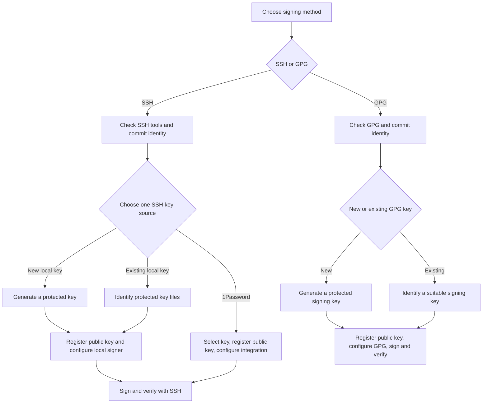

# GitHub Commit Signing Guide

This guide helps you sign Git commits so others can verify the signing key and identity, and check that the commit content has not changed since signing. A valid signature does not establish that the code is safe or correct.

**Quantum computing (QC) risk notice.** A sufficiently large, fault-tolerant quantum computer could break RSA, DSA, ECDSA, and Ed25519 signatures; this does not mean they are currently broken ([NIST analysis, draft](https://nvlpubs.nist.gov/nistpubs/ir/2024/NIST.IR.8547.ipd.pdf)). Hybrid post-quantum (PQ) key exchange does not make authentication or commit signing post-quantum. Keep platform-compatible keys until a supported migration is verified; see the [post-quantum cryptography (PQC) appendix](#appendix--post-quantum-cryptography-pqc).

**Step-by-step draft · macOS and Windows 11 · Official documentation checked October 10, 2026**

Choose **A. Secure Shell (SSH) signing** (signatures made with SSH-format keys) or **B. GNU Privacy Guard (GPG) signing**.

Signing verifies commit/tag content and its signing identity; it does not grant repository access. Authentication for clone/fetch/push is covered in the separate [**GitHub SSH Login Guide**](github-ssh-login.md). Signed commits can be transported over Hypertext Transfer Protocol Secure (HTTPS, encrypted web transport) or SSH.

This guide provides setup instructions, not a record of changes to your keys or accounts. Commands were checked against official documentation, but the complete setup routes were not tested end to end on your computers. The separate [GPG compatibility experiment](#appendix--gpg-verification-matrix) records isolated signing and verification tests. Replace every uppercase placeholder before running a command. See the [commit signing terminology appendix](#appendix--commit-signing-terminology) for definitions.

## Flow — Choose your route once



Choose SSH or GPG, then follow the linked route in order:

- **SSH:** start with [Step A1](#step-a1--check-tools-and-commit-identity), then choose [new local key](#path-a-new--generate-a-local-ssh-key), [existing local key](#path-a-existing--reuse-a-local-ssh-key), or [1Password](#path-a-manager--use-1password). Each path leads to [SSH completion](#ssh-completion--sign-and-verify).
- **GPG:** start with [Step B1](#step-b1--check-gpg-and-your-repository-identity), then choose [new key](#path-b-new--generate-a-gpg-key) or [existing key](#path-b-existing--reuse-a-gpg-key). Each path leads to [GPG completion](#gpg-completion--register-configure-sign-and-verify).

The required steps end when your signed commit verifies. Native ssh-agent, macOS Keychain (the system's protected credential store), and automatic signing defaults are [optional conveniences](#optional-convenience-tools-and-defaults).

## Route A — SSH signing

For SSH, choose exactly one key source: new local key, existing local key, or external manager such as 1Password (an app that stores keys and authorizes their use). Local private files can be used without ssh-agent (a background program that handles key-use requests). The manager path instead requires its supported integration. Optional convenience defaults are kept separate.

**Recommendation — Use separate SSH key pairs (linked public and private keys) for authentication/login and commit signing.** Separate keys let you revoke and rotate each independently and manage permissions and intended uses separately. This is a recommendation, not a GitHub requirement. The examples use `id_ed25519_github` for authentication and `id_ed25519_signing` for signing; apply the same separation when choosing existing keys or manager-held keys. GitHub also allows the same public key for both purposes, but register it separately as an **Authentication key** and a **Signing key** ([GitHub key registration](https://docs.github.com/en/authentication/connecting-to-github-with-ssh/adding-a-new-ssh-key-to-your-github-account)).

For a new SSH signing key, prefer Ed25519 with compatible tools; RSA 4096 is a compatibility alternative. This guide recommends at least 128 bits of classical security for new keys. Suitable existing keys do not automatically need replacement. Key size and security strength describe different things: compare strength across algorithms, not raw bit counts. The [SSH key types and sizes reference](#ssh-key-types-and-sizes) explains other choices and the separate 1Password generation and documented import limits.

### Step A1 — Check tools and commit identity

Use Git 2.34 or later and a current supported OpenSSH release. OpenSSH added signature operations in 8.1. Run these checks in the terminal you will use for signing:

```sh
git --version
ssh -V
git config --show-origin --get-regexp "^(user|gpg|commit|tag)\."
```

Inside the intended repository, set the identity for new commits:

```sh
git config --local user.name "YOUR_NAME"
git config --local user.email "YOUR_VERIFIED_EMAIL"
```

Use an email verified on the intended GitHub account, or your exact GitHub-provided noreply address from **Settings → Emails**. `user.name` need not be your GitHub username. An SSH key's trailing comment is only a label, not email verification.

**Expected result:** compatible tools and the intended repository identity. `--local` affects this repository only; empty output for an unset setting is normal. Review the current signer settings before proceeding with the source you selected in the opening flow.

Sources: [GitHub signing configuration](https://docs.github.com/en/authentication/managing-commit-signature-verification/telling-git-about-your-signing-key), [OpenSSH 8.1](https://www.openssh.org/txt/release-8.1), [commit email](https://docs.github.com/en/account-and-profile/how-tos/email-preferences/setting-your-commit-email-address), [Git name](https://docs.github.com/en/get-started/git-basics/setting-your-username-in-git).

### Path A-new — Generate a local SSH key

Inspect existing filenames first: macOS `ls -al ~/.ssh`; PowerShell `Get-ChildItem -Force "$HOME/.ssh"`. Do not print private-key contents or overwrite an existing key.

Create the directory with your platform's command:

```sh
# macOS
mkdir -p "$HOME/.ssh"
```

```powershell
# PowerShell
New-Item -ItemType Directory -Force "$HOME/.ssh" | Out-Null
```

Then, in either shell:

```sh
ssh-keygen -t ed25519 -C "YOUR_EMAIL_OR_LABEL" -f "$HOME/.ssh/id_ed25519_signing"
ssh-keygen -lf "$HOME/.ssh/id_ed25519_signing.pub"
```

Choose a strong passphrase. Cancel any overwrite prompt and choose a new filename. Protect the private file with user-only access; do not relax its permissions to fix an error. macOS files normally live under `/Users/YOU/.ssh`; PowerShell uses `$HOME/.ssh`, normally under `C:/Users/YOU`.

**Expected result:** a protected private key named `id_ed25519_signing` and its public `.pub` counterpart. No `ssh-add` or SSH agent is required. Continue with [local-file setup](#local-file-setup--register-and-configure).

Sources: [key generation](https://docs.github.com/en/authentication/connecting-to-github-with-ssh/generating-a-new-ssh-key-and-adding-it-to-the-ssh-agent), [OpenSSH key files](https://man.openbsd.org/ssh-keygen).

### Path A-existing — Reuse a local SSH key

Confirm the private-file path, matching public file, fingerprint, user-only permissions, and passphrase availability. Keep the existing identity unchanged. Substitute these real paths for `id_ed25519_signing` and its `.pub` counterpart in the following local-file steps. Continue with [local-file setup](#local-file-setup--register-and-configure).

### Local-file setup — Register and configure

Complete these two steps for the local key you prepared above.

#### 1. Register the public key

Copy the complete public-key line using your platform's command:

```sh
# macOS: copy PUBLIC key
pbcopy < "$HOME/.ssh/id_ed25519_signing.pub"
```

```powershell
# PowerShell: copy PUBLIC key
Get-Content "$HOME/.ssh/id_ed25519_signing.pub" | Set-Clipboard
```

Open **GitHub Settings → SSH and GPG keys → New SSH key**, select **Signing key**, give it a useful title, and paste the public key. Never upload the private file. Keep this public key and its fingerprint available for local verification.

**Expected result:** the public key appears as a Signing key on the correct account. An Authentication key registration alone does not enable signing verification; the two roles are explained in the opening recommendation.

Source: [GitHub's two SSH key roles](https://docs.github.com/en/authentication/connecting-to-github-with-ssh/adding-a-new-ssh-key-to-your-github-account).

#### 2. Configure the native signer

Inside the intended repository, select native OpenSSH and the private-file path you chose:

```sh
git config --local gpg.format ssh
git config --local gpg.ssh.program ssh-keygen
git config --local user.signingkey "$HOME/.ssh/id_ed25519_signing"
```

**There is no `.pub` suffix in `user.signingkey` here.** Git accepts the private-key path directly, without an SSH agent. Start in an interactive terminal so the encrypted key can request its passphrase. It may ask again for each signing operation. Keep the passphrase protection.

**Expected result:** Git selects the native signer and your private file. Continue with [SSH completion](#ssh-completion--sign-and-verify). Other prompt and executable configurations are covered in the [signer compatibility reference](#reference--signer-compatibility).

Sources: [Git user.signingKey](https://git-scm.com/docs/git-config#Documentation/git-config.txt-usersigningKey), [OpenSSH signature key inputs](https://man.openbsd.org/ssh-keygen).

### Path A-manager — Use 1Password

This integration signs with supported SSH keys; it does not manage OpenPGP private keys. Its supported integration is required for this path.

1. Open and unlock the desktop app. Select an existing supported Ed25519 or RSA SSH Key item, or create an Ed25519 item with **New Item → SSH Key → Add Private Key → Generate a New Key → choose Ed25519 → Generate → Save**. Keep the private key in the manager. Generation options and official import support are documented separately in the [SSH key reference](#ssh-key-types-and-sizes); no import was tested for this guide.
2. Copy the item's **public key** and record its fingerprint. Open **GitHub Settings → SSH and GPG keys → New SSH key**, select **Signing key**, give it a useful title, and paste the complete public-key line. Keep the public key for local verification. No private-key export is needed.
3. Enable the supported 1Password SSH integration. Open the selected SSH Key item → **Configure Commit Signing** → **Copy Snippet**. Apply its signer, format, and key selection to the intended repository. Keep the `op-ssh-sign` integration and manager-held key selection. The snippet's `commit.gpgsign=true` is an optional automatic-signing default; the explicit `-S` command below does not require it.

**Expected result:** Git invokes the 1Password signer for the registered key. Continue with [SSH completion](#ssh-completion--sign-and-verify), approving the signing request through 1Password when prompted. Global automatic editing is covered under [optional defaults](#optional-c2--automatic-signing-and-global-defaults).

Sources: [1Password key creation and public-key sharing](https://www.1password.dev/ssh/manage-keys), [1Password signing setup](https://www.1password.dev/ssh/git-commit-signing), [1Password SSH agent](https://www.1password.dev/ssh/agent).

### SSH completion — Sign and verify

The following steps use the signer and public key you selected above.

#### Step A2 — Prepare trusted local verification

Create/edit `~/.ssh/allowed_signers` as plain UTF-8 text, preserving existing entries. Add one trusted entry using your registered public key:

```text
YOUR_VERIFIED_EMAIL namespaces="git" PUBLIC_KEY_TYPE PUBLIC_KEY_BASE64
```

Copy `PUBLIC_KEY_TYPE` and the complete `PUBLIC_KEY_BASE64` from the first two fields of that public-key text, and omit its trailing comment. The key's fingerprint must be the one you recorded. Verify other people's fingerprints through a trusted channel before adding them. Set the trust-file path in the intended repository:

```sh
git config --local gpg.ssh.allowedSignersFile "$HOME/.ssh/allowed_signers"
```

**Expected result:** a trusted public-key entry for local verification. Its principal is a local identifier, not proof of GitHub email ownership. The trust file supports this local check; creating signatures and GitHub verification do not use it. Key-field and encoding details are in the [compatibility reference](#reference--signer-compatibility).

Sources: [local SSH trust](https://git-scm.com/docs/git-config#Documentation/git-config.txt-gpgsshallowedSignersFile), [allowed signers format](https://man.openbsd.org/ssh-keygen#ALLOWED_SIGNERS).

#### Step A3 — Review and create a signed commit

On your own work branch, review already-staged changes, then sign:

```sh
git status --short
git diff --cached
git commit -S -m "YOUR_COMMIT_MESSAGE"
```

**Expected result:** a new signed commit. `-S` requests a cryptographic signature; lowercase `-s` only adds a Signed-off-by trailer. Approve the chosen signer's passphrase or manager prompt.

Source: [Git commit flags](https://git-scm.com/docs/git-commit).

#### Step A4 — Verify the signature

```sh
git verify-commit HEAD
git log -1 --show-signature
```

**Expected result:** local verification succeeds with the expected key and signer. After a separate decision to publish and a permitted push, inspect the commit's **Verified** badge on GitHub. GitHub uses account-registered Signing keys. Local success does not grant push permission or bypass branch rules. See [verification results](#reference--verification-results) for status codes and trust warnings.

Source: [GitHub verification](https://docs.github.com/en/authentication/managing-commit-signature-verification/about-commit-signature-verification).

### SSH key types and sizes

**Checked 10 October 2026.**

| Key type | Guidance for commit signing |
| --- | --- |
| Ed25519 | Preferred for new keys with compatible tools. |
| RSA | A compatibility alternative; use 4096 bits for a new key. |
| ECDSA | Available for local-file use with compatible tools; unsupported by 1Password. |
| ~~DSA~~ (`ssh-dss`) | DSA SSH keys are unsupported by GitHub; do not generate them for SSH use. |

Sources: [GitHub SSH key guidance](https://docs.github.com/en/authentication/connecting-to-github-with-ssh/generating-a-new-ssh-key-and-adding-it-to-the-ssh-agent), [supported RSA/ECDSA keys](https://github.blog/changelog/2026-09-22-security-improvements-for-ssh/).

**1Password generation (checked 11 October 2026):** 1Password can generate Ed25519 or RSA **2048-, 3072-, or 4096-bit** SSH keys. For new manager-held keys, choose Ed25519 or RSA 3072/4096 to follow this guide's strength recommendation. [Official key-generation options](https://www.1password.dev/cli/ssh-keys#generate-an-ssh-key).

**1Password import (official documented support; not tested for this guide):** The [official key-import guidance](https://www.1password.dev/ssh/manage-keys#key-import-errors) lists Ed25519 or RSA **2048-, 3072-, or 4096-bit** keys as supported; other RSA lengths, DSA, and ECDSA are unsupported. This import scope comes from the import documentation, not from the generation options.

SHA-2 (Secure Hash Algorithm 2) is a family of hash functions; SHA-1 (Secure Hash Algorithm 1) is an older hash function.

An `ssh-rsa` public-key prefix does not imply SHA-1 ([key-format distinction](https://github.blog/changelog/2026-09-22-security-improvements-for-ssh/)). For RSA commit signatures, the [SSH signature format (SSHSIG), a detached cryptographic proof](https://github.com/openssh/openssh-portable/blob/master/PROTOCOL.sshsig) requires `rsa-sha2-256` or `rsa-sha2-512`, never legacy RSA/SHA-1.

SSH transport authentication and commit signing have separate algorithm and verification requirements.

For GitHub policy changes and dates, see the [SSH policy appendix](#appendix--github-ssh-key-policy-and-migration-dates).

For the RSA alternative in your selected new-local-key path:

```sh
ssh-keygen -t rsa -b 4096 -C "YOUR_EMAIL_OR_LABEL" -f "$HOME/.ssh/id_rsa_signing"
```

Use this instead of the Ed25519 generation command. Replace `id_ed25519_signing` with `id_rsa_signing` in subsequent local-file examples, including `.pub` paths.

#### Choosing an SSH key size

**For new keys, this guide recommends at least 128 bits of classical security.** Follow a stricter organization policy where applicable. This is the guide's recommendation, not a universal GitHub requirement or a claim that existing RSA 2048 keys are immediately unsafe. Existing-key and 1Password routes still reuse suitable keys without a generation step.

Key size measures an algorithm's parameters; security strength estimates resistance to attacks. Compare strength across algorithms, not raw bit counts.

| SSH key type | Size or curve choice | Approximate classical security |
| --- | --- | --- |
| RSA | At least 3072 bits for a new key; the example above uses 4096. | 3072 bits provides about 128 bits of security; 4096 adds margin. |
| ECDSA | P-256, P-384, or P-521; with `-t ecdsa`, select `-b 256`, `-b 384`, or `-b 521`, respectively. | About 128, 192, or 256 bits, respectively. |
| Ed25519 | Fixed parameters; there is no larger Ed25519 key-size option. | About 128 bits. |

Strength estimates: [NIST SP 800-57 Part 1 Rev. 5, §5.6 and Table 2](https://nvlpubs.nist.gov/nistpubs/SpecialPublications/NIST.SP.800-57pt1r5.pdf), [FIPS 186-5, §7.1 for Ed25519](https://nvlpubs.nist.gov/nistpubs/FIPS/NIST.FIPS.186-5.pdf).

RSA 4096 offers additional classical margin at the cost of larger keys and slower key operations. Choose ECDSA P-256 when its baseline strength meets your needs; choose P-384 or P-521 for a higher required strength and compatible tools. OpenSSH accepts only the three listed ECDSA sizes and ignores `-b` for Ed25519. Keep the dedicated filenames and subsequent path substitutions in your selected generation route. [OpenSSH size options](https://man.openbsd.org/ssh-keygen.1#b).

## Route B — GPG signing

The `gpg` tool belongs to GNU Privacy Guard (GnuPG), an implementation of the OpenPGP protocol (based on Pretty Good Privacy, PGP) for signed and encrypted messages.

GPG provides an alternative signing method. Modern GnuPG uses **gpg-agent (its background key service) as part of its architecture**, normally started automatically. This is distinct from the optional ssh-agent used for SSH keys.

For a new OpenPGP signing key, this guide recommends at least 128 bits of classical security. RSA 4096 is a common compatibility choice; use a GitHub-supported, team-approved signing algorithm. The [OpenPGP key reference](#openpgp-signing-key-types-and-sizes) explains sizes, curves, and signing capability.

**Tested compatibility:** RSA, NIST ECDSA, and Ed25519 signatures passed GitHub API verification in the 11 October 2026 experiment. DSA also passed as a legacy case; do not generate it for new signing keys. See the [dated GPG matrix](#appendix--gpg-verification-matrix) for the exact sizes, signing subkeys, and Ed448 format result.

### Step B1 — Check GPG and your repository identity

Install a supported release via [GnuPG](https://www.gnupg.org/download/) or [Gpg4win for Windows](https://www.gpg4win.org/). The generation command below requires GnuPG 2.1.17+.

```sh
git --version
gpg --version
git config --local user.name "YOUR_NAME"
git config --local user.email "YOUR_VERIFIED_EMAIL"
```

**Expected result:** the intended Git/GPG installation and commit identity. For GitHub GPG verification, the committer email must match an email on your GPG key and a verified email on the intended GitHub account. You may use your exact GitHub noreply address consistently. The display name need not equal your GitHub username. Continue with the new-key or existing-key path you chose in the opening flow.

Sources: [GPG email matching](https://docs.github.com/en/authentication/troubleshooting-commit-signature-verification/using-a-verified-email-address-in-your-gpg-key), [GPG prerequisites](https://docs.github.com/en/authentication/managing-commit-signature-verification/generating-a-new-gpg-key).

### Path B-new — Generate a GPG key

```sh
gpg --full-generate-key
```

Choose your signing algorithm and size. Enter your identity and matching email, a strong passphrase, and an expiry consistent with your policy. Secure an encrypted backup and revocation certificate. Record the full signing-key fingerprint:

```sh
gpg --list-secret-keys --keyid-format=long --with-subkey-fingerprint
```

**Expected result:** a usable signing key and its full fingerprint. Do not rely on a short identifier (ID) alone. Continue with [GPG completion](#gpg-completion--register-configure-sign-and-verify).

Source: [GPG key generation](https://docs.github.com/en/authentication/managing-commit-signature-verification/generating-a-new-gpg-key).

### Path B-existing — Reuse a GPG key

List the available secret keys:

```sh
gpg --list-secret-keys --keyid-format=long --with-subkey-fingerprint
```

Confirm the selected key can sign, is usable, and has the matching email and available private-key material. Record its full fingerprint rather than a short ID. Continue with [GPG completion](#gpg-completion--register-configure-sign-and-verify).

### GPG completion — Register, configure, sign, and verify

Complete these steps with the full fingerprint you recorded above.

#### Step B2 — Register the public GPG key

```sh
gpg --armor --export "YOUR_GPG_FINGERPRINT"
```

Copy the full PGP PUBLIC KEY BLOCK into **GitHub Settings → SSH and GPG keys → New GPG key**. Never export or upload a secret key.

**Expected result:** the public GPG key is registered on the correct account.

Source: [adding a GPG public key](https://docs.github.com/en/authentication/managing-commit-signature-verification/adding-a-gpg-key-to-your-github-account).

#### Step B3 — Select the GPG signer

Inside the intended repository:

```sh
git config --local gpg.format openpgp
git config --local user.signingkey "YOUR_GPG_FINGERPRINT"
```

**Expected result:** Git uses the intended GPG key and keyring. Explicit executable paths and signing-subkey selection are in the [compatibility reference](#reference--signer-compatibility).

Source: [Git signing configuration](https://docs.github.com/en/authentication/managing-commit-signature-verification/telling-git-about-your-signing-key).

#### Step B4 — Prepare passphrase entry

In an interactive macOS shell, set the terminal for GPG:

```sh
export GPG_TTY=$(tty)
```

A terminal device is also called a TTY (from teletype); `GPG_TTY` tells GnuPG which terminal to use for prompts. Native Windows Gpg4win uses Windows pinentry (the passphrase prompt program) and does not require `GPG_TTY`. Use your platform's prompt when signing. Never embed the passphrase in scripts, command arguments, Git settings, or environment variables. GUI prompt configuration is in the [compatibility reference](#reference--signer-compatibility).

Source: [GnuPG agent and pinentry](https://gnupg.org/documentation/manuals/gnupg-devel/Invoking-GPG_002dAGENT.html).

#### Step B5 — Review, sign, and verify

On your own work branch, review staged content, then:

```sh
git status --short
git diff --cached
git commit -S -m "YOUR_COMMIT_MESSAGE"
git verify-commit HEAD
git log -1 --show-signature
```

**Expected result:** passphrase entry works, a signed commit is created, and verification reports the expected key. Read trust warnings separately from cryptographic validity. After separately authorizing publication, inspect GitHub's **Verified** badge. See [verification results](#reference--verification-results) for details.

Source: [verification](https://git-scm.com/docs/git-verify-commit).

### OpenPGP signing key types and sizes

For a new OpenPGP signing key, this guide recommends **at least 128 bits of classical security**. Key sizes and encoded public-key lengths do not compare algorithms directly. Suitable existing keys do not automatically need replacement.

| Signing algorithm | Size or curve | Strength and selection guidance |
| --- | --- | --- |
| RSA | 2048, 3072, or 4096 bits | About 112 bits of security at 2048; about 128 at 3072. RSA 4096 adds margin, not 256-bit security. RSA 3072/4096 are compatibility choices; RFC 9580 discourages new RSA keys and requires at least 3072 bits when generating them. |
| EdDSA with Ed25519 | Fixed parameters; 32-byte encoded public-key value | About 128 bits of security; a practical modern option with compatible tools and key formats. There is no larger Ed25519 key-size setting. |
| EdDSA with ~~Ed448~~ | Fixed parameters; 57-byte encoded public-key value | About 224 bits of security. GitHub rejected the tested GnuPG 2.5.24 certificate using algorithm ID 22 and v5 packets; see the [dated matrix](#appendix--gpg-verification-matrix). This result does not cover all Ed448 formats. |
| ECDSA | NIST P-256, P-384, or P-521; GnuPG names `nistp256`, `nistp384`, `nistp521` | About 128, 192, or 256 bits of security, respectively. Other curves, such as Brainpool or secp256k1, depend on the build; do not assume GitHub accepts every curve. |
| ~~DSA~~ (legacy) | Historical 1024-, 2048-, or 3072-bit parameters | Do not generate new DSA keys: RFC 9580 forbids this, and FIPS 186-5 retains DSA only for verifying old signatures. GitHub still lists DSA for OpenPGP; this is distinct from its retired DSA SSH keys. |

Sources: [GitHub's OpenPGP algorithm list](https://docs.github.com/en/authentication/managing-commit-signature-verification/generating-a-new-gpg-key#supported-gpg-key-algorithms), [RFC 9580 algorithm and generation rules](https://www.rfc-editor.org/rfc/rfc9580.html#section-12.4), [Ed25519 and Ed448 parameters](https://www.rfc-editor.org/rfc/rfc8032.html#section-1), [NIST security-strength comparison](https://nvlpubs.nist.gov/nistpubs/SpecialPublications/NIST.SP.800-57pt1r5.pdf), [FIPS 186-5](https://nvlpubs.nist.gov/nistpubs/FIPS/NIST.FIPS.186-5.pdf), [GnuPG curve parameters](https://www.gnupg.org/documentation/manuals/gcrypt/ECC-key-parameters.html).

**Choose signing capability, not an encryption algorithm.** ECDH with `cv25519` or `cv448`, and ElGamal, are encryption choices; they cannot sign Git commits. ElGamal is legacy, and RFC 9580 forbids generating new ElGamal keys. GnuPG's ML-KEM/Kyber hybrid options are also for encryption, not post-quantum commit signatures; 768/1024 identify parameter sets, not security bits. A GitHub list containing encryption algorithms does not make them signing algorithms. A signing-only setup needs no encryption subkey. Primary keys and subkeys may use different algorithms and strengths; assess each role instead of giving every key the same raw length.

Check the actual installation with `gpg --version` and `gpg --with-colons --list-config curve`; generation menus vary by version. GnuPG's ability to create a key does not establish GitHub support for its curve or packet format. ASCII armor changes the text representation, not the underlying key format. Upload only public keys and verify a test signature on GitHub before relying on a less widely supported choice.

Sources: [OpenPGP algorithm roles](https://www.rfc-editor.org/rfc/rfc9580.html#section-9.1), [GnuPG key management and available algorithms](https://gnupg.org/documentation/manuals/gnupg/OpenPGP-Key-Management.html), [GnuPG curve parameters](https://www.gnupg.org/documentation/manuals/gcrypt/ECC-key-parameters.html).

Increasing RSA or elliptic-curve key size does not make signatures post-quantum; see the [PQC appendix](#appendix--post-quantum-cryptography-pqc).

## Optional convenience tools and defaults

These are **not prerequisites** for the minimum native SSH signing route above.

### Optional C1 — Native ssh-agent and Keychain

After choosing an agent and ensuring it is running, load the signing private key:

```sh
ssh-add "$HOME/.ssh/id_ed25519_signing"
ssh-add -l
git config --local user.signingkey "$HOME/.ssh/id_ed25519_signing.pub"
```

The `.pub` setting is intentional **only in this agent-backed variant**. The matching private key must be available through that agent. The agent can reduce repeated unlocking. macOS Keychain passphrase storage is another optional choice; Windows has a native ssh-agent service. Follow the companion [GitHub SSH Login Guide](github-ssh-login.md) for optional platform instructions, substituting the signing key filename.

**Expected result:** the selected agent can sign with the matching key. A terminal, GUI, Git Bash, Windows Subsystem for Linux (WSL, a Linux environment on Windows), and Windows OpenSSH may use different agents. Do not infer that one application's success proves all are configured.

Sources: [Git key selection](https://git-scm.com/docs/git-config#Documentation/git-config.txt-usersigningKey), [platform agent instructions](https://docs.github.com/en/authentication/connecting-to-github-with-ssh/generating-a-new-ssh-key-and-adding-it-to-the-ssh-agent).

### Optional C2 — Automatic signing and global defaults

To sign future commits by default in this repository:

```sh
git config --local commit.gpgsign true
```

This saves typing `-S`; it does not sign old commits. `--global` is optional and affects other repositories unless overridden. Review local and conditional settings before changing global configuration. For 1Password, **Edit Automatically** is another choice only when you deliberately want global configuration; **Copy Snippet** supports reviewing the settings for the intended repository.

Source: [signing defaults](https://docs.github.com/en/authentication/managing-commit-signature-verification/signing-commits).

## Reference — Signer compatibility

These details help diagnose a tool or prompt mismatch; they do not add steps to every route.

### Native SSH signing and local verification

An integrated development environment (IDE, a coding application) or graphical user interface (GUI, a graphical application) may use a different binary from your terminal. On Windows, multiple OpenSSH installations can require a verified executable path, for example `C:/Windows/System32/OpenSSH/ssh-keygen.exe`, instead of `ssh-keygen`. `gpg.ssh.program` controls signing; `core.sshCommand` controls transport. Do not replace an existing 1Password signer merely to follow the native-file example.

A public-key path or `key::` public-key value in `user.signingkey` requires the private half through an SSH agent. The minimum local-file route uses the private-key path directly. Some GUI/noninteractive environments cannot display its passphrase prompt correctly; stop and fix the prompt or deliberately choose the optional agent workflow, keeping the passphrase.

For the `allowed_signers` entry, the RSA public-key type is `ssh-rsa`; for Ed25519 it is `ssh-ed25519`. The public-key type is not the signature algorithm: do not substitute `rsa-sha2-256` or `rsa-sha2-512` for `ssh-rsa`. Copy both public-key fields from the same selected key. Plain 8-bit Unicode Transformation Format (UTF-8) or American Standard Code for Information Interchange (ASCII) text is supported; avoid Windows PowerShell 5.1's default 16-bit Unicode Transformation Format (UTF-16) redirection.

### GPG executable, subkeys, and prompts

Generation menus vary by GnuPG version. When Git selects the wrong GPG installation, set its verified path using your platform's command:

```sh
# macOS
git config --local gpg.openpgp.program "$(command -v gpg)"
```

```powershell
# PowerShell
git config --local gpg.openpgp.program (Get-Command gpg).Source
```

To force a particular signing subkey, use its full fingerprint followed by `!`, quoted, after confirming it has signing capability and available private-key material.

GUI apps may need graphical pinentry. Use the real installed path when configuring `pinentry-program`; do not copy another computer's Homebrew prefix. After adjusting agent configuration, `gpgconf --kill gpg-agent` allows a fresh agent on the next use. `allowedSignersFile` is an SSH-verification setting and does not apply to the GPG route.

Sources: [Git signing-key inputs](https://git-scm.com/docs/git-config#Documentation/git-config.txt-usersigningKey), [OpenSSH signature key inputs](https://man.openbsd.org/ssh-keygen), [Git signing configuration](https://docs.github.com/en/authentication/managing-commit-signature-verification/telling-git-about-your-signing-key), [GnuPG agent and pinentry](https://gnupg.org/documentation/manuals/gnupg-devel/Invoking-GPG_002dAGENT.html).

## Reference — Verification results


```sh
git log -5 --show-signature
git log -5 --format="%h %G? %GS %s"
```

For `%G?`, common results are `G` good signature, `B` bad signature, `U` good signature with unknown trust, `E` unable to check, and `N` no signature. `X`, `Y`, and `R` concern an expired signature, expired key, and revoked key. Read the full verification output and fingerprint rather than treating every non-`G` result as either acceptable or forged. Cryptographic validity and local trust are different checks.

After you separately authorize publication and push, open the commit on GitHub and inspect its **Verified** badge. GitHub uses its registered keys and account information; your local machine may lack the corresponding public key or trust configuration. GitHub also preserves verification records, so revoking a key later does not automatically remove an existing commit's Verified status.

Sources: [signing commits](https://docs.github.com/en/authentication/managing-commit-signature-verification/signing-commits), [commit flags](https://git-scm.com/docs/git-commit), [verification command](https://git-scm.com/docs/git-verify-commit), [log status codes](https://git-scm.com/docs/git-log), [persistent GitHub verification](https://docs.github.com/en/authentication/managing-commit-signature-verification/about-commit-signature-verification).


## Reference — Tags and existing history


### Signed tags are separate objects

```sh
git tag -s "YOUR_TAG" -m "YOUR_TAG_MESSAGE"
git tag -v "YOUR_TAG"
```

A signed tag does not sign the commit it points to; a signed commit does not automatically sign a tag. See [GitHub's tag-signing instructions](https://docs.github.com/en/authentication/managing-commit-signature-verification/signing-tags).

### Adding signatures to existing commits changes hashes

Amend, rebase, and cherry-pick can create new commit objects. Old signatures do not transfer to changed objects. Before rewriting, verify a clean worktree, create a backup branch, and coordinate with collaborators. Never apply an unfamiliar rewrite to a shared main branch.

```sh
git status
git branch backup-before-signing
# Recreate and sign only the most recent commit
git commit --amend --no-edit -S
```

For an explicitly reviewed, linear sequence, `BASE_COMMIT` below is the parent of the first commit to rewrite:

```sh
git rebase --force-rebase --gpg-sign "BASE_COMMIT"
git log --show-signature "BASE_COMMIT..HEAD"
```

Do not use this simplified example for merge-heavy history or other people's work without planning the rewrite. Use `git rebase --abort` if you need to abandon an in-progress rebase. Verify every rewritten commit and review the resulting changes before publication.

Already-published branches may require a force push. Coordinate first. `--force-with-lease` adds a remote-state check compared with `--force`, but ordinary leases can be weakened by background fetches. This guide does not automate publishing rewritten history or overwriting a shared branch.

### Branch rules remain independent

GitHub's **Require signed commits** is a server-side rule. Successful SSH authentication or local verification does not replace it, and signing does not confer push permissions. GitHub may evaluate commits introduced by a pull request (PR, a proposed change for review), including its existing head-branch history; do not assume a signed final squash commit guarantees that the PR can merge. Other required checks, reviews, and rules still apply.

Sources: [amend](https://git-scm.com/docs/git-commit), [rebase signing](https://git-scm.com/docs/git-rebase), [force-with-lease caveats](https://git-scm.com/docs/git-push), [protected branches](https://docs.github.com/en/repositories/configuring-branches-and-merges-in-your-repository/managing-protected-branches/about-protected-branches).


## Troubleshooting and final checks

- **Unsupported SSH signing format:** check the Git binary actually used; it needs 2.34+.
- **Direct private-file signing cannot prompt:** use an interactive terminal and the intended native signer. A GUI may need supported askpass/prompt integration or an optional agent. Do not remove the passphrase.
- **Public-key path but no agent:** use the actual private-key path for direct signing, or deliberately configure the optional matching agent.
- **Local SSH verification fails:** check the trust-file path, encoding, key fingerprint, and expected signer. This is separate from GitHub registration.
- **GPG fails:** check the secret key, expiry, GPG program/keyring, gpg-agent, and pinentry. Do not confuse gpg-agent with ssh-agent.
- **GitHub Unverified:** read the badge's reason. Check key role/account/committer email and, for GPG, the key email. New settings do not change existing commits.

Before publishing, verify every commit newly introduced to the target branch, including merged history. Investigate missing/unverifiable signatures first. Check the exact remote and branch, keep private keys and passphrases out of Git, and ensure public commit name/email are appropriate to disclose.

## Appendix — GPG verification matrix

**Observed 11 October 2026 · GnuPG 2.5.24 · libgcrypt 1.12.4 · macOS.** This experiment tested nine algorithm/size/curve groups using nine OpenPGP certificates and eleven signing cases. RSA 4096 and Ed25519 each used one certificate for both a primary key and a signing subkey using the same algorithm.

Each empty commit was signed with the exact selected fingerprint from an isolated GnuPG home. Verification used a separate home containing only the public certificates. All eleven passed local verification, and every commit retained the base tree. GitHub accepted eight certificates and its commit API returned `verified=true`, `reason=valid` for ten commits.

The links identify the full commit SHA on the [test branch](https://github.com/NORPG/AllTheThings/tree/codex/gpg-verification-matrix). The key and signature packet versions below were checked separately. `verified` and `reason` describe GitHub's signature result; `verified_at` records its verification time. All listed timestamps are UTC on **2026-10-11**.

| Group | Signer | Algorithm ID | Key / signature packet version | Commit SHA | GitHub API `verified` / `reason` | `verified_at` (UTC) |
| --- | --- | --- | --- | --- | --- | --- |
| RSA 2048 | Primary | 1 | v4 / v4 | [f23d0a3b2382a1265b5989f6544a0271aa702ddf](https://github.com/NORPG/AllTheThings/commit/f23d0a3b2382a1265b5989f6544a0271aa702ddf) | `true` / `valid` | `16:45:13` |
| RSA 3072 | Primary | 1 | v4 / v4 | [374a08ae0c7a4a6b2fc69cc8d6374bde29fdcc47](https://github.com/NORPG/AllTheThings/commit/374a08ae0c7a4a6b2fc69cc8d6374bde29fdcc47) | `true` / `valid` | `16:45:13` |
| RSA 4096 | Primary | 1 | v4 / v4 | [8704ad4c4dd7a8f4160e3ffd3e11a647fa3fa6ad](https://github.com/NORPG/AllTheThings/commit/8704ad4c4dd7a8f4160e3ffd3e11a647fa3fa6ad) | `true` / `valid` | `16:45:13` |
| RSA 4096 | Signing subkey | 1 | v4 / v4 | [e50a892bfb46b2882e4e7a03abc66898c267b729](https://github.com/NORPG/AllTheThings/commit/e50a892bfb46b2882e4e7a03abc66898c267b729) | `true` / `valid` | `16:45:13` |
| ~~DSA~~ 3072 | Primary | 17 | v4 / v4 | [3bb90feb6c559241bf06ee3c450397f03ab33525](https://github.com/NORPG/AllTheThings/commit/3bb90feb6c559241bf06ee3c450397f03ab33525) | `true` / `valid` | `16:45:13` |
| ECDSA NIST P-256 | Primary | 19 | v4 / v4 | [5203f13463d9635706b51930a0943916f6b11b5f](https://github.com/NORPG/AllTheThings/commit/5203f13463d9635706b51930a0943916f6b11b5f) | `true` / `valid` | `16:45:13` |
| ECDSA NIST P-384 | Primary | 19 | v4 / v4 | [e24eeaed2c183154727b85a706050d21b7c812fe](https://github.com/NORPG/AllTheThings/commit/e24eeaed2c183154727b85a706050d21b7c812fe) | `true` / `valid` | `16:45:13` |
| ECDSA NIST P-521 | Primary | 19 | v4 / v4 | [3a7f72621d8068f0b879776c38fb7b54574af22d](https://github.com/NORPG/AllTheThings/commit/3a7f72621d8068f0b879776c38fb7b54574af22d) | `true` / `valid` | `16:45:13` |
| Ed25519 | Primary | 22 | v4 / v4 | [9733f75fc4db0db4cd6379df24e957dce3d46552](https://github.com/NORPG/AllTheThings/commit/9733f75fc4db0db4cd6379df24e957dce3d46552) | `true` / `valid` | `16:45:14` |
| Ed25519 | Signing subkey | 22 | v4 / v4 | [be45b21cbd3594e11d57c51b1282a886bb78ba10](https://github.com/NORPG/AllTheThings/commit/be45b21cbd3594e11d57c51b1282a886bb78ba10) | `true` / `valid` | `16:45:14` |
| ~~Ed448~~ | Primary | 22 | v5 / v5 | [05b40afb33eec6fa3a0ac0163be297de6bf222e8](https://github.com/NORPG/AllTheThings/commit/05b40afb33eec6fa3a0ac0163be297de6bf222e8) | `false` / `gpgverify_error` | `null` |

Each primary key and signing subkey had an independently checked lifetime of **7,200 seconds from its own creation timestamp**. Keys were created between `16:14:14` and `16:14:25` UTC and expired between `18:14:14` and `18:14:25` UTC on 2026-10-11. Verification occurred before expiry. These short-lived experiment keys are not production-key examples.

**Ed448 result and scope:** GitHub rejected the exact Ed448 public certificate using algorithm ID 22 and v5 key packets with: "We got an error adding your GPG key. Please verify the input is a valid GPG key." Its signed commit used a v5 signature packet and returned `verified=false`, `reason=gpgverify_error`, `verified_at=null`, despite passing local verification. GitHub documents `gpgverify_error` as a communication error involving its verification service; it does not identify a curve or packet-version cause. These observations do not establish that every Ed448 format is unsupported. Other Ed448 encodings and packet versions were not tested.

**Selection limits:** Successful DSA 3072 verification does not recommend generating new DSA keys; the [OpenPGP key reference](#openpgp-signing-key-types-and-sizes) explains its legacy status. ElGamal and ECDH were not tested: they are encryption/key-agreement choices, so this matrix makes no commit-signing support claim for them. The results apply to these concrete certificates, signing roles, versions, and recorded observations, rather than guaranteeing every size, curve, packet format, or future platform behavior.

Sources: [GitHub commit API verification fields and reasons](https://docs.github.com/en/rest/commits/commits#get-a-commit), [public test-account GPG key listing](https://api.github.com/users/NORPG/gpg_keys), and the exact commit links above. The API payloads matched the locally signed payloads, and its signature values matched the commits' `gpgsig` values.

## Appendix — GitHub SSH key policy and migration dates

**Checked 10 October 2026.** These policy dates add no setup steps.

DSA SSH keys have been unsupported by GitHub since 15 March 2022. [GitHub SSH key support](https://docs.github.com/en/authentication/connecting-to-github-with-ssh/generating-a-new-ssh-key-and-adding-it-to-the-ssh-agent).

**Announced, not yet effective:** RSA uploads for either role require at least 3072 bits from **14 October 2026**. RSA/SHA-1 authentication brownouts: **4 November** and **9 December 2026**; permanent removal: **13 January 2027**. [Schedule](https://github.blog/changelog/2026-09-22-security-improvements-for-ssh/).

Do not apply old SSH authentication exceptions to commit signing.

## Appendix — Post-quantum cryptography (PQC)

**Checked 10 October 2026.** This is a policy recommendation, not an extra required workflow step.

Distinguish SSH transport **key exchange**, SSH **host/user authentication signatures**, and **Git commit signatures**. Hybrid PQ key exchange protects transport; it does not make RSA, ECDSA, or Ed25519 signatures post-quantum. Ed25519 is the current compatibility recommendation, not a quantum-resistance claim.

A key-encapsulation mechanism (KEM) establishes a shared secret. Module-Lattice-Based Key-Encapsulation Mechanism (ML-KEM) is a post-quantum KEM; Module-Lattice-Based Digital Signature Algorithm (ML-DSA) creates post-quantum signatures, a different task.

GitHub announced `sntrup761x25519-sha512` hybrid KEX for github.com and non-US data-residency regions, effective 17 September 2025 ([rollout](https://github.blog/engineering/platform-security/post-quantum-security-for-ssh-access-on-github/)). GitHub schedules `mlkem768x25519-sha256` for **14 October 2026** on these endpoints; rollout remains future at this check ([schedule](https://github.blog/changelog/2026-09-22-security-improvements-for-ssh/)). No endpoint negotiation was tested while preparing this guide.

[OpenSSH 10.6](https://www.openssh.org/txt/release-10.6), released 6 October 2026, enables hybrid `ssh-mldsa44-ed25519` signatures. The sources checked here do not establish GitHub acceptance of that key type for authentication or commit signing; client capability alone is insufficient evidence.

**Recommended policy:** use maintained SSH/Git clients, prefer compatible hybrid PQ KEX defaults, and confirm the actual endpoint's negotiated algorithm. Keep host-key verification and signature checks; do not globally suppress PQ warnings. Manage transport, authentication, and signing migrations separately. Before adopting PQ signatures, require explicit support from GitHub, clients, agents/hardware, and verifiers, then test recovery, revocation, and historical-signature verification.

## Appendix — Commit signing terminology

This reference explains terms used in this commit signing guide. It adds no required steps or tools.

| Term | Plain-English meaning |
| --- | --- |
| Key pair | Two mathematically linked parts: a public key and a private key. |
| Public key | The shareable half used to check signatures. Register it with GitHub for the intended key role. |
| Private key / secret key | The protected half used to sign or prove key possession. Keep it private; never upload it to GitHub. |
| Passphrase | A secret that unlocks a protected private key. It is separate from a GitHub account password. |
| Fingerprint | A short digest identifying a public key. Compare it through a trusted source before trusting the key. |
| Authentication | Proving which account a connection belongs to. GitHub SSH authentication does not provide website login or a remote shell. |
| Signing / signature | Using a private key to attach a cryptographic check to specific data, such as a commit or tag. |
| Verification | Checking a signature with its public key and applicable identity/trust rules. It does not assess code safety or intent. |
| Verified badge | GitHub accepted the signature under its verification rules. This does not prove safe/correct code or the signer's good intentions. |
| Authentication key / Signing key | Separate GitHub registration roles for SSH access and signature verification. A reused public key must be registered for each role. |
| SSH / OpenSSH | Secure Shell is the connection protocol. OpenSSH supplies the SSH client, key tools, and SSH signing tools used here. |
| HTTPS | Hypertext Transfer Protocol Secure: another encrypted Git transport. It is separate from the commit-signature method. |
| OpenPGP / PGP | OpenPGP is a protocol for signed/encrypted data and keys, based on Pretty Good Privacy (PGP). |
| GnuPG / GPG / gpg | GNU Privacy Guard implements OpenPGP. GPG is its common short name; `gpg` is its command. |
| libgcrypt | The cryptographic library used by the tested GnuPG build. |
| API | Application programming interface: the GitHub commit API reports signature-verification fields. |
| OpenPGP certificate | Public material for the primary key, its identity and self-signatures, and any bound subkeys. |
| Primary key / signing subkey | A certificate's main key and a bound subkey authorized to sign; they have separate fingerprints and lifetimes. |
| Algorithm ID / packet version | The OpenPGP algorithm identifier and the format version of a typed data record. Key packets and signature packets have separately checked versions. |
| Agent / ssh-agent | A background service that performs key operations for clients. Native ssh-agent is optional for these direct local-file routes. |
| gpg-agent / pinentry | GnuPG's key service and passphrase prompt. Modern GnuPG uses gpg-agent as part of its architecture. |
| Keychain | macOS credential storage that can remember a key's passphrase. This is optional and separate from using an SSH agent. |
| 1Password | An external key manager with SSH-agent and signing integrations. Its supported integration is required only when choosing that key-source route. |
| Key size / security strength | Parameter length versus estimated resistance to attacks. Compare security strength across algorithms, not raw key lengths. |
| RSA | Rivest–Shamir–Adleman: a public-key algorithm usable for authentication and signing. Its key format does not determine its signature hash. |
| DSA | Digital Signature Algorithm: a legacy signature scheme. GitHub does not support DSA SSH keys; this SSH restriction is distinct from its GPG-key support. |
| ECDSA | Elliptic Curve Digital Signature Algorithm: a classical signature scheme whose curve determines its parameters, distinct from Ed25519. |
| Ed25519 | A signature scheme in the Edwards-curve Digital Signature Algorithm family; the example key type in these guides. |
| EdDSA / Ed448 | Edwards-curve Digital Signature Algorithm is a signature family. Ed448 is a fixed-parameter scheme in that family; tool support does not establish GitHub format compatibility. |
| ECDH / cv25519 / cv448 | Elliptic Curve Diffie–Hellman is key agreement. The named GnuPG encryption curves do not provide commit-signing capability. |
| ElGamal | A legacy encryption algorithm. RFC 9580 prohibits generating new OpenPGP ElGamal keys. |
| Brainpool / secp256k1 | An elliptic-curve family and a named curve; availability and interoperability depend on the implementation and key format. |
| RFC | Request for Comments: a technical specification series. RFC 9580 specifies the current OpenPGP protocol. |
| SHA-1 / SHA-2 | Secure Hash Algorithm 1 is a hash algorithm; Secure Hash Algorithm 2 is a family. RSA/SHA-2 uses SHA-256/512; SSHSIG excludes RSA/SHA-1. |
| SSHSIG | OpenSSH's signature format, used by Git's SSH signing route. It is separate from SSH transport authentication. |
| QC | Quantum computing: computation using quantum-mechanical effects. The opening notice concerns sufficiently capable future quantum computers. |
| PQ / PQC | Post-quantum / post-quantum cryptography: methods designed to resist quantum-computer attacks, without requiring a quantum computer to use them. |
| Hybrid | A combination of classical and post-quantum methods. Hybrid key exchange and hybrid signatures serve different purposes. |
| KEX | Key exchange: the SSH process that establishes session secrets to protect a connection. It does not sign Git commits. |
| KEM | Key-encapsulation mechanism: public-key algorithms that let two parties establish a shared secret. It is not a digital signature. |
| ML-KEM | Module-Lattice-Based Key-Encapsulation Mechanism: a post-quantum KEM used in the named hybrid SSH key exchange. |
| ML-DSA | Module-Lattice-Based Digital Signature Algorithm: a post-quantum signature scheme. OpenSSH client support does not establish GitHub acceptance. |
| NIST | National Institute of Standards and Technology: the U.S. standards body publishing the cited cryptography standards and guidance. |
| IDE / GUI | Integrated development environment / graphical user interface: different ways to run tools; they may select different clients. |
| WSL | Windows Subsystem for Linux: a Linux environment on Windows that can have its own clients and agents. |
| UTF-8 / UTF-16 / ASCII | Text encodings: 8-bit or 16-bit Unicode Transformation Format, and American Standard Code for Information Interchange. Use the encoding required by the trust-file instructions. |
| PR | Pull request: a proposed change for review. |
| ID | An identifier. |
| TTY / terminal | TTY comes from teletype and names a terminal device. `GPG_TTY` identifies the terminal for GnuPG's passphrase interaction. |

Standards terminology: [NIST ML-KEM](https://csrc.nist.gov/pubs/fips/203/final), [NIST ML-DSA](https://csrc.nist.gov/pubs/fips/204/final).

DSA support scope: [GitHub SSH-key retirement](https://docs.github.com/en/authentication/connecting-to-github-with-ssh/generating-a-new-ssh-key-and-adding-it-to-the-ssh-agent), [GitHub supported GPG-key algorithms](https://docs.github.com/en/authentication/managing-commit-signature-verification/generating-a-new-gpg-key#supported-gpg-key-algorithms).
