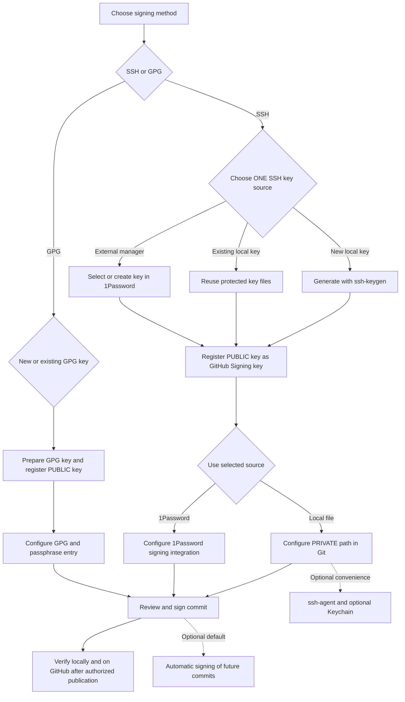

# GitHub Commit Signing Guide

**Quantum computing (QC) risk notice.** A sufficiently large, fault-tolerant quantum computer could break classical signature schemes: RSA (Rivest–Shamir–Adleman), DSA (Digital Signature Algorithm), ECDSA (Elliptic Curve Digital Signature Algorithm), and Ed25519 (an Edwards-curve signature scheme). This does not mean they are currently broken ([National Institute of Standards and Technology (NIST) analysis, draft](https://nvlpubs.nist.gov/nistpubs/ir/2024/NIST.IR.8547.ipd.pdf)). Hybrid post-quantum (PQ) key exchange (KEX, agreeing on connection secrets) does not make authentication or commit signing post-quantum. See the post-quantum cryptography (PQC) policy below; keep platform-compatible keys until a supported migration is verified.

**Step-by-step draft · macOS and Windows 11 · Official documentation checked October 10, 2026**

Choose **A. Secure Shell (SSH) signing** (signatures made with SSH-format keys) or **B. GNU Privacy Guard (GPG) signing**. The `gpg` tool belongs to GNU Privacy Guard (GnuPG), an implementation of the OpenPGP protocol (based on Pretty Good Privacy, PGP) for signed and encrypted messages. For SSH, choose exactly one key source: new local key, existing local key, or external manager such as 1Password (an app that stores keys and authorizes their use). Local private files can be used without ssh-agent (a background program that handles key-use requests). The manager path instead requires its supported integration. Optional convenience defaults are kept separate.

Signing verifies commit/tag content and its signing identity; it does not grant repository access. Authentication for clone/fetch/push is covered in the separate [**GitHub SSH Authentication Guide**](github-ssh-authentication.md). Signed commits can be transported over Hypertext Transfer Protocol Secure (HTTPS, encrypted web transport) or SSH.

**Recommendation — Use separate SSH key pairs (linked public and private keys) for authentication/login and commit signing.** Separate keys let you revoke and rotate each independently and manage permissions and intended uses separately. This is a recommendation, not a GitHub requirement. The examples use `id_ed25519_github` for authentication and `id_ed25519_signing` for signing; apply the same separation when choosing existing keys or manager-held keys. GitHub also allows the same public key for both purposes, but register it separately as an **Authentication key** and a **Signing key** ([GitHub key registration](https://docs.github.com/en/authentication/connecting-to-github-with-ssh/adding-a-new-ssh-key-to-your-github-account)).

This is a draft procedure, not a record of changes made. No keys were generated, accounts/configuration changed, or commits signed/pushed while preparing it. Commands were checked against official documentation but not tested on your computers. Replace every uppercase placeholder before running a command. See the [shared terminology appendix](#appendix--shared-terminology) for definitions.

## Flow — Choose a signing method and one key source



**Text version:** SSH → choose new local / existing local / 1Password → register public Signing key → configure that source's signer → sign → verify. Alternatively, GPG → new/existing GPG key → public-key registration → GPG configuration → sign → verify. Native agents, macOS Keychain (the system's protected credential store), and automatic defaults are optional side paths. **The 1Password integration is required only if you choose the 1Password source; it is not an extra step for everyone.**

## Reference — SSH key types

**Checked 10 October 2026.**

| Key type | Guidance for commit signing |
| --- | --- |
| Ed25519 | Preferred for new keys with compatible tools. |
| RSA | A compatibility alternative; use 4096 bits for a new key. |
| ECDSA | Still available as an alternative. |
| DSA (`ssh-dss`) | Unsupported by GitHub since 15 March 2022; do not generate it. |

Sources: [GitHub key generation and DSA retirement](https://docs.github.com/en/authentication/connecting-to-github-with-ssh/generating-a-new-ssh-key-and-adding-it-to-the-ssh-agent), [supported RSA/ECDSA keys](https://github.blog/changelog/2026-09-22-security-improvements-for-ssh/).

SHA-2 (Secure Hash Algorithm 2) is a family of hash functions; SHA-1 (Secure Hash Algorithm 1) is an older hash function.

An `ssh-rsa` public-key prefix does not imply SHA-1 ([key-format distinction](https://github.blog/changelog/2026-09-22-security-improvements-for-ssh/)). For RSA commit signatures, the [SSH signature format (SSHSIG), a detached cryptographic proof](https://github.com/openssh/openssh-portable/blob/master/PROTOCOL.sshsig) requires `rsa-sha2-256` or `rsa-sha2-512`, never legacy RSA/SHA-1. Do not apply old SSH authentication exceptions to commit signing.

SSH transport authentication and commit signing have separate algorithm and verification requirements.

**Announced, not yet effective:** RSA uploads for either role require at least 3072 bits from **14 October 2026**. RSA/SHA-1 authentication brownouts: **4 November** and **9 December 2026**; permanent removal: **13 January 2027**. [Schedule](https://github.blog/changelog/2026-09-22-security-improvements-for-ssh/).

For the RSA alternative in your selected new-local-key path:

```sh
ssh-keygen -t rsa -b 4096 -C "YOUR_EMAIL_OR_LABEL" -f "$HOME/.ssh/id_rsa_signing"
```

Use this instead of the Ed25519 generation command. Replace `id_ed25519_signing` with `id_rsa_signing` in subsequent local-file examples, including `.pub` paths.

## Policy — Post-quantum cryptography (PQC)

**Checked 10 October 2026.** This is a policy recommendation, not an extra required workflow step.

Distinguish SSH transport **key exchange**, SSH **host/user authentication signatures**, and **Git commit signatures**. Hybrid PQ key exchange protects transport; it does not make RSA, ECDSA, or Ed25519 signatures post-quantum. Ed25519 is the current compatibility recommendation, not a quantum-resistance claim.

A key-encapsulation mechanism (KEM) establishes a shared secret. Module-Lattice-Based Key-Encapsulation Mechanism (ML-KEM) is a post-quantum KEM; Module-Lattice-Based Digital Signature Algorithm (ML-DSA) creates post-quantum signatures, a different task.

GitHub announced `sntrup761x25519-sha512` hybrid KEX for github.com and non-US data-residency regions, effective 17 September 2025 ([rollout](https://github.blog/engineering/platform-security/post-quantum-security-for-ssh-access-on-github/)). GitHub schedules `mlkem768x25519-sha256` for **14 October 2026** on these endpoints; rollout remains future at this check ([schedule](https://github.blog/changelog/2026-09-22-security-improvements-for-ssh/)). No endpoint negotiation was tested while preparing this guide.

[OpenSSH 10.6](https://www.openssh.org/txt/release-10.6), released 6 October 2026, enables hybrid `ssh-mldsa44-ed25519` signatures. The sources checked here do not establish GitHub acceptance of that key type for authentication or commit signing; client capability alone is insufficient evidence.

**Recommended policy:** use maintained SSH/Git clients, prefer compatible hybrid PQ KEX defaults, and confirm the actual endpoint's negotiated algorithm. Keep host-key verification and signature checks; do not globally suppress PQ warnings. Manage transport, authentication, and signing migrations separately. Before adopting PQ signatures, require explicit support from GitHub, clients, agents/hardware, and verifiers, then test recovery, revocation, and historical-signature verification.

## Route A — Required workflow for the SSH key source you choose

### Step A1 — Check tools and commit identity

Use Git 2.34 or later and a current supported OpenSSH release. OpenSSH added signature operations in 8.1. An integrated development environment (IDE, a coding application) or graphical user interface (GUI, a graphical application) may use a different binary from your terminal.

```sh
git --version
ssh -V
git config --show-origin --get-regexp "^(user|gpg|commit|tag)\."
```

Inside the intended repository, check or set the identity for new commits:

```sh
git config --local user.name "YOUR_NAME"
git config --local user.email "YOUR_VERIFIED_EMAIL"
```

Use an email verified on the intended GitHub account, or your exact GitHub-provided noreply address from **Settings → Emails**. `user.name` need not be your GitHub username. An SSH key's trailing comment is only a label, not email verification.

**Expected result:** compatible tools and the intended repository identity. `--local` affects this repository only; user-wide defaults are optional. Empty output for an unset setting is normal.

Sources: [GitHub signing configuration](https://docs.github.com/en/authentication/managing-commit-signature-verification/telling-git-about-your-signing-key), [OpenSSH 8.1](https://www.openssh.org/txt/release-8.1), [commit email](https://docs.github.com/en/account-and-profile/how-tos/email-preferences/setting-your-commit-email-address), [Git name](https://docs.github.com/en/get-started/git-basics/setting-your-username-in-git).

### Step A2 — Choose exactly one key-preparation path

**Path 1 — Generate a new local key with ssh-keygen.** Use this only if you need a new key.

Inspect existing filenames first: macOS `ls -al ~/.ssh`; PowerShell `Get-ChildItem -Force "$HOME/.ssh"`. Do not print private-key contents. If you already have a suitable key, use its real path in later steps and skip generation.

If a new key is needed, create its directory:

```sh
# macOS
mkdir -p "$HOME/.ssh"
```

```powershell
# PowerShell
New-Item -ItemType Directory -Force "$HOME/.ssh" | Out-Null
```

Then, in either shell:

```sh
ssh-keygen -t ed25519 -C "YOUR_EMAIL_OR_LABEL" -f "$HOME/.ssh/id_ed25519_signing"
ssh-keygen -lf "$HOME/.ssh/id_ed25519_signing.pub"
```

Choose a strong passphrase. Cancel any overwrite prompt and choose a new filename. Protect the private file with user-only access; do not relax its permissions to fix an error. macOS files normally live under `/Users/YOU/.ssh`; PowerShell uses `$HOME/.ssh`, normally under `C:/Users/YOU`.

**Expected result:** a protected private key named `id_ed25519_signing` and its public `.pub` counterpart. No `ssh-add` or SSH agent is required for this route.

Sources: [key generation](https://docs.github.com/en/authentication/connecting-to-github-with-ssh/generating-a-new-ssh-key-and-adding-it-to-the-ssh-agent), [OpenSSH key files](https://man.openbsd.org/ssh-keygen).

**Path 2 — Use an existing local key.** Skip all generation commands. Confirm its private-file path, matching public file, fingerprint, permissions, and passphrase availability. Substitute these paths throughout the local-file examples. Expected: the existing identity is reused unchanged.

**Path 3 — Use an external key manager such as 1Password.** Open and unlock the desktop app, then select an existing SSH Key item. To create one there instead: **New Item → SSH Key → Add Private Key → Generate a New Key → choose Ed25519 → Generate → Save**. Keep the private key in the manager. Copy its **public key** and record the fingerprint for Step A3. Expected: a manager-held key, without exporting a private file. Continue through Step A4's manager branch, not its direct-file commands.

Source: [1Password key creation and public-key sharing](https://www.1password.dev/ssh/manage-keys).


### Step A3 — Register only the public key on GitHub

Open **Settings → SSH and GPG keys → New SSH key**, select **Signing key**, give it a useful title, and paste the complete public-key line. For the manager path, copy the public field from 1Password instead of running the local-file clipboard commands.

```sh
# macOS: copy PUBLIC key
pbcopy < "$HOME/.ssh/id_ed25519_signing.pub"
```

```powershell
# PowerShell: copy PUBLIC key
Get-Content "$HOME/.ssh/id_ed25519_signing.pub" | Set-Clipboard
```

**Expected result:** this public key appears as a Signing key on the correct account. Registering it as an Authentication key alone is insufficient. If reusing one public key for both roles, register it separately under each role. Never upload the private file.

Source: [GitHub's two SSH key roles](https://docs.github.com/en/authentication/connecting-to-github-with-ssh/adding-a-new-ssh-key-to-your-github-account).

### Step A4 — Configure the signer for your chosen source

**Local-file paths 1 or 2:**

Run inside the repository only after deliberately choosing native OpenSSH over any existing signer:

```sh
git config --local gpg.format ssh
git config --local gpg.ssh.program ssh-keygen
git config --local user.signingkey "$HOME/.ssh/id_ed25519_signing"
```

**There is no `.pub` suffix in `user.signingkey` here.** Git accepts a private-key path directly. A public-key path or `key::` public-key value instead requires the private half through an SSH agent. Do not replace an existing 1Password signer merely to follow this example.

**Expected result:** Git selects the native signer and private file. An encrypted key needs a supported passphrase prompt; it may ask again for each signing operation. Start in an interactive terminal. Some GUI/noninteractive environments cannot display the prompt correctly; stop and fix the prompt or choose the optional agent workflow rather than removing the passphrase.

On Windows, if multiple OpenSSH installations cause ambiguity, select the verified executable path, for example `C:/Windows/System32/OpenSSH/ssh-keygen.exe`, instead of `ssh-keygen`. `gpg.ssh.program` controls signing; `core.sshCommand` controls transport.

Sources: [Git user.signingKey](https://git-scm.com/docs/git-config#Documentation/git-config.txt-usersigningKey), [OpenSSH signature key inputs](https://man.openbsd.org/ssh-keygen).

**Manager path 3 — 1Password:** enable the supported 1Password SSH integration and open the chosen SSH Key item → **Configure Commit Signing**. Use **Copy Snippet** for the intended repository, or **Edit Automatically** only if you deliberately want global configuration. Keep its `op-ssh-sign` integration rather than setting a local private-file path. Review any copied snippet: signer, format, and key selection belong to this route; `commit.gpgsign=true` is only the optional auto-sign default, so explicit `-S` remains sufficient without it. Approve the signing request through 1Password when prompted. Expected: Git invokes the manager-backed signer for the selected key. No private-key export is needed.

Sources: [1Password signing setup](https://www.1password.dev/ssh/git-commit-signing), [1Password SSH agent](https://www.1password.dev/ssh/agent).

### Step A5 — Review and create a signed commit

On your own work branch, review already-staged changes:

```sh
git status --short
git diff --cached
git commit -S -m "YOUR_COMMIT_MESSAGE"
```

**Expected result:** a new signed commit. `-S` requests a cryptographic signature. Lowercase `-s` only adds a Signed-off-by trailer. No default auto-sign setting is required when you explicitly use `-S`.

Source: [Git commit flags](https://git-scm.com/docs/git-commit).

### Step A6 — Verify locally and check GitHub when published

For the manager path, use the public key copied from the SSH Key item; a local `.pub` file is not required. For trusted **local SSH verification**, create/edit `~/.ssh/allowed_signers` as plain 8-bit Unicode Transformation Format (UTF-8) or American Standard Code for Information Interchange (ASCII, a text encoding) text. Preserve existing entries. Add one trusted public-key entry:

```text
YOUR_VERIFIED_EMAIL namespaces="git" ssh-ed25519 PUBLIC_KEY_BASE64
```

Replace the full base64 field with the second field from your `.pub` file. Avoid Windows PowerShell 5.1's default 16-bit Unicode Transformation Format (UTF-16) redirection. Then:

```sh
git config --local gpg.ssh.allowedSignersFile "$HOME/.ssh/allowed_signers"
git verify-commit HEAD
git log -1 --show-signature
```

**Expected result:** local verification succeeds with the expected key and signer. The trust file is needed for this local check, **not** for creating a signature or for GitHub's verification. Its principal is a local identifier; do not treat it as proof of GitHub email ownership. Verify other people's fingerprints through a trusted channel before adding them.

After a separate decision to publish and a permitted push, inspect the commit's **Verified** badge on GitHub. GitHub uses account-registered Signing keys, not your local trust file. Local success does not grant push permission or bypass branch rules.

Sources: [local SSH trust](https://git-scm.com/docs/git-config#Documentation/git-config.txt-gpgsshallowedSignersFile), [allowed signers format](https://man.openbsd.org/ssh-keygen#ALLOWED_SIGNERS), [GitHub verification](https://docs.github.com/en/authentication/managing-commit-signature-verification/about-commit-signature-verification).

## Route B — Required workflow for GPG signing

GPG is an alternative to Route A, not an extra layer you must install for SSH signing. Modern GnuPG uses **gpg-agent (its background key service) as part of its architecture**, normally started automatically. That is distinct from the **optional ssh-agent** in the SSH workflows.

### Step B1 — Check GPG and your repository identity

Install a supported release via [GnuPG](https://www.gnupg.org/download/) or [Gpg4win for Windows](https://www.gpg4win.org/). The generation command below requires GnuPG 2.1.17+.

```sh
git --version
gpg --version
git config --local user.name "YOUR_NAME"
git config --local user.email "YOUR_VERIFIED_EMAIL"
gpg --list-secret-keys --keyid-format=long --with-subkey-fingerprint
```

**Expected result:** the intended Git/GPG installation and commit identity. For GitHub GPG verification, the committer email must match an email on your GPG key and a verified email on the intended GitHub account. You may use your exact GitHub noreply address consistently. The display name need not equal your GitHub username.

Sources: [GPG email matching](https://docs.github.com/en/authentication/troubleshooting-commit-signature-verification/using-a-verified-email-address-in-your-gpg-key), [GPG prerequisites](https://docs.github.com/en/authentication/managing-commit-signature-verification/generating-a-new-gpg-key).

### Step B2 — Reuse a suitable secret key or generate one

If the listing already shows a suitable key, skip generation. Otherwise:

```sh
gpg --full-generate-key
```

Choose a GitHub-supported, team-approved algorithm; RSA 4096 is a common compatibility choice. Menu choices vary by version. Enter your identity and matching email, a strong passphrase, and an expiry consistent with your policy. Secure an encrypted backup and revocation certificate.

```sh
gpg --list-secret-keys --keyid-format=long --with-subkey-fingerprint
```

**Expected result:** a usable signing key and its full fingerprint. Do not rely on a short identifier (ID) alone.

Source: [GPG key generation](https://docs.github.com/en/authentication/managing-commit-signature-verification/generating-a-new-gpg-key).

### Step B3 — Register the public GPG key

```sh
gpg --armor --export "YOUR_GPG_FINGERPRINT"
```

Copy the full PGP PUBLIC KEY BLOCK into **GitHub Settings → SSH and GPG keys → New GPG key**. Never export or upload a secret key.

**Expected result:** the public GPG key is registered on the correct account.

Source: [adding a GPG public key](https://docs.github.com/en/authentication/managing-commit-signature-verification/adding-a-gpg-key-to-your-github-account).

### Step B4 — Select the GPG signer

Inside the intended repository:

```sh
git config --local gpg.format openpgp
git config --local user.signingkey "YOUR_GPG_FINGERPRINT"
```

If Git selects the wrong GPG installation, set its verified path using your platform's command:

```sh
# macOS
git config --local gpg.openpgp.program "$(command -v gpg)"
```

```powershell
# PowerShell
git config --local gpg.openpgp.program (Get-Command gpg).Source
```

**Expected result:** Git uses the intended GPG key and keyring. To force a particular signing subkey, use its full fingerprint followed by `!`, quoted, after confirming it has signing capability and available private-key material.

Source: [Git signing configuration](https://docs.github.com/en/authentication/managing-commit-signature-verification/telling-git-about-your-signing-key).

### Step B5 — Make passphrase entry work and sign

A terminal device is also called a TTY (from teletype); `GPG_TTY` tells GnuPG which terminal to use for prompts.

In an interactive macOS shell, set the terminal for GPG if needed:

```sh
export GPG_TTY=$(tty)
```

Native Windows Gpg4win uses Windows pinentry (the passphrase prompt program) and does not require `GPG_TTY`. GUI apps may need graphical pinentry. Use the real installed path if configuring `pinentry-program`; do not copy another computer's Homebrew prefix. After adjusting agent configuration, `gpgconf --kill gpg-agent` allows a fresh agent on the next use.

Review staged content on your work branch, then:

```sh
git status --short
git diff --cached
git commit -S -m "YOUR_COMMIT_MESSAGE"
git verify-commit HEAD
git log -1 --show-signature
```

**Expected result:** passphrase entry works, a signed commit is created, and verification reports the expected key. Read trust warnings separately from cryptographic validity. Never embed the passphrase in scripts, command arguments, Git settings, or environment variables.

After separately authorizing publication, inspect GitHub's Verified badge. `allowedSignersFile` is an SSH-verification setting and is not part of this GPG route.

Sources: [GnuPG agent and pinentry](https://gnupg.org/documentation/manuals/gnupg-devel/Invoking-GPG_002dAGENT.html), [verification](https://git-scm.com/docs/git-verify-commit).

## Optional convenience tools and defaults

These are **not prerequisites** for the minimum native SSH signing route above.

### Optional C1 — Native ssh-agent and Keychain

After choosing an agent and ensuring it is running, load the signing private key:

```sh
ssh-add "$HOME/.ssh/id_ed25519_signing"
ssh-add -l
git config --local user.signingkey "$HOME/.ssh/id_ed25519_signing.pub"
```

The `.pub` setting is intentional **only in this agent-backed variant**. The matching private key must be available through that agent. The agent can reduce repeated unlocking. macOS Keychain passphrase storage is another optional choice; Windows has a native ssh-agent service. Follow the companion authentication guide's optional platform instructions, substituting the signing key filename.

**Expected result:** the selected agent can sign with the matching key. A terminal, GUI, Git Bash, Windows Subsystem for Linux (WSL, a Linux environment on Windows), and Windows OpenSSH may use different agents. Do not infer that one application's success proves all are configured.

Sources: [Git key selection](https://git-scm.com/docs/git-config#Documentation/git-config.txt-usersigningKey), [platform agent instructions](https://docs.github.com/en/authentication/connecting-to-github-with-ssh/generating-a-new-ssh-key-and-adding-it-to-the-ssh-agent).

### Optional C2 — Automatic signing and global defaults

To sign future commits by default in this repository:

```sh
git config --local commit.gpgsign true
```

This saves typing `-S`; it does not sign old commits. `--global` is optional and affects other repositories unless overridden. Review local and conditional settings before changing global configuration.

Source: [signing defaults](https://docs.github.com/en/authentication/managing-commit-signature-verification/signing-commits).

## Reference — Verification results


```sh
git log -5 --show-signature
git log -5 --format="%h %G? %GS %s"
```

For `%G?`, common results are `G` good signature, `B` bad signature, `U` good signature with unknown trust, `E` unable to check, and `N` no signature. `X`, `Y`, and `R` concern an expired signature, expired key, and revoked key. Read the full verification output and fingerprint rather than treating every non-`G` result as either acceptable or forged. Cryptographic validity and local trust are different checks.

After you separately authorize publication and push, open the commit on GitHub and inspect its **Verified** badge. GitHub uses its registered keys and account information; your local machine may lack the corresponding public key or trust configuration. GitHub also preserves verification records, so revoking a key later does not automatically remove an existing commit's Verified status.

Sources: [signing commits](https://docs.github.com/en/authentication/managing-commit-signature-verification/signing-commits), [commit flags](https://git-scm.com/docs/git-commit), [verification command](https://git-scm.com/docs/git-verify-commit), [log status codes](https://git-scm.com/docs/git-log), [persistent GitHub verification](https://docs.github.com/en/authentication/managing-commit-signature-verification/about-commit-signature-verification).


## Reference — Tags and existing history


### Signed tags are separate objects

```sh
git tag -s "YOUR_TAG" -m "YOUR_TAG_MESSAGE"
git tag -v "YOUR_TAG"
```

A signed tag does not sign the commit it points to; a signed commit does not automatically sign a tag. See [GitHub's tag-signing instructions](https://docs.github.com/en/authentication/managing-commit-signature-verification/signing-tags).

### Adding signatures to existing commits changes hashes

Amend, rebase, and cherry-pick can create new commit objects. Old signatures do not transfer to changed objects. Before rewriting, verify a clean worktree, create a backup branch, and coordinate with collaborators. Never apply an unfamiliar rewrite to a shared main branch.

```sh
git status
git branch backup-before-signing
# Recreate and sign only the most recent commit
git commit --amend --no-edit -S
```

For an explicitly reviewed, linear sequence, `BASE_COMMIT` below is the parent of the first commit to rewrite:

```sh
git rebase --force-rebase --gpg-sign "BASE_COMMIT"
git log --show-signature "BASE_COMMIT..HEAD"
```

Do not use this simplified example for merge-heavy history or other people's work without planning the rewrite. Use `git rebase --abort` if you need to abandon an in-progress rebase. Verify every rewritten commit and review the resulting changes before publication.

Already-published branches may require a force push. Coordinate first. `--force-with-lease` adds a remote-state check compared with `--force`, but ordinary leases can be weakened by background fetches. This guide does not automate publishing rewritten history or overwriting a shared branch.

### Branch rules remain independent

GitHub's **Require signed commits** is a server-side rule. Successful SSH authentication or local verification does not replace it, and signing does not confer push permissions. GitHub may evaluate commits introduced by a pull request (PR, a proposed change for review), including its existing head-branch history; do not assume a signed final squash commit guarantees that the PR can merge. Other required checks, reviews, and rules still apply.

Sources: [amend](https://git-scm.com/docs/git-commit), [rebase signing](https://git-scm.com/docs/git-rebase), [force-with-lease caveats](https://git-scm.com/docs/git-push), [protected branches](https://docs.github.com/en/repositories/configuring-branches-and-merges-in-your-repository/managing-protected-branches/about-protected-branches).


## Troubleshooting and final checks

- **Unsupported SSH signing format:** check the Git binary actually used; it needs 2.34+.
- **Direct private-file signing cannot prompt:** use an interactive terminal and the intended native signer. A GUI may need supported askpass/prompt integration or an optional agent. Do not remove the passphrase.
- **Public-key path but no agent:** use the actual private-key path for direct signing, or deliberately configure the optional matching agent.
- **Local SSH verification fails:** check the trust-file path, encoding, key fingerprint, and expected signer. This is separate from GitHub registration.
- **GPG fails:** check the secret key, expiry, GPG program/keyring, gpg-agent, and pinentry. Do not confuse gpg-agent with ssh-agent.
- **GitHub Unverified:** read the badge's reason. Check key role/account/committer email and, for GPG, the key email. New settings do not change existing commits.

Before publishing, verify every commit newly introduced to the target branch, including merged history. Investigate missing/unverifiable signatures first. Check the exact remote and branch, keep private keys and passphrases out of Git, and ensure public commit name/email are appropriate to disclose.

## Appendix — Shared terminology

This shared reference explains terms used across both guides. It adds no required steps or tools.

| Term | Plain-English meaning |
| --- | --- |
| Key pair | Two mathematically linked parts: a public key and a private key. |
| Public key | The shareable half used to check signatures. Register it with GitHub for the intended key role. |
| Private key / secret key | The protected half used to sign or prove key possession. Keep it private; never upload it to GitHub. |
| Passphrase | A secret that unlocks a protected private key. It is separate from a GitHub account password. |
| Fingerprint | A short digest identifying a public key. Compare it through a trusted source before trusting the key. |
| Authentication | Proving which account a connection belongs to. GitHub SSH authentication does not provide website login or a remote shell. |
| Authorization | Permission to access a repository or perform an action. Authentication alone does not grant this permission. |
| Signing / signature | Using a private key to attach a cryptographic check to specific data, such as a commit or tag. |
| Verification | Checking a signature with its public key and applicable identity/trust rules. It does not assess code safety or intent. |
| Verified badge | GitHub accepted the signature under its verification rules. This does not prove safe/correct code or the signer's good intentions. |
| Authentication key / Signing key | Separate GitHub registration roles for SSH access and signature verification. A reused public key must be registered for each role. |
| SSH / OpenSSH | Secure Shell is the connection protocol. OpenSSH supplies the SSH client, key tools, and SSH signing tools used here. |
| HTTPS | Hypertext Transfer Protocol Secure: another encrypted Git transport. It is separate from the commit-signature method. |
| OpenPGP / PGP | OpenPGP is a protocol for signed/encrypted data and keys, based on Pretty Good Privacy (PGP). |
| GnuPG / GPG / gpg | GNU Privacy Guard implements OpenPGP. GPG is its common short name; `gpg` is its command. |
| Agent / ssh-agent | A background service that performs key operations for clients. Native ssh-agent is optional for these direct local-file routes. |
| gpg-agent / pinentry | GnuPG's key service and passphrase prompt. Modern GnuPG uses gpg-agent as part of its architecture. |
| Keychain | macOS credential storage that can remember a key's passphrase. This is optional and separate from using an SSH agent. |
| 1Password | An external key manager with SSH-agent and signing integrations. Its supported integration is required only when choosing that key-source route. |
| RSA | Rivest–Shamir–Adleman: a public-key algorithm usable for authentication and signing. Its key format does not determine its signature hash. |
| DSA | Digital Signature Algorithm: a legacy signature scheme unsupported by GitHub since 15 March 2022. |
| ECDSA | Elliptic Curve Digital Signature Algorithm: a classical signature scheme, distinct from Ed25519. |
| Ed25519 | A signature scheme in the Edwards-curve Digital Signature Algorithm family; the example key type in these guides. |
| SHA-1 / SHA-2 | Secure Hash Algorithm 1 is a hash algorithm; Secure Hash Algorithm 2 is a family. RSA/SHA-2 uses SHA-256/512; SSHSIG excludes RSA/SHA-1. |
| SSHSIG | OpenSSH's signature format, used by Git's SSH signing route. It is separate from SSH transport authentication. |
| QC | Quantum computing: computation using quantum-mechanical effects. The opening notice concerns sufficiently capable future quantum computers. |
| PQ / PQC | Post-quantum / post-quantum cryptography: methods designed to resist quantum-computer attacks, without requiring a quantum computer to use them. |
| Hybrid | A combination of classical and post-quantum methods. Hybrid key exchange and hybrid signatures serve different purposes. |
| KEX | Key exchange: the SSH process that establishes session secrets to protect a connection. It does not sign Git commits. |
| KEM | Key-encapsulation mechanism: public-key algorithms that let two parties establish a shared secret. It is not a digital signature. |
| ML-KEM | Module-Lattice-Based Key-Encapsulation Mechanism: a post-quantum KEM used in the named hybrid SSH key exchange. |
| ML-DSA | Module-Lattice-Based Digital Signature Algorithm: a post-quantum signature scheme. OpenSSH client support does not establish GitHub acceptance. |
| NIST | National Institute of Standards and Technology: the U.S. standards body publishing the cited cryptography standards and guidance. |
| SSO / IP | Single sign-on connects organization login to an identity provider. Internet Protocol addresses may also be subject to access restrictions. |
| CLI / IDE / GUI | Command-line interface / integrated development environment / graphical user interface: different ways to run tools; they may select different clients. |
| WSL | Windows Subsystem for Linux: a Linux environment on Windows that can have its own clients and agents. |
| UTF-8 / UTF-16 / ASCII | Text encodings: 8-bit or 16-bit Unicode Transformation Format, and American Standard Code for Information Interchange. Use the encoding required by the trust-file instructions. |
| PR / CI | Pull request: a proposed change for review. Continuous integration: automated checks that repository events may trigger. |
| URL / ID | Uniform Resource Locator: an address. ID: an identifier. |
| TTY / terminal | TTY comes from teletype and names a terminal device. `GPG_TTY` identifies the terminal for GnuPG's passphrase interaction. |

Standards terminology: [NIST ML-KEM](https://csrc.nist.gov/pubs/fips/203/final), [NIST ML-DSA](https://csrc.nist.gov/pubs/fips/204/final).
