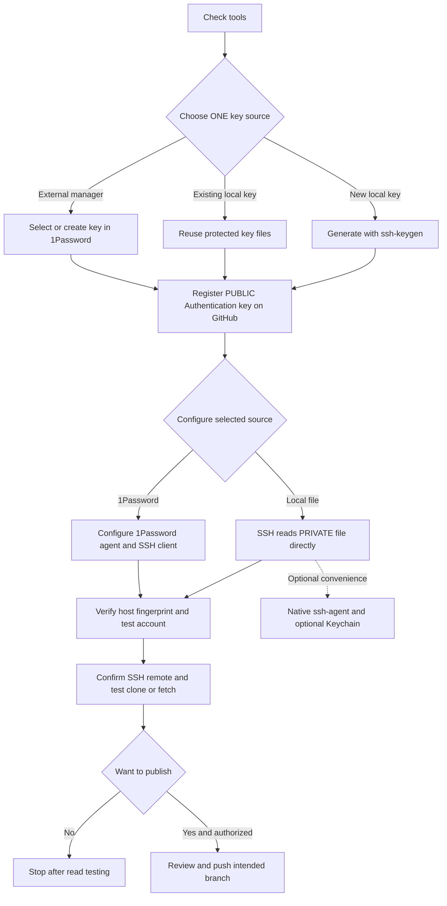

# GitHub Secure Shell (SSH) Authentication Guide

**Quantum computing (QC) risk notice.** A sufficiently large, fault-tolerant quantum computer could break classical signature schemes: RSA (Rivest–Shamir–Adleman), DSA (Digital Signature Algorithm), ECDSA (Elliptic Curve Digital Signature Algorithm), and Ed25519 (an Edwards-curve signature scheme). This does not mean they are currently broken ([National Institute of Standards and Technology (NIST) analysis, draft](https://nvlpubs.nist.gov/nistpubs/ir/2024/NIST.IR.8547.ipd.pdf)). Hybrid post-quantum (PQ) key exchange (KEX, agreeing on connection secrets) does not make authentication or commit signing post-quantum. See the post-quantum cryptography (PQC) policy below; keep platform-compatible keys until a supported migration is verified.

**Step-by-step draft · macOS and Windows 11 · Official documentation checked October 10, 2026**

SSH provides an encrypted client/server connection for Git transport. Follow the numbered workflow for **one selected key source**: new local key, existing local key, or external manager such as 1Password (an app that stores keys and authorizes their use). Local-file paths need no ssh-agent (a background program that handles key-use requests). The manager path requires its own supported agent/client integration. Native agents, macOS Keychain (the system's protected credential store), global defaults, and GitHub's command-line interface (CLI) are not universal prerequisites.

Here, “login” means SSH authentication for Git clone/fetch/push, not website login or a remote shell. An Authentication key enables transport; a Signing key enables commit/tag verification. Reusing a public key for both requires registering it separately in both roles. See the companion [**GitHub Commit Signing Guide**](github-commit-signing.md) for signatures.

**Recommendation — Use separate SSH key pairs (linked public and private keys) for authentication/login and commit signing.** Separate keys let you revoke and rotate each independently and manage permissions and intended uses separately. This is a recommendation, not a GitHub requirement. The examples use `id_ed25519_github` for authentication and `id_ed25519_signing` for signing; apply the same separation when choosing existing keys or manager-held keys. GitHub also allows the same public key for both purposes, but register it separately as an **Authentication key** and a **Signing key** ([GitHub key registration](https://docs.github.com/en/authentication/connecting-to-github-with-ssh/adding-a-new-ssh-key-to-your-github-account)).

This is an unexecuted draft procedure. No keys or settings were changed and no repository was pushed. Commands are based on official docs, not testing on your computers. Replace uppercase placeholders with your values. See the [shared terminology appendix](#appendix--shared-terminology) for definitions.

## Flow — Choose one SSH key source



**Text version:** choose new local / existing local / 1Password → register the public Authentication key → configure that source → verify host and account → test repository reads → push only if intended and authorized. Native ssh-agent and Keychain are optional for local files. **Choosing 1Password requires its own agent/client integration, not exporting its private key.**

## Reference — SSH key types

**Checked 10 October 2026.**

| Key type | Guidance for authentication |
| --- | --- |
| Ed25519 | Preferred for new keys with compatible tools. |
| RSA | A compatibility alternative; use 4096 bits for a new key. |
| ECDSA | Still available as an alternative. |
| DSA (`ssh-dss`) | Unsupported by GitHub since 15 March 2022; do not generate it. |

Sources: [GitHub key generation and DSA retirement](https://docs.github.com/en/authentication/connecting-to-github-with-ssh/generating-a-new-ssh-key-and-adding-it-to-the-ssh-agent), [supported RSA/ECDSA keys](https://github.blog/changelog/2026-09-22-security-improvements-for-ssh/).

SHA-2 (Secure Hash Algorithm 2) is a family of hash functions; SHA-1 (Secure Hash Algorithm 1) is an older hash function.

An `ssh-rsa` public-key prefix identifies RSA, not SHA-1. Use `rsa-sha2-256` or `rsa-sha2-512` for authentication ([RSA distinction](https://github.blog/changelog/2026-09-22-security-improvements-for-ssh/)).

Git commit signing is a separate use: the [SSH signature format (SSHSIG), a detached cryptographic proof](https://github.com/openssh/openssh-portable/blob/master/PROTOCOL.sshsig) requires RSA/SHA-2; historical SSH authentication exceptions do not apply to commit signatures.

**Announced, not yet effective:** RSA uploads for either role require at least 3072 bits from **14 October 2026**. RSA/SHA-1 authentication brownouts: **4 November** and **9 December 2026**; permanent removal: **13 January 2027**. [Schedule](https://github.blog/changelog/2026-09-22-security-improvements-for-ssh/).

For the RSA alternative in your selected new-local-key path:

```sh
ssh-keygen -t rsa -b 4096 -C "YOUR_EMAIL_OR_LABEL" -f "$HOME/.ssh/id_rsa_github"
```

Use this instead of the Ed25519 generation command. Replace `id_ed25519_github` with `id_rsa_github` in subsequent local-file examples, including `.pub` paths.

## Policy — Post-quantum cryptography (PQC)

**Checked 10 October 2026.** This is a policy recommendation, not an extra required workflow step.

Distinguish SSH transport **key exchange**, SSH **host/user authentication signatures**, and **Git commit signatures**. Hybrid PQ key exchange protects transport; it does not make RSA, ECDSA, or Ed25519 signatures post-quantum. Ed25519 is the current compatibility recommendation, not a quantum-resistance claim.

A key-encapsulation mechanism (KEM) establishes a shared secret. Module-Lattice-Based Key-Encapsulation Mechanism (ML-KEM) is a post-quantum KEM; Module-Lattice-Based Digital Signature Algorithm (ML-DSA) creates post-quantum signatures, a different task.

GitHub announced `sntrup761x25519-sha512` hybrid KEX for github.com and non-US data-residency regions, effective 17 September 2025 ([rollout](https://github.blog/engineering/platform-security/post-quantum-security-for-ssh-access-on-github/)). GitHub schedules `mlkem768x25519-sha256` for **14 October 2026** on these endpoints; rollout remains future at this check ([schedule](https://github.blog/changelog/2026-09-22-security-improvements-for-ssh/)). No endpoint negotiation was tested while preparing this guide.

[OpenSSH 10.6](https://www.openssh.org/txt/release-10.6), released 6 October 2026, enables hybrid `ssh-mldsa44-ed25519` signatures. The sources checked here do not establish GitHub acceptance of that key type for authentication or commit signing; client capability alone is insufficient evidence.

**Recommended policy:** use maintained SSH/Git clients, prefer compatible hybrid PQ KEX defaults, and confirm the actual endpoint's negotiated algorithm. Keep host-key verification and signature checks; do not globally suppress PQ warnings. Manage transport, authentication, and signing migrations separately. Before adopting PQ signatures, require explicit support from GitHub, clients, agents/hardware, and verifiers, then test recovery, revocation, and historical-signature verification.

## Required workflow — Follow only your chosen key-source branch

### Step 1 — Check the client and existing key files

```sh
git --version
ssh -V
```

macOS:

```sh
command -v ssh
ls -al "$HOME/.ssh"
```

PowerShell:

```powershell
Get-Command ssh, ssh-keygen
Get-ChildItem -Force "$HOME/.ssh"
```

**Expected result:** identify the SSH client and any suitable existing key. Reuse a suitable key instead of generating another unnecessarily. Do not print private-key contents. The local-file route needs no agent. If choosing the manager path, check the manager and its supported client integration instead.

Source: [OpenSSH client](https://man.openbsd.org/ssh).

### Step 2 — Choose exactly one key-preparation path

**Path 1 — Generate a new local key with ssh-keygen.**

If a suitable key already exists, skip generation and substitute its path in the later examples. Otherwise create the directory:

```sh
# macOS
mkdir -p "$HOME/.ssh"
```

```powershell
# PowerShell
New-Item -ItemType Directory -Force "$HOME/.ssh" | Out-Null
```

Generate the pair and view its public fingerprint:

```sh
ssh-keygen -t ed25519 -C "YOUR_EMAIL_OR_LABEL" -f "$HOME/.ssh/id_ed25519_github"
ssh-keygen -lf "$HOME/.ssh/id_ed25519_github.pub"
```

Choose a strong passphrase and cancel any overwrite prompt. `id_ed25519_github` is private; `.pub` is public. Protect the private file from other users; do not weaken permissions to silence an error. On macOS, files are normally under `/Users/YOU/.ssh`; in PowerShell `$HOME/.ssh` normally maps under `C:/Users/YOU`.

**Expected result:** a usable protected private file and its public counterpart. `-C` is only a label; it need not be a verified GitHub email. SSH authentication maps the registered public key to your account. Commit email is a separate setting.

Source: [GitHub key generation](https://docs.github.com/en/authentication/connecting-to-github-with-ssh/generating-a-new-ssh-key-and-adding-it-to-the-ssh-agent).

**Path 2 — Use an existing local key.** Skip generation. Confirm the private path, matching public key and fingerprint, safe permissions, and available passphrase. Substitute the existing paths in the examples. Expected: reuse the existing key without overwriting it.

**Path 3 — Use an external key manager such as 1Password.** Open/unlock the desktop app and choose an existing SSH Key item. If you need a new manager-held key: **New Item → SSH Key → Add Private Key → Generate a New Key → Ed25519 → Generate → Save**. Copy only its public field for Step 3; retain the private key in 1Password. Expected: a selected manager-held identity. Continue through Step 4's manager setup/test branch, not its direct-file command.

Source: [1Password key management](https://www.1password.dev/ssh/manage-keys).


### Step 3 — Register the public Authentication key

Go to **GitHub Settings → SSH and GPG keys → New SSH key**. Give it a device/purpose title, select **Authentication key**, and paste the whole public-key line. Manager users copy the public field from 1Password; the following clipboard commands are for local-file paths only.

```sh
# macOS: PUBLIC key only
pbcopy < "$HOME/.ssh/id_ed25519_github.pub"
```

```powershell
# PowerShell: PUBLIC key only
Get-Content "$HOME/.ssh/id_ed25519_github.pub" | Set-Clipboard
```

For an organization using single sign-on (SSO, organization-managed login), authorize the key with **Configure SSO** if required. You may first need an identity-provider login, and Internet Protocol (IP) allow-list restrictions may also apply.

**Expected result:** the public key is an Authentication key on the intended GitHub account and authorized for the relevant organization where required. Never upload the private file.

Sources: [adding SSH keys](https://docs.github.com/en/authentication/connecting-to-github-with-ssh/adding-a-new-ssh-key-to-your-github-account), [SSO authorization](https://docs.github.com/en/enterprise-cloud@latest/authentication/authenticating-with-single-sign-on/authorizing-an-ssh-key-for-use-with-single-sign-on).

### Step 4 — Configure the selected source and test safely

**Local-file paths 1 or 2:**

Run in an interactive terminal; this command explicitly avoids an agent:

```sh
ssh -o IdentityAgent=none -o IdentitiesOnly=yes -i "$HOME/.ssh/id_ed25519_github" -T git@github.com
```

The `-i` path is the **private file**, not `.pub`. An encrypted file needs its passphrase; without an agent you may be prompted on each connection. The username for GitHub.com is `git`; your key determines your GitHub account.

**Manager path 3 — 1Password:** enable its SSH agent and configure your SSH client using the app's supported setup. Replace conflicting direct-file/`IdentityAgent none` settings with the intended manager configuration; do not start a competing native agent. Keep the private key in 1Password. Then test:

```sh
ssh -T git@github.com
```

Approve only the intended client request in 1Password, optionally using Touch ID (Apple's fingerprint authentication) or Windows Hello. Expected: the selected manager-held key is offered. [Official 1Password agent/client setup](https://www.1password.dev/ssh/agent).

**Both branches:** Before accepting a first-use host prompt, compare its fingerprint with [GitHub's official fingerprints](https://docs.github.com/en/authentication/keeping-your-account-and-data-secure/githubs-ssh-key-fingerprints). On an unexpected host-key change, stop and investigate. Do not disable host checking or delete `known_hosts` just to hide the warning.

**Expected result:** GitHub identifies your expected username and reports successful authentication with no shell access. **Exit code 1 is normal for this successful GitHub test.** It proves account authentication, not access to a particular repository.

Sources: [SSH identity options](https://man.openbsd.org/ssh), [IdentityAgent and IdentityFile](https://man.openbsd.org/ssh_config), [GitHub test result](https://docs.github.com/en/authentication/connecting-to-github-with-ssh/testing-your-ssh-connection).

### Step 5 — Make Git use the same identity

**Local-file paths 1 or 2:**

Git also needs to select the intended private key. This guide uses a host entry so Git operations can use the key without repeating `-i`. Configuration is a selection method, not an agent requirement.

Merge this into `~/.ssh/config` on macOS or `$HOME\.ssh\config` in PowerShell. The filename has no `.txt` suffix. Preserve existing configuration; if there is already a GitHub/1Password entry, reconcile it rather than blindly appending duplicate settings.

```sshconfig
Host github.com
  HostName github.com
  User git
  IdentityFile ~/.ssh/id_ed25519_github
  IdentitiesOnly yes
  IdentityAgent none
```

`IdentityAgent none` explicitly disables agent use for this host. It is not a host-security bypass. If you later choose an agent, remove or replace this setting as part of that intentional switch.

```sh
ssh -T git@github.com
```

**Expected result:** the same account succeeds using the saved key selection. You can instead pass equivalent SSH options through `git -c core.sshCommand=...`; you only need one consistent selection method.

If Git for Windows selects a different SSH binary, inspect its configuration and use a verified executable where necessary, for example:

```powershell
git config --local core.sshCommand "C:/Windows/System32/OpenSSH/ssh.exe"
```

Run `--local` inside the intended repository. It affects transport, not signing. Windows Subsystem for Linux (WSL, a Linux environment on Windows) and graphical user interfaces (GUIs, graphical applications) can have different clients or prompt support. Fix the client/prompt or use an optional supported agent rather than removing the key passphrase.

Sources: [SSH configuration](https://man.openbsd.org/ssh_config), [Windows SSH client conflicts](https://docs.github.com/en/authentication/connecting-to-github-with-ssh/generating-a-new-ssh-key-and-adding-it-to-the-ssh-agent).

**Manager path 3:** keep the client setup completed in Step 4; do not apply the agentless host block above. Confirm Git uses the same SSH client/integration. Expected: Git requests authorization from 1Password with the intended key.

### Step 6 — Confirm the repository Uniform Resource Locator (URL, a resource address) and test read access

For an existing repository:

```sh
git remote -v
git remote get-url origin
git remote get-url --push origin
```

Hypertext Transfer Protocol Secure (HTTPS, encrypted web transport) looks like `https://github.com/OWNER/REPO.git`; SSH looks like `git@github.com:OWNER/REPO.git`. Adding a key does not switch an HTTPS remote automatically. `origin` and `upstream` are labels, not guaranteed destinations.

Only if you deliberately want to switch this remote:

```sh
git remote set-url origin git@github.com:OWNER/REPO.git
```

Recheck fetch and push URLs: a separately configured `pushurl` may still differ. For a new local copy instead:

```sh
git clone git@github.com:OWNER/REPO.git
```

Enter the cloned folder, then test:

```sh
git ls-remote origin
git fetch origin
```

**Expected result:** `ls-remote` reads the accessible refs, and fetch completes. An empty repository may have no refs. Fetch updates local remote-tracking information; it does not merge into your work branch or change the remote.

Sources: [remote management](https://docs.github.com/en/get-started/git-basics/managing-remote-repositories), [clone](https://git-scm.com/docs/git-clone), [fetch](https://git-scm.com/docs/git-fetch).

### Step 7 — Push only when you intend to publish

You can stop after read-access testing if you do not want to publish anything. If publishing is intended, review the changes, exact destination, branch rules, and authorization first:

```sh
git push -u origin YOUR_BRANCH
```

**Expected result:** only the intended branch update is accepted, subject to repository permissions and rules. A push can trigger continuous integration (CI, automated checks), notifications, or deployments. Reading a public repository does not imply write access; successful SSH authentication does not bypass SSO, required signatures, reviews, or branch protection. Do not test publishing by pushing to a shared main branch.

Sources: [push](https://git-scm.com/docs/git-push), [protected branches](https://docs.github.com/en/repositories/configuring-branches-and-merges-in-your-repository/managing-protected-branches/about-protected-branches).

## Optional convenience tools — Not part of the minimum workflow

### Optional A — macOS ssh-agent and Keychain

Only choose this if you want agent-backed key use. Remove `IdentityAgent none` from the relevant host entry, or deliberately select your desired agent. If no agent is reachable:

```sh
eval "$(ssh-agent -s)"
```

Load the key without storing its passphrase in Keychain:

```sh
/usr/bin/ssh-add "$HOME/.ssh/id_ed25519_github"
ssh-add -l
```

If you also want Keychain to save the passphrase, use this alternative instead:

```sh
/usr/bin/ssh-add --apple-use-keychain "$HOME/.ssh/id_ed25519_github"
```

For that choice, add `AddKeysToAgent yes` and `UseKeychain yes` to the host entry. Use Apple's tools; Monterey 12+ uses `--apple-use-keychain`, while older macOS used `-K`. `UseKeychain` is Apple-specific; another client may require `IgnoreUnknown UseKeychain` before it or use the intended Apple client.

**Expected result:** your chosen agent can use the key with fewer repeated unlock prompts. Keychain storage is a separate optional decision.

Source: [GitHub macOS agent instructions](https://docs.github.com/en/authentication/connecting-to-github-with-ssh/generating-a-new-ssh-key-and-adding-it-to-the-ssh-agent).

### Optional B — Windows native ssh-agent

Choose this only if you want the native agent. Do not alter company-managed services without understanding their policy. Remove the deliberate `IdentityAgent none` host setting before agent use.

Administrator PowerShell:

```powershell
Get-Service -Name ssh-agent | Set-Service -StartupType Manual
Start-Service ssh-agent
```

Normal PowerShell:

```powershell
ssh-add "$HOME/.ssh/id_ed25519_github"
ssh-add -l
```

**Expected result:** the intended key is loaded in the agent used by your SSH client. Manual startup may require starting the service after reboot. Git for Windows, WSL, and GUIs may use different clients/agents; verify them individually. `UseKeychain` is not a Windows option. An SSH server is unnecessary for GitHub client access.

Sources: [Microsoft key management](https://learn.microsoft.com/en-us/windows-server/administration/openssh/openssh_keymanagement), [GitHub agent conflicts](https://docs.github.com/en/authentication/connecting-to-github-with-ssh/generating-a-new-ssh-key-and-adding-it-to-the-ssh-agent).

### Optional C — Global defaults and GitHub CLI

This guide uses repository-local Git settings. Choose `--global` only when you intentionally want a user-wide default, accounting for local/conditional overrides. GitHub CLI is not required for browser-based public-key registration. Selecting 1Password in Step 2 is an alternative key-source workflow, not an additional convenience layer everyone must configure.

## Troubleshooting and security


- **Permission denied (publickey):** Check that the SSH username is `git`, the public key is an Authentication key on the correct account, and the selected private file is readable with correct permissions. For the optional agent route, also inspect `ssh-add -l`. Use `ssh -vT git@github.com` to inspect key selection.
- **SSH test works but repository not found / push denied:** Check `OWNER/REPO`, account permissions, organization SSO, and separate fetch/push URLs. Account authentication is not repository authorization.
- **PowerShell works but Git or a GUI fails:** Compare `Get-Command ssh` with `git config --show-origin --get core.sshCommand`. Windows OpenSSH, Git Bash, WSL, and GUI clients can use different agents.
- **Wrong account or too many authentication failures:** Select the intended `IdentityFile`; native-key configurations can use `IdentitiesOnly yes`. Multiple accounts typically need host aliases and corresponding remote URLs. Changing `user.email` does not switch the SSH account.
- **Repeated passphrase prompts:** Repeated prompts are expected with direct encrypted-file use. If you chose an agent, check that the client uses it and that Keychain or 1Password is available. Do not weaken the key's passphrase protection as a shortcut.

Sources: [GitHub SSH troubleshooting](https://docs.github.com/en/authentication/troubleshooting-ssh/error-permission-denied-publickey), [SSH client configuration](https://man.openbsd.org/ssh_config).

## Security checklist

- Never commit, paste into chat, or upload a private key to GitHub.
- Keep passphrases out of scripts and command-line arguments.
- Verify host fingerprints; do not disable host checking.
- Redact unnecessary usernames, paths, hosts, and sensitive details before sharing diagnostic logs.
- Give keys clear device/purpose names. Revoke and replace affected keys if a device is lost or a key may be compromised.
- Treat authentication, commit signing, repository authorization, and permission to publish as separate checks.

## Appendix — Shared terminology

This shared reference explains terms used across both guides. It adds no required steps or tools.

| Term | Plain-English meaning |
| --- | --- |
| Key pair | Two mathematically linked parts: a public key and a private key. |
| Public key | The shareable half used to check signatures. Register it with GitHub for the intended key role. |
| Private key / secret key | The protected half used to sign or prove key possession. Keep it private; never upload it to GitHub. |
| Passphrase | A secret that unlocks a protected private key. It is separate from a GitHub account password. |
| Fingerprint | A short digest identifying a public key. Compare it through a trusted source before trusting the key. |
| Authentication | Proving which account a connection belongs to. GitHub SSH authentication does not provide website login or a remote shell. |
| Authorization | Permission to access a repository or perform an action. Authentication alone does not grant this permission. |
| Signing / signature | Using a private key to attach a cryptographic check to specific data, such as a commit or tag. |
| Verification | Checking a signature with its public key and applicable identity/trust rules. It does not assess code safety or intent. |
| Verified badge | GitHub accepted the signature under its verification rules. This does not prove safe/correct code or the signer's good intentions. |
| Authentication key / Signing key | Separate GitHub registration roles for SSH access and signature verification. A reused public key must be registered for each role. |
| SSH / OpenSSH | Secure Shell is the connection protocol. OpenSSH supplies the SSH client, key tools, and SSH signing tools used here. |
| HTTPS | Hypertext Transfer Protocol Secure: another encrypted Git transport. It is separate from the commit-signature method. |
| OpenPGP / PGP | OpenPGP is a protocol for signed/encrypted data and keys, based on Pretty Good Privacy (PGP). |
| GnuPG / GPG / gpg | GNU Privacy Guard implements OpenPGP. GPG is its common short name; `gpg` is its command. |
| Agent / ssh-agent | A background service that performs key operations for clients. Native ssh-agent is optional for these direct local-file routes. |
| gpg-agent / pinentry | GnuPG's key service and passphrase prompt. Modern GnuPG uses gpg-agent as part of its architecture. |
| Keychain | macOS credential storage that can remember a key's passphrase. This is optional and separate from using an SSH agent. |
| 1Password | An external key manager with SSH-agent and signing integrations. Its supported integration is required only when choosing that key-source route. |
| RSA | Rivest–Shamir–Adleman: a public-key algorithm usable for authentication and signing. Its key format does not determine its signature hash. |
| DSA | Digital Signature Algorithm: a legacy signature scheme unsupported by GitHub since 15 March 2022. |
| ECDSA | Elliptic Curve Digital Signature Algorithm: a classical signature scheme, distinct from Ed25519. |
| Ed25519 | A signature scheme in the Edwards-curve Digital Signature Algorithm family; the example key type in these guides. |
| SHA-1 / SHA-2 | Secure Hash Algorithm 1 is a hash algorithm; Secure Hash Algorithm 2 is a family. RSA/SHA-2 uses SHA-256/512; SSHSIG excludes RSA/SHA-1. |
| SSHSIG | OpenSSH's signature format, used by Git's SSH signing route. It is separate from SSH transport authentication. |
| QC | Quantum computing: computation using quantum-mechanical effects. The opening notice concerns sufficiently capable future quantum computers. |
| PQ / PQC | Post-quantum / post-quantum cryptography: methods designed to resist quantum-computer attacks, without requiring a quantum computer to use them. |
| Hybrid | A combination of classical and post-quantum methods. Hybrid key exchange and hybrid signatures serve different purposes. |
| KEX | Key exchange: the SSH process that establishes session secrets to protect a connection. It does not sign Git commits. |
| KEM | Key-encapsulation mechanism: public-key algorithms that let two parties establish a shared secret. It is not a digital signature. |
| ML-KEM | Module-Lattice-Based Key-Encapsulation Mechanism: a post-quantum KEM used in the named hybrid SSH key exchange. |
| ML-DSA | Module-Lattice-Based Digital Signature Algorithm: a post-quantum signature scheme. OpenSSH client support does not establish GitHub acceptance. |
| NIST | National Institute of Standards and Technology: the U.S. standards body publishing the cited cryptography standards and guidance. |
| SSO / IP | Single sign-on connects organization login to an identity provider. Internet Protocol addresses may also be subject to access restrictions. |
| CLI / IDE / GUI | Command-line interface / integrated development environment / graphical user interface: different ways to run tools; they may select different clients. |
| WSL | Windows Subsystem for Linux: a Linux environment on Windows that can have its own clients and agents. |
| UTF-8 / UTF-16 / ASCII | Text encodings: 8-bit or 16-bit Unicode Transformation Format, and American Standard Code for Information Interchange. Use the encoding required by the trust-file instructions. |
| PR / CI | Pull request: a proposed change for review. Continuous integration: automated checks that repository events may trigger. |
| URL / ID | Uniform Resource Locator: an address. ID: an identifier. |
| TTY / terminal | TTY comes from teletype and names a terminal device. `GPG_TTY` identifies the terminal for GnuPG's passphrase interaction. |

Standards terminology: [NIST ML-KEM](https://csrc.nist.gov/pubs/fips/203/final), [NIST ML-DSA](https://csrc.nist.gov/pubs/fips/204/final).
